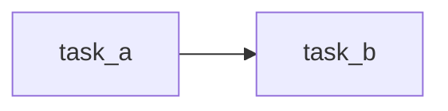

# {{TEAM_TITLE}} — Team

<!-- The one upstream artefact of a team (D89): what it must do (Need), how we will know it does (Acceptance),
     how it is built (Design) and in which order (Plan). Written by /team-spec section by section, checked by
     `orkeon-bench check team <slug>`, validated once by the user with `/team-approve team <slug>`.
     Keep the four H2 and every H3 below, in this order. Ids (R, AC, IND, INV, J, B, H) are never renumbered.
     Unknown yet: write TBD and put the question under "Open questions". -->

## Need

<!-- No agent, no task, no tool in this section: zero design detail. -->

### Purpose

<!-- Two or three sentences: who needs what, and what changes for them once the team runs. -->

### Actors

<!-- Who triggers the team, who reads its outputs, who approves an action. -->

### Inputs

<!-- One row per source (folder, files, mail, database, web). Virtual path: where the team reads it, under a root declared in "Mounts". -->

| Source | Format | Volume | Frequency | Virtual path | Sample |
|---|---|---|---|---|---|
| | | | | | |

### Outputs

<!-- Kind: file | action (e-mail draft, API call, database write). An action names the authorization it requires. -->

| Kind | Virtual root | Format / schema | Destination | Authorization |
|---|---|---|---|---|
| | | | | |

### Mounts

<!-- The mount points of the team: the folders its agents see, free in name and number. The rule (names, access, reserved
     points, folder of the team) is references/orkeon/studio-layout.md § "Mount points"; this table is its only copy
     for this team. Access: ro | rw | rwnd. Role: inputs | deliverables | state | archive | mailbox | reference | … -->

| Mount point | Access | Role | Folder of the team | What it holds |
|---|---|---|---|---|
| | | | | |

### Triggers and scheduling

<!-- Manual, scheduled (Studio card `schedule`, or the orkeon-host daemon), on arrival. -->

### Processing rules

<!-- Numbered business rules. An id is never renumbered. -->

| Id | Rule |
|---|---|
| R-01 | |

### Incremental processing and memory

<!-- What counts as "already processed", the deduplication key, where the state lives. Write "None." when every run starts from scratch. -->

### Failure and resume

<!-- Unit of work, expected failures, what must be idempotent, what must never be done twice.
     Orkeon has no native resume at run time: the team carries it. -->

### Constraints

<!-- Local or remote LLM, cost, duration, language, confidentiality. -->

### Security

<!-- Keys and where they live (never on disk), allowed recipients, untrusted inputs, what must never leave. -->

### Non-goals

<!-- What this team deliberately does not do. -->

### Open questions

<!-- Blocking questions first. No plan is written while one is open. Assumptions made meanwhile go in the table;
     the user settles them at the gate. -->

| Id | Assumption | To be validated by |
|---|---|---|
| H1 | | |

## Acceptance

<!-- How we will know the team is right. Thresholds live here and nowhere else: tests, reports and analyses cite the id.
     A criterion that is abandoned stays in its table with Status "dropped (DEC-nnnn)". -->

### Acceptance criteria

<!-- One observable behaviour per row: Given a dataset / When the team runs / Then …
     Level: the LOWEST level that can prove it — L0 static · L1 unit · L2 component · L3 e2e local · L4 e2e remote.
     A criterion required "remote" is never proven by a local run. Status: active | dropped (DEC-nnnn). -->

| Id | Given (dataset) | When | Then | Level | Status |
|---|---|---|---|---|---|
| AC-01 | | the team runs | | L3 | active |

### Indicators

<!-- Always measured, thresholds per team. Direction: ">=" (higher is better) or "<=" (lower is better).
     Measure names what the bench computes from a scenario's `indicators` (duration_seconds, tokens_total, usd, tool_calls,
     human_inputs, pass_rate) or a judge (judge:J-nn). A local threshold may differ from the remote one: then one row per level. -->

| Id | Measure | Unit | Threshold | Direction | Level |
|---|---|---|---|---|---|
| IND-01 | pass_rate | % | 100 | >= | L3 |

### Invariants

<!-- True on every run. Take them from references/testing/invariants-catalog.md, with the same id: the four below apply to
     every team, the others (INV-INJECTION, INV-RESUME, INV-INCR, INV-IDEMP, INV-SCHEMA, INV-EMAIL) when the need calls for them.
     Add the team's own as INV-01, INV-02 … Check: what the bench evaluates from the run archive. -->

| Id | Statement | Check | Level |
|---|---|---|---|
| INV-FS | The team writes only under its rw / rwnd roots | events + snapshot of the roots | L2 |
| INV-SECRETS | No secret or key in the outputs, the logs or the deliverables | pattern scan | L2 |
| INV-TOOLS | Only the declared tools are called | events vs the definition | L2 |
| INV-BUDGET | Tokens and duration stay under the cap | the run manifest | L3 |

### Datasets

<!-- Origin: synthetic | provided | anonymized. One dataset folder holds one subfolder per virtual root.
     Say explicitly what cannot be tested here (a root bound to a share that is not mounted in the container). -->

| Name | Origin | Size | Cases covered | Criteria served |
|---|---|---|---|---|
| nominal | synthetic | | | AC-01 |
| adversarial | synthetic | | instructions hidden in an input | INV-INJECTION |

### LLM targets

<!-- "LLM" is the model the TESTED TEAM calls, never the model of the harness.
     stub: simulated LLM (free). local: the machine profile (Ollama on this machine). remote: a named profile — which one,
     and when it is required. Repetitions and pass@k of the local level live in tests/<slug>/bench.config.json `levels`. -->

| Target | Profile | Model | Required for |
|---|---|---|---|
| stub | `stub` | — | L2 |
| local | `machine` | | L3 |
| remote | | | L4, on request |

### Judges

<!-- Only where quality cannot be checked by a deterministic oracle. Rubrics live in tests/<slug>/judges/, versioned.
     The bench does not run a judge: /team-run grades with the judge agent and hands the judgements to `orkeon-bench evaluate`. -->

| Id | Rubric | Scale | Threshold | Applies to |
|---|---|---|---|---|
| J-01 | | 1–5 | | |

### Budget

<!-- Local: minutes. Remote: cap in USD per attempt (default 2.00). A remote run needs `orkeon-bench estimate` and the user's
     `/team-approve remote <slug> <usd>`. -->

| Kind | Limit |
|---|---|
| local | 60 minutes |
| remote | 2.00 USD per attempt |

## Design

<!-- Nothing here may be absent from references/orkeon/: no invented key, tool or method. -->

### Format and rationale

<!-- YAML by default · TypeScript when custom tools or build-time logic are needed · C# for heavy tools, I/O or .NET integration. Say why. -->

### Process

<!-- sequential (default) | hierarchical | parallel | consensual | graph | autonomous — and why. In every mode a failed task fails the run:
     any mode but sequential needs an active acceptance criterion on what happens when a task fails. -->

### Agents

<!-- 2 to 5 agents, one competency each. Tools: catalogue names only, the bare minimum. maxIter sized to the work (justification). -->

| Id | Role | Tools | maxIter | Justification |
|---|---|---|---|---|
| | | | | |

### Tasks and DAG

<!-- One task per step. Dependencies: every task whose result the task reads. The task that produces a deliverable carries it. -->

| Id | Agent | Dependencies | Reads | Deliverable |
|---|---|---|---|---|
| | | | | |

### Tools

<!-- Built-in: by catalogue name (orkeon run --list-tools). Custom: only for deterministic work — say why it is deterministic,
     and whether it is pure TypeScript (no I/O) or C#. -->

| Tool | Kind (built-in / custom) | Used by | Why deterministic |
|---|---|---|---|
| | | | |

### Mounts

<!-- Source of mounts.json: the rows of "Need § Mounts", settled. The definition never names a physical path; the launchers and
     the Studio card are written from mounts.json by `orkeon-bench scaffold`. -->

| Mount point | Access | Role | Folder of the team |
|---|---|---|---|
| | | | |

### Deliverables and schemas

<!-- Path under an rw (or rwnd) root, source (final_message, written out: omitted, Orkeon uses tool_call), format, JSON schema when structured. -->

| Path | Source | Format | Schema |
|---|---|---|---|
| | | | |

### Resume and incremental strategy

<!-- State registry (where, which key), idempotent units, what "done" means, how a rerun skips it; Orkeon memory or a file registry. "None." if not applicable. -->

### LLM profile

<!-- The target profile and what the design assumes of the model (context size, tool calling). No model is pinned in the crew. -->

### Risks

<!-- Known pitfalls that apply (references/orkeon/orkeon-reference.md § 9), limits of the mode chosen, what the local model may not manage. -->

| Risk | Mitigation |
|---|---|
| | |

## Plan

<!-- Batches in order; one sheet per batch. Batches are B1, B2, … (L is reserved for the test levels L0–L4).
     Typical split: B1 deterministic tools · B2 agents and tasks skeleton · B3 deliverables and schemas · B4 resume and incremental · B5 hardening.
     A proof tick is set only on an observed result (command and exit code): TESTS ✅ · BUILD ✅ · L0/L1 ✅. -->

### Batches

<!-- Status: todo | in progress | done (ATT-nnnn). -->

| Batch | Scope | AC/INV covered | Tests that must pass | Expected cost | Status |
|---|---|---|---|---|---|
| B1 | | | | | todo |

### B1

<!-- The sheet of the batch, sections in this fixed order. The implementer receives it as its contract. -->

#### Intent

<!-- What exists at the end of the batch that did not exist before, in two lines. -->

#### Design decisions

<!-- The decisions of "Design" this batch applies, and the ones it settles itself. -->

#### Steps

<!-- One line per step, each with its proof ticks. Untick = not observed yet. -->

1. TESTS ☐ · BUILD ☐ · L0/L1 ☐ —

#### Anchors

<!-- Every file the implementer creates or edits, and the tests that observe it. A missing path is a gap of the plan, not a search to run. -->

| Step | Files to create or edit | Tests that observe it |
|---|---|---|
| 1 | | |

#### Assumptions

| Id | Assumption | To be validated by |
|---|---|---|
| H1 | | |

<!-- A fix coming from FIX-PLAN.md is appended under the sheet, with its own ticks, without erasing earlier proofs:

#### Correction C1 — F-1

1. TESTS ☐ · BUILD ☐ · L0/L1 ☐ —
-->

### Order and dependencies

<!-- Which batch needs which; which ones touch disjoint files and may be built in parallel (merge and checks stay serial). -->
