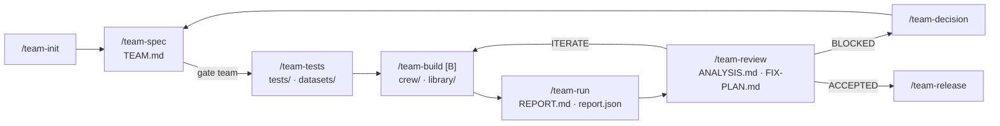

# The workflow — from a need to a released team

> Process reference of the Orkeon harness (the workshop's `references/process/`). Established for Orkeon
> 1.2.0 (a9f3878, 2026-11-16; method v2 since D89). The `team-*` skills automate every step; the strings shared
> with scripts (phases, gates, verdicts, ids) are frozen in `.claude/harness/FROZEN-LITERALS.md`.

## 1. Principles

1. **A chain of artefacts.** Each step reads a file and writes one; nothing important travels through
   the conversation; no step starts without the artefact of the previous one.
2. **Progressive and interruptible.** `workbooks/<slug>/STATUS.md` says where the team is; any step
   resumes after a pause, a `/clear` or a restart, and refuses to skip a gate.
3. **Tests before the team.** Criteria, indicators and invariants are written with the need; the tests
   exist before the build; a team is accepted only by a report that proves it.
4. **The orchestrator judges, subagents produce**, each in its own scope (the test author never writes
   in `crew/`, the implementer never modifies a test, the reviewer is read-only), else `BLOCKED`.
5. **Deterministic wherever possible.** Parsing, rules, registries, deduplication go in tools with unit
   tests; the LLM judges and writes; wiring is tested with a simulated LLM.
6. **Controlled cost and secure by default.** Levels run from free to paid; a remote LLM is called only
   after an estimate, a cap and an explicit approval; no key on disk (D109 aside); inputs are untrusted; invariants
   are checked on every run; everything is archived (attempts, reports, runs, decisions).
7. **The Orkeon reference is authoritative**; one fact lives in one place; literals are frozen.
8. **One upstream artefact, one user gate** (D89). The need, the acceptance, the design and the plan
   are the four sections of `TEAM.md`; the user validates it once.

## 2. The loop

One gate needs the user: the team gate, after `/team-spec`. Then the loop tests → build → run → review
turns without the user (`/team-loop` chains it), except on `BLOCKED` or at the budget gate.

**A prototype first** (D34). The user may ask for a prototype: `/orkeon-crew --format yaml|ts` writes
the team at once in `teams/<slug>/`, and nothing proves it yet. `/team-init --adopt <slug>` brings it
into the method: its crew is the starting point of the build, its README the first draft of the need.

## 3. The steps

| # | Step | Reads | Writes | Exit gate |
|---|---|---|---|---|
| 0 | `/team-init [--adopt] <slug>` | — | `STATUS.md`, `TEAM.md` (the template), `DEC-0001`, `tests/<slug>/` | — |
| 1 | `/team-spec` | `STATUS.md`, a brief if any, `references/` | `TEAM.md` (`## Need`, `## Acceptance`, `## Design`, `## Plan`), `tests/<slug>/bench.config.json` | gate team: `orkeon-bench check team` green, then the user types `/team-approve team <slug>` |
| 2 | `/team-tests` | `TEAM.md` | `tests/**`, `library/datasets/` when shared | every test exists, cites an id, and is **red** (for an adopted prototype, those that already pass are listed in the journal) |
| 3 | `/team-build [B<n>]` | the batch sheet and `## Design` of `TEAM.md`, the tests of the batch | `crew/**`, `library/tools/**`, the team `README.md`; `B1` creates `teams/<slug>/`: `mounts.json` from `## Design › Mounts`, the crew, then `orkeon-bench scaffold <slug>` | L0 and L1 green on the batch (`orkeon-bench run --level L1`); no test modified |
| 4 | `/team-run [--level] [--profile]` | `tests/`, `bench.config.json`, `mounts.json` | `attempts/ATT-n/REPORT.md` + `report.json`, `judgements.json`, `runs/` | budget gate before any remote profile: `orkeon-bench estimate`, `/team-approve remote <usd> <slug>` |
| 5 | `/team-review` | `capture.md` (written by `/team-run` through `orkeon-bench capture`: status, diff since the previous attempt, report, judgements, event excerpts), `TEAM.md § Design` and the batch sheet; then the review `team-reviewer` returns | `attempts/ATT-n/ANALYSIS.md`, `FIX-PLAN.md`, the verdict in `STATUS.md`, a `#### Correction` sheet in `TEAM.md § Plan` on `ITERATE`; the attempt closed on `ACCEPTED` only | `ACCEPTED` · `ITERATE` · `BLOCKED` |
| 6 | `/team-release` | the whole folder | final `README.md`, card and launchers realigned, attempts summary, proposed commit and tag command (`orkeon-bench release`), runs compacted | — |
| loop | `/team-loop` | `STATUS.md` | runs 2 → 5 until `ACCEPTED`, `BLOCKED`, the budget gate or two rounds still in gap | — |
| any | `/team-decision "…"` | `STATUS.md` | `DEC-nnnn`, `TEAM.md` marked to revise, `STATUS.md` | — |
| any | `/team-status` | `STATUS.md`, the folder | nothing (or a realigned `STATUS.md`) | — |

Every step reads `STATUS.md` first, checks the previous gate, and updates it last (hook `status-check`).

## 4. Gates and `STATUS.md`

`STATUS.md` carries the state in its front matter — `phase`, `gate_passed` (`null` before the first
gate), `iteration` (raised at each `ITERATE`, D38), `attempt`, `batch`, `verdict`, `next_action`,
`updated_at` — then a journal, one bullet per event.

| Gate | Exit of | What must be true | Validated by | `STATUS.md` once passed |
|---|---|---|---|---|
| team | `/team-spec` | the four sections of `TEAM.md` filled (`TBD` only under `### Open questions`, no blocking question open); every AC attached to a level and a dataset; thresholds and budget stated; tool names in the catalogue; every batch has anchors — `orkeon-bench check team <slug>` green | script, then the user | `phase: tests`, `gate_passed: team`, next `/team-tests` |
| tests red | `/team-tests` | every test exists and cites an id; no orphan test, no AC without a test; all red | script | `phase: tests`, `gate_passed: tests`, next `/team-build B1` |
| batch green | each `/team-build B<n>` | L0 and L1 green on the batch; `tests/` untouched | script, diff read by the orchestrator | `phase: build`, `batch: B<n>`; `gate_passed: build` after the last batch |
| budget | before a remote `/team-run` | estimate ≤ cap; explicit approval recorded in the open attempt | the user | — (the approval lives in the attempt) |
| verdict | `/team-review` | see § 5, `/team-review` | the reviewer | `verdict` set; `gate_passed: review` with `phase: accepted` on `ACCEPTED`, `phase: review` on `BLOCKED`; on `ITERATE`, `phase: build`, `gate_passed: tests` (D38) |

Phases, in order: `spec` → `tests` → `build` → `run` → `review` → `accepted` → `published`. `ITERATE`
sets the phase back to `build` on the attempt it keeps open, `gate_passed: tests` and the `iteration` counter
raised (D38), so that the gate never runs ahead of the phase.

**Approvals come from what the user types** (D36): `/team-approve team [<slug>]` at the team gate,
`/team-approve remote <usd> [<slug>]` for a paid run. The hook `team-approve` reads the line before the
model does and records it: the team gate in `STATUS.md` (`phase: tests`, `gate_passed: team`,
`next_action: /team-tests <slug>`, the journal line `— /team-approve — gate team passed: the user typed
…`) — only for a team in `phase: spec` with `gate_passed: null`, whose `TEAM.md` holds its four
sections free of placeholders, of a `> To revise` line and of `TBD` outside `### Open questions`, and
once `/team-spec` has submitted the gate by ending on `next_action: /team-approve team <slug>`; a paid
run through `orkeon-bench attempt approve <slug> --usd <usd>`, which alone writes the approval of the
open attempt (D19). `need`, `test-plan` and `design` are refused by name. A refusal blocks the prompt
and writes nothing. It is a trace, not a proof: `guard-phase` refuses an Edit or a Write that raises
`gate_passed` before the gate, `guard-user-gate` a shell command that writes it; an "ok" in the
conversation is not the approval. The skill `team-approve` only makes the line a command.

**`guard-phase` freezes the folders from `phase` and `gate_passed`**: `crew/` is writable only in
phase `build`; `tests/<slug>/` is writable while `gate_passed` is `null`, `team` or `tests` and frozen
once the last batch is built (`gate_passed: build`) and from `run` to `published`; after the team gate
`TEAM.md` changes in its `## Plan` section only; a team without a phase (a prototype) is not held.

## 5. The steps in detail

**`/team-init [--adopt] <slug>`** creates the workbook `workbooks/<slug>/` and the tests
`tests/<slug>/` (D29): `STATUS.md` (`phase: spec`, `iteration: 0`), `TEAM.md` from its template,
`DEC-0001`. It never creates `teams/<slug>/` (D35): the first build batch does. With `--adopt`, the
prototype's folder is kept and the need starts from its README.

**`/team-spec`** writes `TEAM.md` section by section — one question = one decision, the recommended
option first, `TBD` with its question under `### Open questions`, assumptions `Hn — to be validated by`:

- `## Need` — inputs, outputs and the authorizations they need, the mounts that follow
  (`references/orkeon/studio-layout.md#mount-points`), triggers, rules `R-nn`, incremental processing,
  resume, constraints, security, non-goals, open questions. No agent, no task, no tool.
- `## Acceptance` — criteria `AC-nn` (Given / When / Then, each at the lowest level that proves it),
  indicators `IND-nn`, invariants `INV-…` (`references/testing/invariants-catalog.md` plus the team's),
  datasets, LLM targets, judges `J-nn`, budget — the values go into `tests/<slug>/bench.config.json`.
  What only the user decides (a threshold, a remote model, the budget) is asked, one question at a time.
- `## Design` — the format (YAML / TypeScript / C#) and why, 2 to 5 agents, the tasks and their DAG,
  tools (a custom tool with its "why deterministic"), the mounts settled, deliverables and schemas,
  resume and incremental strategy, LLM profile, risks. Nothing absent from `references/orkeon/`.
- `## Plan` — ordered batches (`B1` deterministic tools, `B2` agents and tasks, `B3` deliverables,
  `B4` resume and incremental, `B5` hardening), each with a sheet: intent, design decisions, steps with
  proof ticks, **Anchors** naming every file the implementer will touch, assumptions.

It writes nothing in `teams/<slug>/`. Before submitting, it runs `orkeon-bench check team <slug>`
(headings, ids, levels, thresholds, tool names, DAG, mounts, deliverables, coverage, anchors), fixes
every error, then ends on `next_action: /team-approve team <slug>` and hands the file to the user.

**`/team-tests`** delegates to `team-test-author` and `dataset-synthesizer`: datasets (one subfolder
per virtual root, `expected/`, `manifest.json`, its digest computed by `dataset-synthesizer`),
component scenarios with the replies of the simulated LLM, end-to-end scenarios (a `dataset` or a
`sequence` of steps on a kept state point, `/registry`, deterministic checks, `indicators`, judge rubrics), unit tests
of the custom tools. Every test cites the id it covers and is red — for an adopted prototype (D34),
the tests that already pass are listed in the journal.

**`/team-build [B<n>]`** delegates one batch to `team-implementer` with a compact contract: batch,
target files, ids covered, tests to pass, what is forbidden. The implementer uses `/orkeon-crew
--format yaml|ts` (into the existing team folder, D34) and never touches `tests/`: a test that cannot
pass without being modified comes back `BLOCKED`. A short correction goes to the same agent (under
three turns), otherwise to a new agent with a corrected contract; never the same instruction twice.
The batch ends on `orkeon-bench run <slug> --level L1` green and the proof ticks of the sheet.

**`/team-run`** calls `orkeon-bench run <team> --level <max> [--profile <name>]`: L0 and L1 without
an LLM, L2 on the simulated LLM, L3 on the machine profile (`repeat`, `pass_at`), L4 on a remote
profile; levels run in order and stop at the first red one. The bench binds every mount point to a
temporary copy of the dataset and evaluates the invariants and the indicators from the run archive;
with judges, the skill grades the outputs with the `judge` agent and hands `judgements.json` to
`orkeon-bench evaluate --judgements`. Before a remote target (`orkeon-bench profile <slug> <name>` says
which, an L3 run included): `orkeon-bench estimate <team> --level L3|L4 [--decide <calls>]`, the cap of
`bench.config.json`, `next_action: /team-approve remote <usd> <slug>`, then the user's line (§ 4)
recorded in the open attempt — the hook refuses a line no estimate submitted (D104). Result: `REPORT.md` and
`report.json` in the attempt, raw runs under `runs/`.

**`/team-review`** runs `team-reviewer`, read-only, on the capture `/team-run` wrote last with
`orkeon-bench capture <team>` (`attempts/ATT-n/capture.md`: status, diff since the previous attempt,
report, judgements, event excerpts). The reviewer returns its review — verdict, gap table, fix plan —
and the skill, in the main thread, writes `ANALYSIS.md`; on `ACCEPTED` it closes the attempt
(`orkeon-bench attempt close --verdict ACCEPTED`); on `ITERATE` it writes `FIX-PLAN.md`, appends a
`#### Correction Cn — F-m` sheet in `TEAM.md § Plan` and keeps the attempt open for the next build
(D38); on `BLOCKED` the attempt stays open too. A gap has a severity (`Blocking` / `Major` /
`Minor`), an id, a category (`prompt`, `tool`, `dag`, `data`, `model`, `flaky`, `need`) and an evidence.
Verdict: `ACCEPTED` (every AC at its level, every IND within threshold, every INV true, no `Blocking` or
`Major` gap), `ITERATE` (the fix plan is applicable) or `BLOCKED` (the user must decide).

**`/team-loop`** chains tests → build → run → review until `ACCEPTED`, `BLOCKED`, the budget gate (it
never approves a paid run) or two rounds still in gap; a round after an `ITERATE` runs on the attempt the verdict kept open.

**`/team-decision "<change>"`** turns any change into a `DEC-nnnn` (context, decision, alternatives,
artefacts to revise, step to resume from). A change of need, acceptance or design goes back to
`/team-spec` (`phase: spec`, `gate_passed: null`: the user passes the team gate again), a change of a
test to `/team-tests` — never a step the team has not reached. Each artefact to revise gets the line
`> To revise — DEC-nnnn: …` under its title, which the resuming step removes (`artefacts.md` § 6).

**`/team-status`** summarises `STATUS.md` and realigns it when the files say otherwise, after the user
said yes; it never passes a user gate. Without a slug it lists every team.

**`/team-release`** checks the verdict is `ACCEPTED`, runs `orkeon-bench release <slug>` (README, Studio
card and launchers realigned, `phase: published`, old runs compacted), commits and pushes what the
release changed (D71) and **proposes** the tag command (`team/<slug>/v<n>`) without running it.

## 6. Who writes where

| Role | Tools | May write | Report |
|---|---|---|---|
| orchestrator (main thread) | all | `workbooks/<slug>/`, and in the open attempt `ANALYSIS.md` and `FIX-PLAN.md` only, never `runs/`; `settings/<slug>/` — the team's own Orkeon settings — at the first `/team-build` batch when the team needs them (no subagent writes a settings file, D40); nothing in `crew/` or `tests/<slug>/` by itself, but `tests/<slug>/bench.config.json`, which `/team-spec` writes from `## Acceptance` | to the user |
| `team-test-author` | read, write, bash | `tests/<slug>/**`, `library/datasets/**` | `DONE` / `BLOCKED` |
| `dataset-synthesizer` | read, write, bash | `tests/<slug>/datasets/**`, `library/datasets/**` | `DONE` / `BLOCKED` |
| `team-implementer` | read, write, bash | `teams/<slug>/crew/**`, `teams/<slug>/mounts.json` (first batch), the team `README.md`, `library/tools/**`; never `tests/<slug>/`, `workbooks/<slug>/` nor a settings file | `DONE` / `BLOCKED` |
| `team-reviewer` | read, read-only bash | nothing: it returns its review | the review (verdict, gaps, fixes) then `DONE` / `BLOCKED` |
| `run-analyst` | read | nothing | `DONE` with the summary |
| `judge` | read | nothing | `DONE` with the judgements |
| `orkeon-bench` | — | `workbooks/<slug>/runs/**`; the attempt folders with their `manifest.json`, `REPORT.md`, `report.json`, `judgements.json`, `capture.md`, `remote-approval.json`, `design-snapshot/`; the Studio card mounts, the launchers, the folders of the mount points with their `.gitkeep` and the team's `.gitignore` (`scaffold`, `release`) | JSON on stdout |

Three mechanisms hold these scopes: the agent frontmatter, the `permissions.deny` rules (`runs/`) and
the `guard-phase` hook (agent type, path, phase, gate, attempt: a closed attempt is read-only, only the
main thread writes in an open one, no subagent writes a settings file, D40). Outside a team's four
trees only the charter or the contract holds a subagent; a write through Bash escapes the hook.

Every subagent ends with a `## DONE` or `## BLOCKED` report (files, ids covered, command and exit, or
reason, missing, next), checked for shape by a hook (`subagent-report-shape`).

## 7. Test levels

| Level | Proves | Tools | LLM | Cost | When |
|---|---|---|---|---|---|
| **L0 static** | the definition is well formed and loadable | `check_crew.py` / `check_team.py`, `orkeon run --validate`, `tsc`, `dotnet build`, schema validation, secrets absent, `mounts.json` consistent with card and launchers | none | none | end of every batch, before any run |
| **L1 unit** | the custom tools are correct | vitest (TypeScript); the project's tests (C#) | none | none | end of every batch |
| **L2 component** | one task or agent in isolation, wiring, deliverables, resume | `orkeon-bench` + simulated LLM: scripted replies, real tool calls | simulated | none | every attempt |
| **L3 end-to-end local** | the whole team reaches the AC with a local model | `orkeon-bench` + the machine profile (Ollama) on the datasets, deterministic checks + judges | local | machine time | every attempt, with repetitions |
| **L4 end-to-end remote** | the same with a remote model: the production one, or a comparison the need asks for | `orkeon-bench` + a remote profile | remote | **paid** | on request, before acceptance, behind the budget gate |

In `report.json` the levels are keyed `static`, `unit`, `component`, `e2e_local`, `e2e_remote`; a run
stops at the first red level (`references/testing/test-levels.md`).

## 8. Mounts

A team sees only its mount points, declared in `TEAM.md` (`§ Need › Mounts`, settled in `§ Design ›
Mounts`), written in `teams/<slug>/mounts.json`, from which `orkeon-bench scaffold` derives the
launchers (`orkeon run crew` from the team folder), the Studio card and the folders. The rule lives in
one place: `references/orkeon/studio-layout.md#mount-points`. A team using C# plugin tools is run by
hand with `orkeon-harness-run crew --plugins <dir>` (`references/orkeon/csharp-tools.md` § 9).

## 9. The user steps in

- **At the team gate**: validates, amends (`/team-spec` resumes at the question) or refuses.
- **Between gates or in the middle of the loop**: `/team-decision`, or a free message ("stop, change
  X") that the running step treats as a decision once the action in progress ends cleanly.
- **Not** by changing `crew/` outside a build, `tests/` once the team is built, or `TEAM.md` above
  `## Plan` after the gate: `guard-phase` refuses it and points to `/team-decision`; a change made by
  hand in an editor is recorded afterwards as a `DEC-nnnn`.
- **By Orkeon Studio's Rename, Delete or Duplicate only when its teams root is the workshop's `teams/`**
  (STUDIO-64, `references/orkeon/studio-layout.md`); otherwise move or remove `teams/<slug>/`,
  `workbooks/<slug>/`, `tests/<slug>/`, `settings/<slug>/` and each `mounts.<name>/<slug>/` together
  by hand; `orkeon-bench doctor` lists the orphans.

## 10. Resuming

After a `/clear`, a restart or a new session, `/team-status` (or any `team-*` step) rereads the files
and resumes: `STATUS.md` is the state machine, and nothing needed next exists only in the conversation.

## 11. What is archived

Decisions (`decisions/DEC-nnnn-<slug>.md`), attempts (`attempts/ATT-nnnn/`: manifest, design snapshot,
report, judgements, capture, analysis, fix plan — opened by `/team-build` or `/team-decision`, closed
by `/team-review`, then immutable), runs (`runs/RUN-<stamp>-<target>/`, ignored by git, the last N
kept plus those a report cites), the accepted team (the commit pushed, the tag `team/<slug>/v<n>`
proposed, D71) and the deployment archive (`deployments/`, D45: the team as Studio runs it; workbook,
tests, data and keys stay here). The harness proposes commits and tags; it never runs them.

## 12. Artefacts and identifiers

The artefacts, who writes and reads each, and the id prefixes (`R-`, `AC-`, `IND-`, `INV-`, `J-`, `DEC-`,
`ATT-`, `RUN-`, `B<n>`, `F-`, `H<n>`, `C<n>`): `references/process/artefacts.md` § 1 and § 11.
