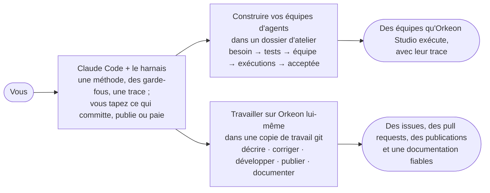

# Orkeon Workshop

*[English](./README.md) · Français*

[](https://github.com/Orkeon/orkeon-workshop/actions/workflows/checks.yml)
[](https://github.com/Orkeon/orkeon-workshop/actions/workflows/image.yml)
[](./LICENSE)
[](https://orkeon.github.io/orkeon-workshop/index.fr.html)

<p align="center">
  
</p>

**Un harnais open source qui met [Claude Code](https://code.claude.com/docs/en/overview) au travail autour
d'[Orkeon](https://github.com/Orkeon/orkeon) : construire et tester vos propres équipes d'agents, et
travailler sur Orkeon lui-même — décrire un problème, le corriger, développer, publier, documenter — avec
une méthode, des garde-fous et une trace.**

Orkeon est un framework .NET pour des équipes d'agents d'IA. Demander une telle équipe à un assistant de
programmation est facile ; savoir si elle fait ce qu'il fallait, ce qu'elle coûte et comment elle se
comporte quand les choses tournent mal ne l'est pas. Il en va de même d'une modification d'Orkeon : un
correctif sans son test, une publication sans ses preuves, une page qui ne dit plus ce que fait le code.
Orkeon Workshop répond aux deux avec un seul **harnais** pour Claude Code — skills, sous-agents, règles et
hooks — et une seule image de conteneur, **`orkeon-workshop`**, qui porte la ligne de commande d'Orkeon,
des modèles locaux sur votre GPU et le harnais ; Claude Code est installé au premier démarrage de l'image
publiée.

## Ce que fait le harnais



**Construire vos équipes d'agents.** Dans un **atelier** — un dossier à vous, que lit Orkeon Studio —
Claude consigne le besoin, place les critères d'acceptation et les tests en premier, construit l'équipe
(YAML, TypeScript ou C#), la confronte à ce qu'Orkeon et Orkeon Studio acceptent réellement, l'exécute sur
des modèles simulés, locaux puis distants, et la passe en revue et la corrige jusqu'à ce qu'un rapport
prouve qu'elle remplit ses critères. Chaque tentative et chaque décision restent sur disque ; une
exécution payante attend votre accord ; une équipe s'empaquette en archive pour un autre atelier.

**Travailler sur Orkeon lui-même, au niveau où vous intervenez.** Dans une **copie de travail git**
d'Orkeon — ou de ce projet — le même harnais vous aide à **décrire** un échec avec précision (le
reproduire dans un atelier, rédiger l'issue), à le **corriger** (valider le correctif sur sa branche,
préparer la pull request), à **développer** (une spécification, un plan, une implémentation menée par ses
tests, une vérification, avec des sous-agents qui écrivent les tests, implémentent, auditent et attaquent
le résultat, et un rapport qualité), à **publier** (les barrières qualité, le contrôle de préparation, le
dossier de preuves, les notes, la vérification de ce qui a été publié) et à **garder la documentation
fidèle** au code. Ce qui est propre à un dépôt — ses commandes, ses listes de contrôle, ses règles
d'arborescence — vient dans un pack de dépôt : Orkeon et ce projet livrent le leur.

**Les mêmes règles partout.** Claude committe et pousse ce qu'une étape a produit, et ouvre une pull
request après vous avoir demandé (un réglage la rend automatique) ; il ne tague, ne dépose une issue, ne
commente ni ne paie une exécution de lui-même : il prépare le texte et vous remet la commande. Dans une
copie de travail, il n'écrit rien que git suit et garde `git status` propre ; le travail va sous `todo/`,
ou sous le dossier où le dépôt range ses tâches.
Les lectures sont bornées, les secrets restent hors des fichiers, et chaque garde-fou est un hook avec ses
évals.

## Une image, un rôle à la fois

Le harnais est découpé en **packs**, et un **profil** choisit les packs que reçoit le dossier dans lequel
Claude Code travaille. Un dossier est en `user` tant que vous ne choisissez pas autre chose, et un atelier
en `user` reçoit le harnais exactement tel qu'il était avant les profils.

| Vous voulez… | Profil | Où Claude travaille | Packs de skills |
|---|---|---|---|
| **construire des équipes Orkeon** et prouver qu'elles marchent | `user` (par défaut) | un atelier | la méthode (`/team-init` … `/team-tests`), les générateurs, `orkeon-bench`, `/deploy`, la visite guidée |
| **décrire et corriger** : contribuer à Orkeon ou à ce projet | `contrib` | un atelier, ou une copie de travail git | l'issue, le correctif validé, la pull request |
| **le développer** | `dev` | une copie de travail git | spécification, plan, implémentation par les tests, vérification, les quatre sous-agents de revue, le rapport qualité |
| **le publier** | `release` | une copie de travail git | les barrières, le contrôle de préparation, le dossier de preuves, les notes, la vérification |
| **garder sa documentation fidèle** | `docs` | une copie de travail git | l'audit des pages contre le code |
| un peu de tout | `all`, ou `custom:<pack>,<pack>` | l'un ou l'autre | les packs qui conviennent à l'espace |

Choisissez avec `/workshop-profile <nom>` dans Claude Code (ou `workshop-profile <nom>` dans le terminal
du conteneur), ou donnez `-e HARNESS_PROFILE=<nom>` au premier démarrage — [Profils et packs](./docs/fr/reference/harness.md#profils-et-packs).

## Le découvrir en discutant

- **Avant d'installer** : collez [ce prompt](./docs/fr/discover-with-claude.md) dans une conversation
  claude.ai ou Claude Desktop. Claude vous présente le projet dans votre langue et vous guide dans
  l'installation.
- **Une fois installé** : ouvrez Claude Code avec `workshop`. Dans un atelier, tapez
  `/workshop-language fr` pour travailler en français, puis `/orkeon-tour` — une visite guidée de votre
  propre atelier, qui peut construire une première équipe avec vous. Dans une copie de travail, ouvrez la
  page de votre rôle ([les workflows](./docs/fr/workflows/overview.md#par-où-commencer-)).

## Démarrer

Il vous faut Docker Desktop (Windows, moteur WSL 2) ou Docker Engine (Linux), environ 25 Go de disque et
un compte Claude. Trois choses dépendent de votre rôle : le dossier que vous montez sur `/workspace`, le
profil que vous donnez au premier démarrage, et ce que vous faites ensuite dans Claude Code.

| Vous | Le dossier monté sur `/workspace` | Profil | Ensuite, dans Claude Code |
|---|---|---|---|
| **construisez des équipes Orkeon** | votre **atelier** : le dossier qui contient vos équipes, ou un dossier vide que vous créez pour lui — sous Windows, Orkeon Studio lit `%USERPROFILE%\Orkeon` par défaut, et peut [lire tout autre dossier](./docs/fr/concepts/workshop.md#orkeon-studio-le-voit) | `user` | `/workshop-language fr`, puis `/orkeon-tour` : la visite guidée, qui peut construire une première équipe avec vous |
| **signalez une panne, validez un correctif** | votre atelier aussi : la reproduction est une équipe | `contrib` | `/workshop-language fr`, puis [Contribuer](./docs/fr/workflows/contribute.md) |
| **développez, publiez ou documentez Orkeon, préparez une pull request** | une **copie de travail git** d'Orkeon : `git clone https://github.com/Orkeon/orkeon.git` | `dev`, `release`, `docs` ou `contrib` | la page de votre rôle : [Développer](./docs/fr/workflows/develop.md), [Publier](./docs/fr/workflows/release.md), [Garder la documentation fidèle](./docs/fr/workflows/keep-docs-true.md), [Contribuer](./docs/fr/workflows/contribute.md) |
| **maintenez Orkeon Workshop lui-même** | une copie de travail de ce dépôt : `git clone https://github.com/Orkeon/orkeon-workshop.git` | `dev`, `docs` ou `all` | [Faire vivre Orkeon Workshop](./docs/fr/workflows/maintain-the-workshop.md) |

La commande est la même pour tous : votre dossier dans `$folder` (Windows) ou `folder` (Linux), votre
profil sur la dernière ligne. Une copie de travail est clonée avant ; un dossier vide est pris pour un
nouvel atelier.

Sous Windows, dans PowerShell :

```powershell
docker pull ghcr.io/orkeon/orkeon-workshop:latest
docker tag ghcr.io/orkeon/orkeon-workshop:latest orkeon-workshop
$folder = "<le dossier de la table>"                         # par exemple "$env:USERPROFILE\Orkeon" ou "$env:USERPROFILE\src\orkeon"

docker run -it --init --name my-orkeon-workshop --gpus=all `
  --cap-add=NET_ADMIN --cap-add=NET_RAW --add-host=host.docker.internal:host-gateway `
  -v /var/run/docker.sock:/var/run/docker-host.sock `
  -v cc-ollama:/home/node/.ollama/models `
  -v my-orkeon-workshop-claude:/home/node/.claude -e CLAUDE_CONFIG_DIR=/home/node/.claude `
  -v "${folder}:/workspace" `
  -e OLLAMA_DEFAULT_MODEL=qwen3:8b `
  -e HARNESS_PROFILE=<profil> -e DOCKER_MODE=socket orkeon-workshop
```

Sous Linux, dans un terminal :

```bash
docker pull ghcr.io/orkeon/orkeon-workshop:latest
docker tag ghcr.io/orkeon/orkeon-workshop:latest orkeon-workshop
folder="<le dossier de la table>"                            # par exemple "$HOME/Orkeon" ou "$HOME/src/orkeon"

docker run -it --init --name my-orkeon-workshop --gpus=all \
  --cap-add=NET_ADMIN --cap-add=NET_RAW --add-host=host.docker.internal:host-gateway \
  -v /var/run/docker.sock:/var/run/docker-host.sock \
  -v cc-ollama:/home/node/.ollama/models \
  -v my-orkeon-workshop-claude:/home/node/.claude -e CLAUDE_CONFIG_DIR=/home/node/.claude \
  -v "$folder:/workspace" \
  -e OLLAMA_DEFAULT_MODEL=qwen3:8b \
  -e HARNESS_PROFILE=<profil> -e DOCKER_MODE=socket orkeon-workshop
```

La ligne `-e OLLAMA_DEFAULT_MODEL=qwen3:8b` nomme le modèle local sur lequel tournent vos équipes, téléchargé en
arrière-plan au premier démarrage (environ 5 Go) ; retirez-la pour n'en télécharger aucun
([Modèles](./docs/fr/guides/models.md)). Pas de GPU NVIDIA ? Retirez `--gpus=all`. Si le démarrage échoue sur une erreur GPU, le conteneur a
souvent été créé quand même : `docker rm my-orkeon-workshop` avant de réessayer — voir
[l'option `--gpus=all`](./docs/fr/reference/troubleshooting.md#loption---gpusall). Ensuite, dans le conteneur :

```text
workshop                 ← dans le terminal du conteneur : ouvre Claude Code dans le dossier monté
```

puis la dernière colonne de la table.

**Dans un atelier**, `/workshop-language fr` est la première commande à taper : Claude converse alors avec
vous en français, même quand vous ne tapez que des commandes, et rédige en français les documents qui
décrivent vos équipes (besoin, critères, plan de test, conception). Vous ne la tapez qu'une fois —
l'atelier s'en souvient ([Votre langue](./docs/fr/getting-started/install.md#votre-langue)). Le harnais se
pose à côté de vos équipes, sans y toucher.

**Dans une copie de travail**, ni `/workshop-language` ni visite : Claude suit la langue de vos messages.
Le harnais se pose dans le `.claude/` de la copie de travail, listé dans `.git/info/exclude`, jamais dans
un fichier suivi ([Dans une copie de travail](./docs/fr/reference/harness.md#dans-une-copie-de-travail)).

Dans les deux cas, `/workshop-profile <nom>` change le profil plus tard ; `user` est refusé dans une copie
de travail, et `dev` dans un atelier. Pas à pas, pour Windows et Linux :
[Installer](./docs/fr/getting-started/install.md).

## Documentation

| | |
|---|---|
| **Démarrer** | [Installer](./docs/fr/getting-started/install.md) · [Votre première équipe](./docs/fr/getting-started/first-team.md) · [VS Code](./docs/fr/getting-started/vs-code.md) |
| **Comprendre** | [L'atelier](./docs/fr/concepts/workshop.md) · [Les équipes](./docs/fr/concepts/teams.md) · [Points de montage](./docs/fr/concepts/mount-points.md) · [Comment se construit une équipe](./docs/fr/concepts/process.md) · [Tester](./docs/fr/concepts/testing.md) |
| **Faire** | [Équipe YAML](./docs/fr/guides/yaml-team.md) · [Équipe TypeScript](./docs/fr/guides/typescript-team.md) · [Outils C#](./docs/fr/guides/csharp-tools.md) · [Modèles](./docs/fr/guides/models.md) · [Modes Docker](./docs/fr/guides/docker-modes.md) · [Mettre à jour](./docs/fr/guides/updating.md) |
| **Rôles** | [Les workflows : qui fait quoi](./docs/fr/workflows/overview.md) · [Contribuer](./docs/fr/workflows/contribute.md) · [Développer](./docs/fr/workflows/develop.md) · [Publier](./docs/fr/workflows/release.md) · [Garder la doc fidèle](./docs/fr/workflows/keep-docs-true.md) · [Faire vivre l'atelier](./docs/fr/workflows/maintain-the-workshop.md) · [Mesurer](./docs/fr/workflows/measure.md) · [Profils et packs](./docs/fr/reference/harness.md#profils-et-packs) · [Dans une copie de travail](./docs/fr/reference/harness.md#dans-une-copie-de-travail) · [Les skills des packs](./docs/fr/reference/harness.md#les-skills-des-packs) · [Conception des profils](./docs/profiles-design.md) (en anglais) |
| **Consulter** | [`orkeon-bench`](./docs/fr/reference/orkeon-bench.md) · [Options et variables](./docs/fr/reference/configuration.md) · [Le harnais](./docs/fr/reference/harness.md) · [Dépannage](./docs/fr/reference/troubleshooting.md) · [FAQ](./docs/fr/faq.md) |
| **Construire et concevoir** (en anglais) | [Construire l'image](./.devcontainer/README.md) · [Le plan d'Orkeon Workshop](./docs/orkeon-workshop-plan.md) |

Tout part du [sommaire de la documentation](./docs/fr/README.md) ; la documentation est aussi publiée sous
forme de site, avec un champ de recherche : <https://orkeon.github.io/orkeon-workshop/index.fr.html>.

## Où en est le projet

**Construire des équipes** — les fondations sont construites et vérifiées : l'image, le
harnais et ses garde-fous, les documents de référence, les générateurs d'équipes (`orkeon-crew-yaml`,
`orkeon-crew-typescript`), la visite guidée, `orkeon-bench` et les gabarits .NET, ainsi
qu'`orkeon-studio-check`, qui lit une équipe avec le propre code d'Orkeon Studio. Les premières étapes de
la méthode sont des skills : `/team-init`, `/team-need`, `/team-test-plan`,
`/team-design`, `/team-tests`, `/team-decision` et `/team-status`, et vos validations, tapées sous la forme
`/team-approve …` et enregistrées par un hook ; `/deploy` empaquette une équipe en archive pour un autre
atelier ; le banc vérifie sur le papier les critères, le plan de test et la conception, et exécute les
vérifications statiques d'une équipe et ses scénarios de composant sur un modèle simulé.
**Ensuite** : les skills des étapes suivantes, et les commandes du banc qui exécutent une équipe sur un
modèle local puis distant et la notent.

**Les autres rôles** — les profils et les packs sont livrés : `contrib`, `dev`, `release` et
`docs`, les packs de dépôt d'Orkeon et de ce projet, la bascule entre profils, le déploiement dans une
copie de travail git qui n'écrit rien que git suit, et `cc-usage`, qui mesure ce que coûte une session de
Claude Code (le profil `user` coûte autant qu'avant). **Ensuite** : les skills des packs déroulés de bout
en bout sur une vraie copie de travail d'Orkeon, et un profil qui retire le harnais d'une copie de travail.

La [feuille de route](./docs/fr/README.md#feuille-de-route) liste ce qui est livré et ce qui vient ensuite.

## Remerciements

Orkeon Workshop s'appuie sur le travail d'autres personnes. Le répartiteur Bash du harnais, ses garde-fous de lecture
et de délégation, son lanceur d'évals et, dans les packs, la chaîne de développement viennent du
[claude-code-toolkit](https://github.com/pierrebelin/claude-code-toolkit) de Pierre Belin ; la commande
`cc-usage`, qui mesure ce que coûte une session de Claude Code, est son
[claude-code-token-usage](https://github.com/pierrebelin/claude-code-token-usage). Le devcontainer est
parti du devcontainer de référence d'Anthropic pour Claude Code, et les gabarits .NET partagent leurs
fichiers de convention avec [Orkeon](https://github.com/Orkeon/orkeon). Merci à leurs auteurs.
[`THIRD-PARTY-NOTICES.md`](./THIRD-PARTY-NOTICES.md) dit, fichier par fichier, ce qui a été repris et à
quelles conditions.

## Licence

Orkeon Workshop est distribué sous [licence MIT](./LICENSE). [`THIRD-PARTY-NOTICES.md`](./THIRD-PARTY-NOTICES.md)
recense ce qui vient d'ailleurs : des éléments adaptés de trois projets sous licence MIT, et six fichiers de
devcontainer dérivés du devcontainer de référence d'Anthropic, dont les parties issues d'Anthropic ne sont
pas couvertes par la licence MIT. Les logiciels que l'image installe, à commencer par Claude Code, gardent
leur propre licence ; l'image publiée ne contient pas Claude Code.

Orkeon Workshop n'est ni affilié à Anthropic ni cautionné par cette entreprise. Pour Claude Code lui-même,
consultez sa [documentation](https://code.claude.com/docs/en/overview).
