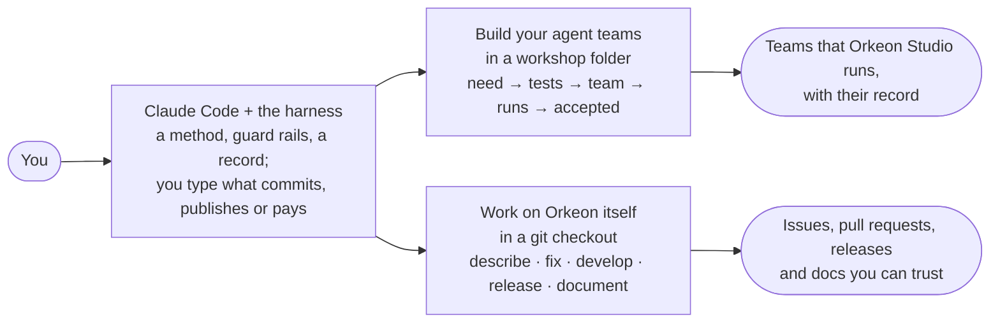

# Orkeon Workshop

*English · [Français](./README.fr.md)*

[](https://github.com/Orkeon/orkeon-workshop/actions/workflows/checks.yml)
[](https://github.com/Orkeon/orkeon-workshop/actions/workflows/image.yml)
[](./LICENSE)
[](https://orkeon.github.io/orkeon-workshop/)

<p align="center">
  
</p>

**An open-source harness that puts [Claude Code](https://code.claude.com/docs/en/overview) to work
around [Orkeon](https://github.com/Orkeon/orkeon): build and test your own agent teams, and work on Orkeon
itself — describe a problem, fix it, develop, release, document — with a method, guard rails and a record.**

Orkeon is a .NET framework for teams of AI agents. Asking a coding assistant for such a team is easy;
knowing whether it does what was needed, what it costs and how it behaves when things go wrong is not. The
same goes for a change to Orkeon itself: a fix without its test, a release without its evidence, a page
that no longer says what the code does. Orkeon Workshop answers both with one **harness** for Claude Code —
skills, subagents, rules and hooks — and one container image, **`orkeon-workshop`**, that carries the
Orkeon CLI, local models on your GPU and the harness; Claude Code is installed at the first start of the
published image.

## What the harness does



**Build your agent teams.** In a **workshop** — a folder of yours, which Orkeon Studio reads — Claude
writes the need down, puts the acceptance criteria and the tests first, builds the team (YAML, TypeScript or
C#), checks it against what Orkeon and Orkeon Studio really accept, runs it on simulated, local then remote
models, and reviews and fixes it until a report proves it meets its criteria. Every attempt and every
decision stays on disk; a paid run waits for your approval; a team packs into an archive for another
workshop.

**Work on Orkeon itself, at the level you work at.** In a **git checkout** of Orkeon — or of this project —
the same harness helps you **describe** a failure precisely (reproduce it in a workshop, write the issue),
**fix** it (validate the fix on its branch, prepare the pull request), **develop** (a spec, a plan, an
implementation driven by its tests, a verification, with subagents that write the tests, implement, audit
and attack the result, and a quality report), **release** (the quality gates, the readiness check, the
evidence record, the notes, the verification of what was published) and **keep the documentation true** to
the code. What is specific to a repository — its commands, checklists, layout rules — comes in a
repository pack: Orkeon and this project ship theirs.

**The same rules everywhere.** Claude commits and pushes what a step produced, and opens a pull request
after asking you (a switch makes it automatic); it never tags, files an issue, comments or pays for a run
on its own: it prepares the text and hands you the command. In a checkout it writes nothing
git tracks and keeps `git status` clean; the work goes under `todo/`, or under the folder the repository
keeps its tasks in. Reads are bounded, secrets are kept
out of the files, and every guard is a hook with its evals.

## One image, one role at a time

The harness is cut into **packs**, and a **profile** chooses which packs the folder Claude Code works in
receives. A folder runs `user` unless you choose otherwise, and a workshop on `user` gets the harness
exactly as it was before profiles existed.

| You want to… | Profile | Where Claude works | Packs of skills |
|---|---|---|---|
| **build Orkeon teams** and prove they work | `user` (the default) | a workshop | the method (`/team-init` … `/team-tests`), the generators, `orkeon-bench`, `/deploy`, the guided tour |
| **describe and fix**: contribute to Orkeon or to this project | `contrib` | a workshop, or a git checkout | the issue, the validated fix, the pull request |
| **develop** it | `dev` | a git checkout | spec, plan, implementation by tests, verification, the four review subagents, the quality report |
| **release** it | `release` | a git checkout | the gates, the readiness check, the evidence record, the notes, the verification |
| **keep its documentation true** | `docs` | a git checkout | the audit of the pages against the code |
| do a bit of everything | `all`, or `custom:<pack>,<pack>` | either | the packs that fit the space |

Choose with `/workshop-profile <name>` in Claude Code (or `workshop-profile <name>` in the container's
terminal), or give the first start `-e HARNESS_PROFILE=<name>` — [Profiles and packs](./docs/reference/harness.md#profiles-and-packs).

## Discover it in a chat

- **Before installing**: paste [this prompt](./docs/discover-with-claude.md) into a claude.ai or Claude
  Desktop chat. Claude explains the project in your language and walks you through the installation.
- **Once installed**: open Claude Code with `workshop`. In a workshop, set your language if it is not
  English (`/workshop-language fr`), then type `/orkeon-tour` — a guided tour of your own workshop, which
  can build a first team with you. In a checkout, open the page of your role
  ([the workflows](./docs/workflows/overview.md#where-do-you-start)).

## Get started

You need Docker Desktop (Windows, WSL 2 engine) or Docker Engine (Linux), about 25 GB of disk and a
Claude account. Three things depend on your role: the folder you mount on `/workspace`, the profile you
give the first start, and what you do next in Claude Code.

| You | The folder mounted on `/workspace` | Profile | Next, in Claude Code |
|---|---|---|---|
| **build Orkeon teams** | your **workshop**: the folder that holds your teams, or an empty folder you create for it — on Windows, Orkeon Studio reads `%USERPROFILE%\Orkeon` by default, and can be [pointed at any other folder](./docs/concepts/workshop.md#orkeon-studio-sees-it) | `user` | `/workshop-language fr` if English is not your language, then `/orkeon-tour`: the guided tour, which can build a first team with you |
| **report a failure, validate a fix** | your workshop too: the reproduction is a team | `contrib` | `/workshop-language fr` if English is not your language, then [Contribute](./docs/workflows/contribute.md) |
| **develop, release or document Orkeon, prepare a pull request** | a **git checkout** of Orkeon: `git clone https://github.com/Orkeon/orkeon.git` | `dev`, `release`, `docs` or `contrib` | the page of your role: [Develop](./docs/workflows/develop.md), [Release](./docs/workflows/release.md), [Keep the documentation true](./docs/workflows/keep-docs-true.md), [Contribute](./docs/workflows/contribute.md) |
| **maintain Orkeon Workshop itself** | a checkout of this repository: `git clone https://github.com/Orkeon/orkeon-workshop.git` | `dev`, `docs` or `all` | [Maintain Orkeon Workshop](./docs/workflows/maintain-the-workshop.md) |

The command is the same for everyone: your folder in `$folder` (Windows) or `folder` (Linux), your
profile on the last line, and in `$name` the container's name, one per folder. Its two volumes take that
name: Claude Code's state (sign-in, history, memory), and the worktrees of `/dev-batches`, off a Windows
disk ([The worktrees on a volume](./docs/guides/docker-modes.md#advanced-the-worktrees-on-a-volume)). A
checkout is cloned before; an empty folder is taken for a new workshop.

On Windows, in PowerShell:

```powershell
docker pull ghcr.io/orkeon/orkeon-workshop:latest
docker tag ghcr.io/orkeon/orkeon-workshop:latest orkeon-workshop
$name = "my-orkeon-workshop"                                 # the container; its two volumes take its name
$folder = "<the folder of the table>"                        # for instance "$env:USERPROFILE\Orkeon" or "$env:USERPROFILE\src\orkeon"
docker volume create "${name}-claude"
docker volume create "${name}-worktrees"

docker run -it --init --name $name --gpus=all `
  --cap-add=NET_ADMIN --cap-add=NET_RAW --add-host=host.docker.internal:host-gateway `
  -v /var/run/docker.sock:/var/run/docker-host.sock `
  -v cc-ollama:/home/node/.ollama/models `
  -v "${name}-claude:/home/node/.claude" -e CLAUDE_CONFIG_DIR=/home/node/.claude `
  -v "${name}-worktrees:/worktrees" -e HARNESS_WORKTREE_ROOT=/worktrees `
  -v "${folder}:/workspace" `
  -e OLLAMA_DEFAULT_MODEL=qwen3:8b `
  -e HARNESS_PROFILE=<profile> -e DOCKER_MODE=socket orkeon-workshop
```

On Linux, in a terminal:

```bash
docker pull ghcr.io/orkeon/orkeon-workshop:latest
docker tag ghcr.io/orkeon/orkeon-workshop:latest orkeon-workshop
name="my-orkeon-workshop"                                    # the container; its two volumes take its name
folder="<the folder of the table>"                           # for instance "$HOME/Orkeon" or "$HOME/src/orkeon"
docker volume create "${name}-claude"
docker volume create "${name}-worktrees"

docker run -it --init --name "$name" --gpus=all \
  --cap-add=NET_ADMIN --cap-add=NET_RAW --add-host=host.docker.internal:host-gateway \
  -v /var/run/docker.sock:/var/run/docker-host.sock \
  -v cc-ollama:/home/node/.ollama/models \
  -v "${name}-claude:/home/node/.claude" -e CLAUDE_CONFIG_DIR=/home/node/.claude \
  -v "${name}-worktrees:/worktrees" -e HARNESS_WORKTREE_ROOT=/worktrees \
  -v "$folder:/workspace" \
  -e OLLAMA_DEFAULT_MODEL=qwen3:8b \
  -e HARNESS_PROFILE=<profile> -e DOCKER_MODE=socket orkeon-workshop
```

The `-e OLLAMA_DEFAULT_MODEL=qwen3:8b` line names the local model your teams run on, downloaded in the
background at the first start (about 5 GB); remove it to download none ([Models](./docs/guides/models.md)).
No NVIDIA GPU? Remove `--gpus=all`. If the start fails on a GPU error, the container was often created
anyway: `docker rm my-orkeon-workshop` before trying again — see
[the `--gpus=all` option](./docs/reference/troubleshooting.md#the---gpusall-option). Then, in the container:

```text
workshop                 ← in the container's terminal: opens Claude Code in the mounted folder
```

then the last column of the table.

**In a workshop**, `/workshop-language` is the first command to type when English is not your language:
Claude then talks with you in it, even when you only type commands, and writes in it the documents that
describe your teams (need, criteria, test plan, design). You type it once — the workshop remembers
([Your language](./docs/getting-started/install.md#your-language)). The harness lands next to your teams
and leaves them untouched.

**In a checkout**, there is neither `/workshop-language` nor a tour: Claude follows the language of your
messages. The harness lands in the checkout's `.claude/`, listed in `.git/info/exclude`, never in a
tracked file ([In a source checkout](./docs/reference/harness.md#in-a-source-checkout)).

In both, `/workshop-profile <name>` changes the profile later; `user` is refused in a checkout, and `dev`
in a workshop. Step by step, for Windows and Linux: [Install](./docs/getting-started/install.md).

## Documentation

| | |
|---|---|
| **Start** | [Install](./docs/getting-started/install.md) · [Your first team](./docs/getting-started/first-team.md) · [VS Code](./docs/getting-started/vs-code.md) |
| **Understand** | [The workshop](./docs/concepts/workshop.md) · [Teams](./docs/concepts/teams.md) · [Mount points](./docs/concepts/mount-points.md) · [How a team gets built](./docs/concepts/process.md) · [Testing](./docs/concepts/testing.md) |
| **Do** | [YAML team](./docs/guides/yaml-team.md) · [TypeScript team](./docs/guides/typescript-team.md) · [C# tools](./docs/guides/csharp-tools.md) · [Models](./docs/guides/models.md) · [Docker modes](./docs/guides/docker-modes.md) · [Updating](./docs/guides/updating.md) |
| **Roles** | [Workflows: who does what](./docs/workflows/overview.md) · [Contribute](./docs/workflows/contribute.md) · [Develop](./docs/workflows/develop.md) · [Release](./docs/workflows/release.md) · [Keep the docs true](./docs/workflows/keep-docs-true.md) · [Maintain the workshop](./docs/workflows/maintain-the-workshop.md) · [Measure](./docs/workflows/measure.md) · [Profiles and packs](./docs/reference/harness.md#profiles-and-packs) · [In a source checkout](./docs/reference/harness.md#in-a-source-checkout) · [The skills of the packs](./docs/reference/harness.md#the-skills-of-the-packs) · [Design of the profiles](./docs/profiles-design.md) |
| **Look up** | [`orkeon-bench`](./docs/reference/orkeon-bench.md) · [Options and variables](./docs/reference/configuration.md) · [The harness](./docs/reference/harness.md) · [Troubleshooting](./docs/reference/troubleshooting.md) · [FAQ](./docs/faq.md) |
| **Build and design** | [Building the image](./.devcontainer/README.md) · [The Orkeon Workshop plan](./docs/orkeon-workshop-plan.md) |

All of it starts from the [documentation index](./docs/README.md), and is published as a site, with a
search box: <https://orkeon.github.io/orkeon-workshop/>.

## Where the project stands

**Building teams** — the foundation is built and checked: the image, the harness and its
guards, the reference documents, the team generators (`orkeon-crew-yaml`, `orkeon-crew-typescript`), the
guided tour, `orkeon-bench` and the .NET templates, and `orkeon-studio-check`, which reads a team with
Orkeon Studio's own code. The first steps of the method are skills:
`/team-init`, `/team-need`, `/team-test-plan`, `/team-design`, `/team-tests`, `/team-decision` and
`/team-status`, and your approvals, typed as `/team-approve …` and recorded by a hook; `/deploy` packs a
team into an archive for another workshop; the bench checks the criteria, the test plan and the design on
paper, and runs a team's static checks and its component scenarios on a simulated model. **Next**: the skills of the later steps, and the bench commands that run a team on a local then a
remote model and score it.

**The other roles** — profiles and packs are delivered: `contrib`, `dev`, `release` and `docs`,
the repository packs of Orkeon and of this project, the switch between profiles, the deployment into a git
checkout that writes nothing git tracks, and `cc-usage`, which measures what a Claude Code session costs
(the `user` profile costs the same as before). **Next**: the skills of the packs run end to end on a real
Orkeon checkout, and a profile that removes the harness from a checkout.

The [roadmap](./docs/README.md#roadmap) lists what is delivered and what comes next.

## Acknowledgements

Orkeon Workshop builds on the work of others. The harness's Bash dispatcher, its read and delegation guards, its eval
runner and, in the packs, the development chain come from Pierre Belin's
[claude-code-toolkit](https://github.com/pierrebelin/claude-code-toolkit); the `cc-usage` command, which
measures what a Claude Code session costs, is his
[claude-code-token-usage](https://github.com/pierrebelin/claude-code-token-usage). The devcontainer
started from Anthropic's reference devcontainer for Claude Code, and the .NET templates share their
convention files with [Orkeon](https://github.com/Orkeon/orkeon). Our thanks to their authors.
[`THIRD-PARTY-NOTICES.md`](./THIRD-PARTY-NOTICES.md) says, file by file, what was taken and under which terms.

## Licence

Orkeon Workshop is released under the [MIT licence](./LICENSE). [`THIRD-PARTY-NOTICES.md`](./THIRD-PARTY-NOTICES.md)
lists what comes from elsewhere: material adapted from three MIT-licensed projects, and six devcontainer
files derived from Anthropic's reference devcontainer, whose Anthropic parts are not covered by the MIT
licence. The software the image installs, Claude Code first of all, keeps its own licence; the published
image does not contain Claude Code.

Orkeon Workshop is not affiliated with or endorsed by Anthropic. For Claude Code itself, see its
[documentation](https://code.claude.com/docs/en/overview).
