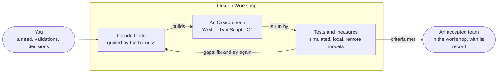
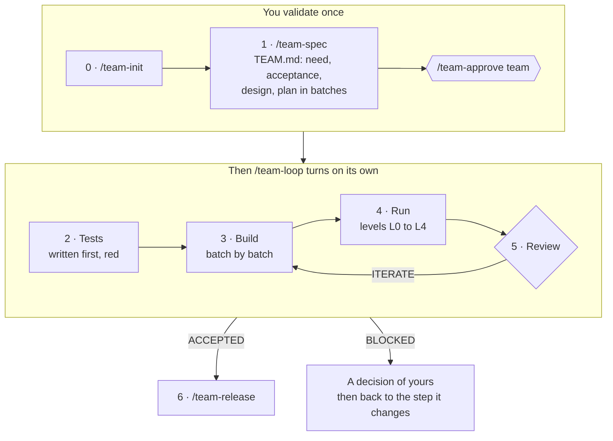
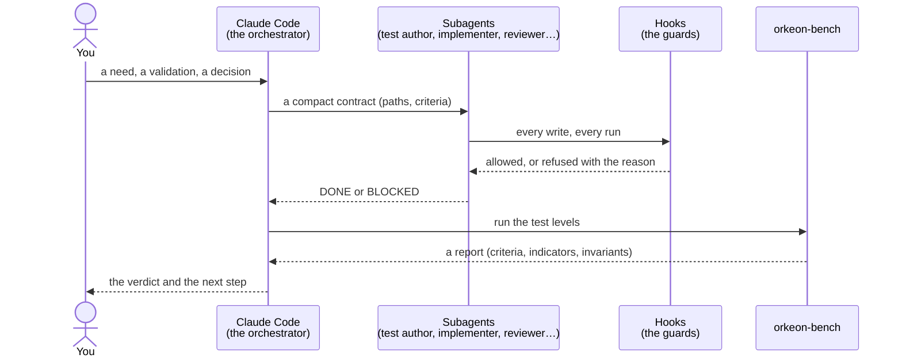

# How a team gets built

*English · [Français](../fr/concepts/process.md)*

Asking a coding assistant for an agent team is easy. A few minutes later there is a folder that loads
and seems to work — and nobody knows whether it does what was needed, what happens when it stops
halfway or meets the same input twice, what it costs, whether a mail it reads can talk it into doing
something else, or why it was built that way once the conversation is gone.

The workshop's method answers those questions before a team is called finished.



## A prototype, or the method

When you ask for a team, Claude offers two ways and lets you choose:

- **A prototype**: the generator skill (`orkeon-crew`) writes the team at once, checks it and loads it
  in Orkeon. It is quick, and nothing proves it does what you need yet.
- **The method** described below: the need, the criteria and the tests come first, and a record proves
  the result.

A prototype can join the method later, through `/team-init --adopt <slug>`, which keeps its crew as the
starting point and makes its README the first draft of the need.

## The steps

Each step reads a file and writes one; nothing important travels through the conversation; no step
starts without the result of the previous one. You validate one document, `TEAM.md`; after that, the
loop turns on its own until the team is accepted, or until it needs a decision from you.



| # | Step | Produces | Exit gate |
|---|---|---|---|
| 0 | Start — `/team-init <slug>` | the workbook (`TEAM.md` from its template, `STATUS.md`, a first decision) and the tests folder; the team folder itself comes with the first build, once its format and mount points are decided | — |
| 1 | Spec — `/team-spec` | `TEAM.md`, in four sections: **Need** (what the team reads and writes, its mount points, how it resumes, its constraints), **Acceptance** (criteria, indicators, invariants; datasets, models, judges, budget), **Design** (format, agents, tasks, tools, deliverables), **Plan** (batches `B1`, `B2`…, each with its steps and the files it creates); six questions at most, the rest written as assumptions you settle at the gate; `orkeon-bench check team` green | **you validate `TEAM.md`**: `/team-approve team <slug>` |
| 2 | Tests — `/team-tests` | synthetic datasets, scenarios (component, end to end, with a sequence for resume and a measure for each indicator), judge rubrics, unit tests of the custom tools, in `tests/<slug>/` | every test exists, cites an id, and fails |
| 3 | Build — `/team-build` | the team, batch by batch, by a subagent that cannot touch the tests; the first batch through `orkeon-crew` | static and unit levels pass (L0, L1), no test modified |
| 4 | Run — `/team-run` | an attempt: the runs at the highest level declared, the judges graded, a report and a capture for the reviewer | budget gate before any remote model: `/team-approve remote <usd> [<slug>]` |
| 5 | Review — `/team-review` | an analysis and, on `ITERATE`, a fix plan and correction sheets in the plan, from a read-only subagent | `ACCEPTED` · `ITERATE` (back to 3, two rounds at most per `/team-loop`) · `BLOCKED` (a decision is needed) |
| 6 | Release — `/team-release` | `orkeon-bench release`: the card and launchers realigned, the runs compacted, the README up to date; committed and pushed when the workshop is a git repository; a git tag proposed | — |

`/team-loop <slug>` runs steps 2 to 5 in one command and stops on `ACCEPTED`, `BLOCKED`, a paid run that
waits for your approval, or after two `ITERATE` rounds. Each step can also be typed alone.

You can change the need, the criteria or the design at any time: the change becomes a dated decision
(`/team-decision`) and the steps it invalidates are redone — from `/team-spec`, which reopens the gate,
from `/team-tests`, or from `/team-build`. `/team-status` tells where a team is — in any session:
everything needed to resume is in the workbook, nothing in the conversation.

You pass the gate by typing a line: `/team-approve team <slug>`. A hook records it as you typed it; Claude
cannot write a gate in your place, and "ok" said in the conversation is not the approval — Claude will
ask you to type it. A line typed too early is refused, with the reason: the gate is recorded only once
`/team-spec` has finished `TEAM.md`, checked it and handed it to you. The other line you type is
`/team-approve remote <usd> [<slug>]`, the approval of a paid run once `/team-run` priced it with
`orkeon-bench estimate` and wrote that line as its `next_action` — a line no estimate submitted is refused (D104).

**In your language.** By default Claude talks in the language of your messages and writes every file in
English. `/workshop-language fr` — any language tag, or its name — sets the language of the workshop:
Claude then talks in it even when you only type commands, and writes the text of the workbook in it (the
need, the criteria, the design, the decisions). What scripts read stays in English: the headings of the
documents, the keys and the journal of `STATUS.md`, the identifiers, and the messages of the hooks,
which Claude reports in your language. Nothing already written is translated, and
`/workshop-language default` goes back. The language a team's agents write in is another matter: it is
part of that team's need.

> **The skills.** `/team-init`, `/team-spec`, `/team-approve`, `/team-loop` and the four steps it drives
> (`/team-tests`, `/team-build`, `/team-run`, `/team-review`), `/team-release`, `/team-decision`,
> `/team-status`; `/workshop-language`, `/workshop-profile` (the packs this space deploys),
> `/orkeon-tour`, `/deploy` (a team packed as an archive for another workshop) and the generator
> `orkeon-crew` (`--format yaml|ts`), which builds and checks a prototype. The levels they run are in
> [Testing a team](./testing.md).

## The workbook

Everything about how a team is made stays in `workbooks/<slug>/`:

```text
workbooks/notes-digest/
├── TEAM.md          the need, the acceptance (AC-01…, IND-01…, INV-…), the design, the plan in batches B1, B2…
├── STATUS.md        where the team is: phase, last gate passed, attempt, verdict, next action
├── decisions/       DEC-0001-<slug>.md, DEC-0002-<slug>.md… — every change of direction, dated
├── attempts/        ATT-0001/… — each try at making the team pass: report, capture, judgements, analysis, fix plan
└── runs/            the raw runs (written by orkeon-bench only)
```

`STATUS.md` starts with a few fields that scripts read — the phase is one of `spec`, `tests`, `build`,
`run`, `review`, `accepted`, `published`; the gate passed one of `team`, `tests`, `build`, `review`:

```markdown
---
phase: build
gate_passed: tests
iteration: 0
attempt: ATT-0002
batch: B1
verdict: null
next_action: /team-build B1 notes-digest
updated_at: 2026-10-30T19:12:00Z
---

- 2026-10-30 19:12 — /team-build — B1 started (ATT-0002)
```

## Who does what

Claude Code does not write everything itself. The main session splits the work, delegates it with a
short contract and judges the result; subagents produce; hooks watch every write and every run; the
bench measures.



The hooks enforce part of the method whatever the permission mode — and `workshop` starts Claude Code
without permission prompts (`--dangerously-skip-permissions`,
[The workshop](./workshop.md#what-belongs-to-whom)), so they are the guards:

- no run on a paid remote model without a recorded approval;
- no gate passed by Claude: your validation is recorded from the line you type (`/team-approve team …`),
  and an edit that would write it in your place is refused;
- no test edited during a build, no team edited by the one who writes its tests, and no team's settings
  written by a subagent;
- no key written to disk.

Commits and tags are proposed, never made: that is a rule Claude follows (the `guard-git` hook that would
enforce it is off by default).

The details of each guard are in [The harness](../reference/harness.md).

Next: [Testing a team](./testing.md).
