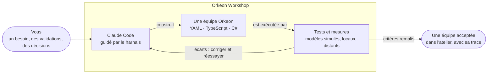
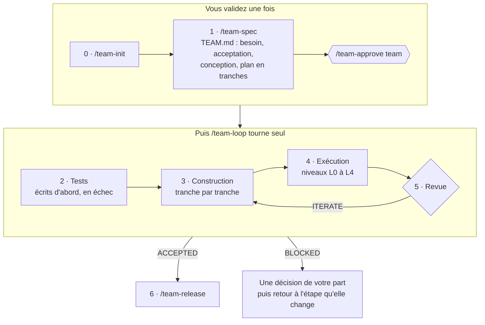
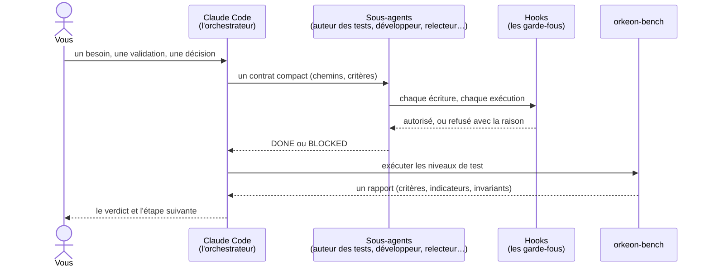

# Comment se construit une équipe

*[English](../../concepts/process.md) · Français*

Demander une équipe d'agents à un assistant de programmation, c'est facile. Quelques minutes plus tard,
on obtient un dossier qui se charge et semble fonctionner — et personne ne sait s'il fait ce qu'il
fallait, ce qui se passe quand l'équipe s'arrête à mi-chemin ou reçoit deux fois la même entrée, ce
qu'elle coûte, si un e-mail qu'elle lit peut la convaincre de faire autre chose, ni pourquoi elle a été
construite ainsi une fois la conversation terminée.

La méthode de l'atelier répond à ces questions avant qu'une équipe soit déclarée terminée.



## Un prototype, ou la méthode

Quand vous demandez une équipe, Claude vous propose deux voies et vous laisse choisir :

- **Un prototype** : le skill générateur (`orkeon-crew`) écrit l'équipe d'un coup, la vérifie et la
  charge dans Orkeon. C'est rapide, mais rien ne prouve encore qu'elle fait ce dont vous avez besoin.
- **La méthode** décrite ci-dessous : le besoin, les critères et les tests viennent d'abord, et une trace
  prouve le résultat.

Un prototype peut rejoindre la méthode plus tard, grâce à `/team-init --adopt <slug>`, qui garde son crew
comme point de départ et fait de son README le premier brouillon du besoin.

## Les étapes

Chaque étape lit un fichier et en écrit un ; rien d'important ne passe par la conversation ; aucune étape
ne commence sans le résultat de la précédente. Vous validez un seul document, `TEAM.md` ; ensuite, la
boucle tourne seule jusqu'à ce que l'équipe soit acceptée, ou jusqu'à ce qu'il faille une décision de
votre part.



| # | Étape | Produit | Validation de sortie |
|---|---|---|---|
| 0 | Démarrage — `/team-init <slug>` | le cahier (`TEAM.md` d'après son gabarit, `STATUS.md`, une première décision) et le dossier des tests ; le dossier de l'équipe lui-même arrive avec la première construction, une fois son format et ses points de montage décidés | — |
| 1 | Spécification — `/team-spec` | `TEAM.md`, en quatre sections : **Need** (ce que l'équipe lit et écrit, ses points de montage, comment elle reprend, ses contraintes), **Acceptance** (critères, indicateurs, invariants ; jeux de données, modèles, juges, budget), **Design** (format, agents, tâches, outils, livrables), **Plan** (tranches `B1`, `B2`…, chacune avec ses étapes et les fichiers qu'elle crée) ; six questions au plus, le reste écrit comme hypothèses que vous tranchez à la validation ; `orkeon-bench check team` vert | **vous validez `TEAM.md`** : `/team-approve team <slug>` |
| 2 | Tests — `/team-tests` | jeux de données synthétiques, scénarios (composant, de bout en bout, avec une séquence pour la reprise et une mesure pour chaque indicateur), grilles d'évaluation des juges, tests unitaires des outils sur mesure, dans `tests/<slug>/` | chaque test existe, cite un identifiant, et échoue |
| 3 | Construction — `/team-build` | l'équipe, tranche par tranche, par un sous-agent qui ne peut pas toucher aux tests ; la première tranche par `orkeon-crew` | les niveaux statique et unitaire passent (L0, L1), aucun test n'est modifié |
| 4 | Exécution — `/team-run` | une tentative : les exécutions au plus haut niveau déclaré, les juges notés, un rapport et une capture pour le relecteur | barrière de budget avant tout modèle distant : `/team-approve remote <usd> [<slug>]` |
| 5 | Revue — `/team-review` | une analyse et, sur `ITERATE`, un plan de correction et des fiches de correction dans le plan, par un sous-agent en lecture seule | `ACCEPTED` · `ITERATE` (retour à 3, deux tours au plus par `/team-loop`) · `BLOCKED` (une décision est nécessaire) |
| 6 | Livraison — `/team-release` | `orkeon-bench release` : carte et lanceurs réalignés, exécutions compactées, README à jour ; une étiquette git proposée | — |

`/team-loop <slug>` enchaîne les étapes 2 à 5 en une commande et s'arrête sur `ACCEPTED`, `BLOCKED`,
une exécution payante qui attend votre accord, ou après deux tours `ITERATE`. Chaque étape peut aussi
être tapée seule.

Vous pouvez changer le besoin, les critères ou la conception à tout moment : le changement devient une
décision datée (`/team-decision`) et les étapes qu'il invalide sont refaites — depuis `/team-spec`, qui
rouvre la validation, depuis `/team-tests`, ou depuis `/team-build`. `/team-status` indique où en est
une équipe — dans n'importe quelle session : tout ce qu'il faut pour reprendre est dans le cahier, rien
dans la conversation.

Vous passez la validation en tapant une ligne : `/team-approve team <slug>`. Un hook l'enregistre telle
que vous l'avez tapée ; Claude ne peut pas écrire une validation à votre place, et un « ok » dit dans la
conversation n'est pas la validation — Claude vous demandera de la taper. Une ligne tapée trop tôt est
refusée, avec la raison : la validation n'est enregistrée qu'une fois que `/team-spec` a terminé
`TEAM.md`, l'a vérifié et vous l'a soumis. L'autre ligne que vous tapez est
`/team-approve remote <usd> [<slug>]`, l'accord pour une exécution payante une fois qu'`orkeon-bench
estimate` l'a chiffrée.

**Dans votre langue.** Par défaut, Claude converse dans la langue de vos messages et écrit tous les
fichiers en anglais. `/workshop-language fr` — une étiquette de langue, ou son nom — règle la langue de
l'atelier : Claude converse alors dans cette langue même quand vous ne tapez que des commandes, et y écrit
le texte du cahier (le besoin, les critères, la conception, les décisions). Ce que lisent les scripts
reste en anglais : les titres des documents, les clés et le journal de `STATUS.md`, les identifiants, et
les messages des hooks, que Claude vous rapporte dans votre langue. Rien de ce qui est déjà écrit n'est
traduit, et `/workshop-language default` revient en arrière. La langue dans laquelle écrivent les agents
d'une équipe est une autre question : elle fait partie du besoin de cette équipe.

> **Les skills.** `/team-init`, `/team-spec`, `/team-approve`, `/team-loop` et les quatre étapes qu'il
> pilote (`/team-tests`, `/team-build`, `/team-run`, `/team-review`), `/team-release`, `/team-decision`,
> `/team-status` ; `/workshop-language`, `/workshop-profile` (les packs que cet espace déploie),
> `/orkeon-tour`, `/deploy` (une équipe empaquetée en archive pour un autre atelier) et le générateur
> `orkeon-crew` (`--format yaml|ts`), qui construit et vérifie un prototype. Les niveaux qu'ils
> exécutent sont décrits dans [Tester une équipe](./testing.md).

## Le cahier

Tout ce qui concerne la fabrication d'une équipe reste dans `workbooks/<slug>/` :

```text
workbooks/notes-digest/
├── TEAM.md          le besoin, l'acceptation (AC-01…, IND-01…, INV-…), la conception, le plan en tranches B1, B2…
├── STATUS.md        où en est l'équipe : phase, dernière validation franchie, tentative, verdict, prochaine action
├── decisions/       DEC-0001-<slug>.md, DEC-0002-<slug>.md… — chaque changement de direction, daté
├── attempts/        ATT-0001/… — chaque essai pour faire passer l'équipe : rapport, capture, notes des juges, analyse, plan de correction
└── runs/            les exécutions brutes (écrites par orkeon-bench seulement)
```

`STATUS.md` commence par quelques champs que lisent des scripts — la phase est l'une de `spec`, `tests`,
`build`, `run`, `review`, `accepted`, `published` ; la validation franchie l'une de `team`, `tests`,
`build`, `review` :

```markdown
---
phase: build
gate_passed: tests
iteration: 0
attempt: ATT-0002
batch: B1
verdict: null
next_action: /team-build B1 notes-digest
updated_at: 2026-10-30T19:12:00Z
---

- 2026-10-30 19:12 — /team-build — B1 started (ATT-0002)
```

## Qui fait quoi

Claude Code n'écrit pas tout lui-même. La session principale découpe le travail, le délègue avec un
contrat court et juge le résultat ; les sous-agents produisent ; les hooks surveillent chaque écriture et
chaque exécution ; le banc mesure.



Les hooks font respecter une partie de la méthode, quel que soit le mode de permission — et `workshop`
lance Claude Code sans demande de permission (`--dangerously-skip-permissions`,
[L'atelier](./workshop.md#ce-qui-appartient-à-qui)), si bien que ce sont eux les garde-fous :

- aucune exécution sur un modèle distant payant sans un accord enregistré ;
- aucune validation passée par Claude : votre validation est enregistrée à partir de la ligne que vous
  tapez (`/team-approve team …`), et une modification qui l'écrirait à votre place est refusée ;
- aucun test modifié pendant une construction, aucune équipe modifiée par celui qui écrit ses tests, et
  aucun réglage d'équipe écrit par un sous-agent ;
- aucune clé écrite sur le disque.

Les commits et les étiquettes de version sont proposés, jamais effectués : c'est une règle que Claude suit (le hook
`guard-git` qui la ferait respecter est désactivé par défaut).

Le détail de chaque garde-fou se trouve dans [Le harnais](../reference/harness.md).

Suite : [Tester une équipe](./testing.md).
