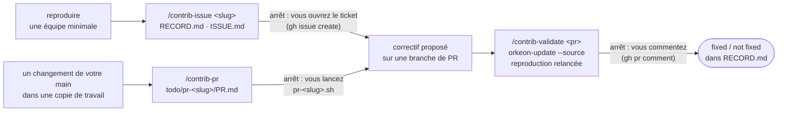

# Contribuer : signaler un échec, valider un correctif, ouvrir une pull request

*[English](../../workflows/contribute.md) · Français*

Cette page s'adresse au contributeur extérieur : quelque chose échoue pendant que vous utilisez Orkeon,
et vous voulez que l'échec soit signalé sous une forme qu'un développeur peut traiter, que le correctif
soit vérifié sur l'équipe même qui l'a montré, ou qu'un changement de votre main soit prêt pour la revue.
Les deux premières étapes se font dans un **atelier**, là où vit l'équipe qui échoue ; la troisième dans
une **copie de travail git** du dépôt. Le profil `contrib` donne les trois dans l'un ou l'autre espace :
`/workshop-profile contrib` dans Claude Code, ou `-e HARNESS_PROFILE=contrib` au premier démarrage d'un
conteneur. Dans un atelier, il garde le pack `workshop`, et la reproduction se construit avec les skills
de l'atelier ; dans une copie de travail il n'y a pas de pack `workshop`, et seul `/contrib-pr`
s'applique. Claude ne publie rien : il écrit la trace, le ticket, le commentaire et le texte de la pull
request sous `contrib/<slug>/` ou `todo/pr-<slug>/`, puis la commande vous est remise (D47), en disant
où elle se tape.



## Avant de commencer

- **Le profil.** `/workshop-profile contrib`, puis redémarrez Claude Code comme il le demande (`/exit`,
  puis `workshop` ; `claude` dans une copie de travail). `/workshop-profile --show` liste les packs
  déployés ([Choisir un profil](../reference/harness.md#choisir-un-profil)).
- **Pour `/contrib-issue` et `/contrib-validate` : un atelier** — un dossier `teams/` et `orkeon` sur le
  PATH. `/contrib-validate` a aussi besoin d'`orkeon-update` sur le PATH : construire une branche est ce
  que fait cette commande ([Orkeon et Ollama, dans un conteneur](../guides/updating.md#orkeon-et-ollama-dans-un-conteneur)).
- **Pour `/contrib-pr` : la copie de travail** du dépôt, montée là où irait un atelier
  ([Dans une copie de travail git d'Orkeon](../../../README.fr.md#démarrer)),
  le changement déjà écrit, `origin` pointant vers votre fork quand vous contribuez depuis l'un.
- **`gh`.** Les skills lisent avec lui le modèle de ticket et la pull request, et chaque commande qu'ils
  vous remettent est une commande `gh`. Sans lui, `/contrib-issue` se rabat sur la forme hors ligne des
  modèles d'Orkeon et le dit.
- **Les valeurs du dépôt** (forme des branches et des messages de commit, liste de contrôle, modèle de
  pull request, commandes de construction et de test) viennent du pack `repo-orkeon` dans une copie de
  travail d'Orkeon ; ailleurs, `/contrib-pr` vous demande une fois chaque valeur manquante et nomme la clé
  qui l'aurait donnée.

## 1. `/contrib-issue <slug> [bug|docs|feature]` — consigner l'échec, rédiger le ticket

Vous le tapez dans l'atelier, avec un slug de quelques mots en minuscules reliés par des tirets, et le
genre de ticket (`bug` par défaut). Claude :

- s'arrête hors d'un atelier : la reproduction est une équipe d'un atelier ;
- attend une reproduction, une équipe minimale sous `teams/` et une commande. S'il n'en existe pas encore,
  il s'arrête et propose le plus petit crew qui échoue, construit avec les skills de l'atelier ; vous
  revenez une fois qu'il échoue. Il ne construit rien lui-même à cette étape ;
- lance la commande maintenant et enregistre sa sortie sous `contrib/<slug>/evidence/`, clés expurgées.
  Une commande qui n'échoue pas n'est pas signalée : l'entrée dit `not reproduced`, et le skill s'arrête ;
- relève l'environnement en lançant des commandes, sans vous le demander : `orkeon --version`,
  `orkeon-update --check` (le canal d'installation), `uname -sr`, `dotnet --version`, le fournisseur et le
  modèle d'`orkeon doctor` ;
- ajoute une entrée datée `reproduced` à `contrib/<slug>/RECORD.md` : version, canal, environnement,
  étapes, attendu, observé, chemins des preuves. Le comportement attendu est cité de vous ou de la page de
  documentation qui le promet. Une entrée passée n'est jamais réécrite ;
- écrit `contrib/<slug>/ISSUE.md` sur le modèle de ticket du dépôt, lu avec `gh api` : une ligne `Title:`,
  puis une section par champ de saisie, dans l'ordre du modèle. Quand le modèle est injoignable, la forme
  hors ligne du modèle `bug`, `docs` ou `feature` d'Orkeon sert, et Claude le dit. Une liste déroulante
  prend l'une de ses options mot pour mot ; un champ obligatoire que Claude ne peut pas remplir reste
  `TBD` et vous est nommé.

Puis il s'arrête, affiche le chemin et le titre d'`ISSUE.md`, et la commande vous est remise. Vous la
tapez dans le terminal du conteneur, après `/exit` :

```bash
gh issue create --repo <owner>/<repo> --title "<title>" --body-file contrib/<slug>/ISSUE.md
```

Pas de `--label` : les étiquettes demandent des droits de tri sur le dépôt. Une fois le ticket ouvert,
consignez son URL avec `/contrib-issue <slug> filed <issue url>` : une entrée datée `filed` rejoint la
trace, et le skill s'arrête.

## 2. `/contrib-validate <pr number> [<slug>] | main [<slug>]` — essayer le correctif sur la reproduction

Une pull request affirme corriger ce que vous avez consigné. Vous tapez le skill dans le même atelier,
avec le numéro de la pull request, ou `main` une fois le correctif fusionné. Le skill tourne dans un
sous-agent forké, `contrib-validator`, qui n'écrit que sous `contrib/<slug>/` et ne peut rien vous
demander. Sans slug, Claude prend la seule trace sans entrée `validated` ; quand plusieurs conviennent, il
s'arrête, les liste et donne la relance, `/contrib-validate <n> <slug>` ; sans aucune trace il s'arrête et
nomme `/contrib-issue`. Puis il :

- lit la pull request avec `gh pr view` : titre, état, branche et commit de tête, et si elle vient d'un
  fork. Il **refuse**, consigne une entrée datée `refused PR #<n>` avec la raison, et s'arrête quand la
  pull request vient d'un fork (`orkeon-update --source` ne récupère que les branches, étiquettes et
  commits d'`Orkeon/orkeon`, et la branche vit dans le fork), quand elle est fermée, ou quand elle est
  fusionnée et que sa branche a disparu — il propose alors `/contrib-validate main <slug>`. Avec `main` à
  la place d'un numéro, aucune pull request n'est lue : la référence est `main`, son commit lu dans le dépôt ;
- note la version en place (`orkeon --version`, `orkeon-update --check`), pour que vous puissiez y
  revenir, puis construit la branche avec `orkeon-update --source <branch>`, sortie dans
  `contrib/<slug>/evidence/<YYYYMMDD-HHMM>-build.log` : quelques minutes, refusé tant qu'un processus
  `orkeon` tourne. Une branche qui ne se construit pas est consignée `inconclusive`, avec les lignes
  d'erreur. Ensuite, `orkeon-update --check` doit rapporter le commit de tête qu'il a lu :
  quand la branche a bougé entre-temps, Claude dit quel commit a été construit ;
- relance les étapes de la première entrée `reproduced`, mot pour mot, depuis la racine de l'atelier, et
  enregistre la sortie sous `contrib/<slug>/evidence/`. Le verdict est `fixed` (le comportement attendu
  de la trace, observé), `not fixed` (le comportement observé, à nouveau) ou `inconclusive` (tout autre
  cas, dit en une ligne : une autre erreur, un modèle qui n'a pas répondu) ;
- ajoute une entrée datée `validated on PR #<n>` (`validated on main` avec `main`) : commit construit,
  version, verdict, chemin de la preuve.

Puis il s'arrête. Avec une pull request, il écrit `contrib/<slug>/PR-<n>-COMMENT.md` — ce qui a été
construit, les étapes, le résultat, l'environnement, au plus les lignes de journal qui montrent le
verdict — et la commande vous est remise, à taper dans le terminal du conteneur après `/exit` :

```bash
gh pr comment <n> --repo <owner>/<repo> --body-file contrib/<slug>/PR-<n>-COMMENT.md
```

Avec `main`, il n'y a pas de pull request à commenter. Dans les deux cas, Claude dit comment revenir à la
version qu'il a notée — `orkeon-update --source` pour la construction que vous aviez, ou `orkeon-update
--channel release` — et la lance quand vous le demandez.

## 3. `/contrib-pr [<slug>]` — préparer un changement de votre main pour la revue

Le changement est écrit dans votre copie de travail, Claude Code y est ouvert sur le profil `contrib`, et
vous tapez le skill. Claude :

- s'arrête hors d'un espace source (la racine d'une copie de travail git, sans `teams/`) : une pull
  request se prépare dans la copie de travail du dépôt ;
- lit les valeurs du dépôt ([le tableau ci-dessous](#la-liste-de-contrôle-pour-orkeon) pour Orkeon) ;
- repère le changement par rapport à `origin/<branche par défaut>`, fichiers non suivis compris, et
  s'arrête quand il n'y en a pas. Sur la branche par défaut il s'arrête aussi et vous remet la ligne qui
  déplace le travail sur une branche, `git switch -c fix/<slug>`, lancée par vous. Le slug est l'argument,
  ou le nom de la branche sans son préfixe ;
- lance la construction et les tests une seule fois, dans un sous-agent généraliste pour que la sortie
  reste hors de la conversation. Les journaux vont dans `todo/pr-<slug>/logs/build.log` et `test.log` ;
  Claude en reçoit le code de sortie, la durée et au plus vingt lignes de chacun ;
- parcourt la liste de contrôle, un verdict par ligne — `met`, `not met`, `not applicable`, ou
  `to confirm` quand vous seul pouvez le dire — chacun avec sa preuve : une commande et son résultat, un
  fichier et une ligne. Les vérifications mécaniques sont lancées, pas devinées. Une ligne `not met` n'est
  pas corrigée ici : Claude la nomme, vous décidez ;
- écrit `todo/pr-<slug>/PR.md` sur le modèle de pull request : ce qui change et pourquoi en deux phrases,
  le ticket corrigé quand il y en a un, la liste de contrôle avec `[x]` seulement sur les lignes `met` et
  `not applicable`, et les notes pour le relecteur — ce qui est `to confirm`, ce qui est laissé de côté.

Puis il s'arrête, affiche les verdicts en tableau et le chemin de `PR.md`, et écrit les quatre commandes
dans un seul script, `.claude/local/scripts/pr-<slug>.sh`, vérifié avec `bash -n` : `git add` des fichiers
changés, `git commit` avec un message à la forme du dépôt, `git push -u origin <branch>`, et
`gh pr create` avec `PR.md` pour texte, sauté quand la pull request existe déjà. `origin` est votre fork
quand vous contribuez depuis l'un. Vous le lancez depuis la racine de la copie de travail, dans Claude
Code avec `!` devant ou dans un terminal du conteneur :

```bash
bash .claude/local/scripts/pr-<slug>.sh
```

Quand cela a marché, sa dernière ligne est l'URL de la pull request.

### La liste de contrôle, pour Orkeon

Les lignes que `/contrib-pr` parcourt dans une copie de travail d'Orkeon, telles que le pack `repo-orkeon`
les énonce :

| Ligne | Comment elle est vérifiée |
|---|---|
| La branche n'est pas `main` et suit `feature\|fix\|chore/<slug>` | la branche courante, contre la forme |
| `dotnet build Orkeon.sln -warnaserror` est vert ; une nouvelle API publique est déclarée dans le `PublicAPI.Unshipped.txt` de son projet | la construction lancée plus haut ; une erreur RS0016/RS0017 nomme le fichier à compléter |
| Une signature publique changée construit aussi `examples/Orkeon.Examples.sln` avec `-warnaserror` | le diff des fichiers `PublicAPI.*.txt` ; la solution des exemples n'est construite que si l'un a changé |
| Des tests ajoutés ou mis à jour pour un changement de comportement, et la suite rapide passe | les tests lancés plus haut, et le diff sous `tests/` |
| La documentation mise à jour quand le comportement ou la configuration change, miroir français compris | le script de parité de la documentation du dépôt ; `not applicable` quand ni la documentation ni le comportement n'ont changé |
| `CHANGELOG.md` a une entrée sous `[Unreleased]` pour tout ce qui est visible de l'utilisateur | le diff de `CHANGELOG.md` ; `not applicable` pour un changement qu'aucun utilisateur ne voit |
| Les nouveaux scripts shell ou à shebang portent le bit exécutable dans l'index | le mode de chaque fichier ajouté qui commence par `#!` ; sinon `git add --chmod=+x <file>` vous est remis |
| Aucun identifiant, jeton ou clé dans le diff | `gitleaks` sur la branche quand il est installé ; sinon une lecture du diff, et `to confirm` |
| Pas de `System.IO` direct dans le code du framework | couvert par la construction : l'analyseur la fait échouer |
| Les commentaires sont en anglais et sans lettre accentuée | le `check-comment-accents.py` du dépôt |
| Les messages de commit suivent `type(scope): summary`, en anglais | le message écrit dans le script |
| Première contribution : la vérification CLA demande une phrase | `to confirm` |

## Ce qu'il y a sur le disque ensuite

Dans l'atelier après les étapes 1 et 2, puis dans la copie de travail après l'étape 3 (le tout exclu de
git) :

```text
teams/<slug>/                       l'équipe minimale qui échoue, construite avec les skills de l'atelier
contrib/<slug>/
├── RECORD.md                       entrées datées, la plus récente en dernier : reproduced, filed, validated on PR #<n>, refused PR #<n>
├── ISSUE.md                        le ticket, sur le modèle du dépôt
├── PR-<n>-COMMENT.md               le commentaire pour la pull request
└── evidence/
    ├── <YYYYMMDD-HHMM>-run.log     la reproduction, clés expurgées
    ├── <YYYYMMDD-HHMM>-build.log   la construction de la branche
    └── <YYYYMMDD-HHMM>-pr<n>.log   la relance sur la branche (-main.log avec main)

todo/pr-<slug>/
├── PR.md                           le texte de la pull request
└── logs/
    ├── build.log
    └── test.log
.claude/local/scripts/pr-<slug>.sh  add, commit, push, gh pr create
```

## Où cette pièce se raccorde

- **Avant : une équipe qui échoue.** L'échec survient en [construisant une équipe](../concepts/process.md) ;
  la reproduction est le plus petit crew qui le montre, construit avec les mêmes skills et
  [testé](../concepts/testing.md) de la même façon.
- **Le correctif est écrit par un développeur**, avec la chaîne de développement de
  [Développer une fonctionnalité](./develop.md), à partir du ticket que vous avez ouvert. Quand la pull
  request est ouverte sur le dépôt, `/contrib-validate <pr number>` l'essaie sur votre reproduction.
- **Une fois fusionné**, `/contrib-validate main <slug>` construit `main`, y confirme le correctif et clôt
  la trace par `validated on main` ; le skill prend un numéro de pull request ou `main`, pas l'étiquette de
  la version qui le porte ([Publier une version](./release.md)).
- **Un changement de votre main** passe par `/contrib-pr` ; sa pull request est ensuite un correctif
  proposé comme un autre : `/contrib-validate` l'essaie sur une reproduction quand sa branche vit sur le
  dépôt lui-même (une branche sur un fork est refusée), ou sur `main` une fois qu'elle est fusionnée.
- **Ce qu'a coûté une session** : le profil `contrib` embarque le pack `usage`, et `/token-usage` répond
  ([Mesurer ce que coûte une session](./measure.md)). Toutes les pièces et leur enchaînement :
  [Vue d'ensemble](./overview.md).

Suite : [Développer une fonctionnalité](./develop.md).
