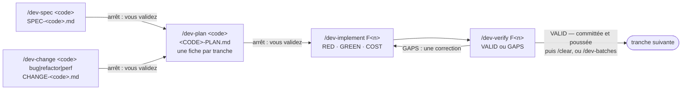

# Développer une fonctionnalité : spécifier, planifier, implémenter, vérifier

*[English](../../workflows/develop.md) · Français*

Cette page s'adresse au développeur du cœur d'un dépôt : vous avez une fonctionnalité à construire, et
vous la voulez spécifiée, planifiée, écrite tests d'abord, auditée et committée. Elle se
déroule **dans une copie de travail git uniquement** : montez la copie de travail là où irait un atelier
et nommez le profil au premier démarrage (`-e HARNESS_PROFILE=dev`), ou changez-le plus tard avec
`/workshop-profile dev`. Le profil `dev` est refusé dans un atelier. À la fin, `todo/<code>/` contient
la spécification, le plan, une fiche par tranche et un verdict par tranche auditée, et le dépôt contient
les commits, un par tranche : poussés sur leur branche quand vous lancez les tranches une à une (D71),
fusionnés dans votre branche et poussés une seule fois avec `/dev-batches` (D79). Un bogue, un refactor ou une amélioration de performance
entre dans la même chaîne par `/dev-change` au lieu de `/dev-spec` : une fiche faite de preuves remplace la
spécification métier, et tout ce qui suit est identique.



Plusieurs tranches à la fois : `/dev-batches F2 F3 F4` fait tourner chacune dans un agent `dev-batch` dans
son propre worktree, en arrière-plan, quatre à la fois, la conversation orchestrant
([étape 3b](#étape-3b--dev-batches--plusieurs-tranches-un-agent-chacune)).

## Avant de commencer

- **L'espace** : la copie de travail git du dépôt, montée sur `/workspace` (ou `ORKEON_WORKSHOP`), comme
  le décrit [Dans une copie de travail](../reference/harness.md#dans-une-copie-de-travail). Le harnais
  s'installe dans le `.claude/` de la copie de travail, listé dans `.git/info/exclude` ; `todo/` est exclu
  de git de la même façon. `todo/` est le **dossier de travail** par défaut : un pack de dépôt peut nommer
  un dossier du dépôt à sa place (Orkeon : `backstage/tasks/`, où vivent ses tâches et son backlog), la
  première ligne de la session dit lequel, et `todo/` dans cette page se lit alors comme ce dossier —
  git le voit, c'est vous qui le validez (D69).
- **Le profil** : `dev` — les packs `core`, `source`, `dev`, `quality` et `usage`
  ([Profils et packs](../reference/harness.md#profils-et-packs)). Le pack règle l'interrupteur
  `HARNESS_DEV_BATCH_GUARD` à `1`, ce qui active le hook `dev-batch-guard` : une tranche `/dev-implement`
  en ligne par contexte, et aucune tranche confiée à un agent générique ; et `HARNESS_PILOT_GUARD` à `1` : le
  contexte qui orchestre une tranche n'ouvre aucun fichier source ou de test (D75).
- **Les valeurs du dépôt** : dans une copie de travail d'Orkeon (`origin` sur `Orkeon/orkeon`), le pack de
  dépôt `repo-orkeon` rejoint le profil. Il apporte les règles de couche `orkeon-domain.md`,
  `orkeon-application.md` et `orkeon-tests.md`, chargées quand un fichier de cette couche est lu, et
  `repo.yaml` : l'organisation (où vivent les projets du domaine, de l'application, de l'infrastructure
  et des tests) et les commandes de construction et de test que les skills lancent. Dans tout autre
  dépôt, les skills demandent une valeur manquante une seule fois, en nommant la clé.
- **Docker**, quand une tranche touche un adaptateur : un test d'intégration s'exécute contre la vraie
  dépendance, dans un conteneur. Sans Docker, le test est écrit et signalé comme non exécuté.
- **Le CLI du produit**, dans une copie de travail d'Orkeon : l'`orkeon` du PATH est la construction que
  l'image embarque à son propre commit, pas ce code. Une commande qui l'exécute est refusée, et le refus
  cite la commande de la copie de travail, lue dans `repo.yaml`
  (`dotnet run --project src/scripting/Orkeon.Scripting.Cli -- …`, tapée depuis la racine de la copie de
  travail).

## Étape 1 — `/dev-spec` : la spécification métier

```text
/dev-spec <code> [la fonctionnalité, ou le chemin d'un brief]
```

`<code>` est un court slug en kebab-case ; le dossier est `todo/<code>/`. Claude lit le brief, fait
inventorier par un sous-agent `Explore` ce que le code répond déjà, puis vous demande ce qu'il ne peut
pas répondre : **une décision par question**, la réponse recommandée en premier ; le périmètre n'est
remis en cause que lorsqu'une réponse le réduirait, en trois questions au plus. Il écrit ensuite
`todo/<code>/SPEC-<code>.md` : cas d'usage `UC-nn`, chacun disant où l'acteur le rencontre (un écran, une
commande, un menu ou un parcours existant, et sa place parmi ce qui est déjà là, en vocabulaire métier),
règles métier `BR-nn` avec leur origine et leur sévérité, données, états, ce qui est hors périmètre,
hypothèses et questions ouvertes. Rien de technique : ni type, ni fichier, ni table, ni framework. Une spécification existante est révisée, jamais
écrasée ; elle est écrite en anglais sauf si vous demandez autrement.

Le sous-agent `adversarial-reviewer` tente ensuite de réfuter la spécification, en lecture seule : il
rend des questions fermées classées `Blocking` ou `Major`, ou `CLEAR`. Chaque question `Blocking` vous
est posée, une à la fois, et sa réponse écrite dans la spécification ; les `Major` restent en questions
ouvertes ou en hypothèses. Le réviseur garde une mémoire du dépôt sous
`.claude/agent-memory/adversarial-reviewer/` — les trous qu'une spécification ou un plan de ce dépôt tend à
laisser, les questions qui ont reçu une réponse et laquelle, les chemins qui existent et ceux qui avaient
été devinés — et le hook `memory-scope` le laisse écrire là et nulle part ailleurs.

**Arrêt : vous validez.** Claude montre les cas d'usage et les règles, les questions ouvertes et leur
sévérité, puis s'arrête. `/dev-plan` refuse de démarrer tant qu'une question ouverte `Blocking`
subsiste.

## Étape 1, pour un changement — `/dev-change` : la fiche d'un bogue, d'un refactor ou d'une amélioration de performance

```text
/dev-change <code> bug|refactor|perf [la demande, un ticket, ou contrib/<slug>/RECORD.md]
```

Ce qui n'a pas de spécification métier à écrire prend cette entrée : un comportement que le produit
promet déjà et ne tient pas (`bug`), le même comportement sous une meilleure forme (`refactor`), le même
comportement à moindre coût (`perf`). Claude établit les faits avant d'écrire : un bogue est
**reproduit en exécutant** la reproduction d'origine ou la commande de la demande (un bogue qui ne se
montre pas s'arrête là) ; une amélioration de performance est **mesurée** d'abord (le nombre avant,
comment il a été lu, la ligne `Cost:` du script de coût d'accès) ; un sous-agent `Explore` liste le
chemin de code, les tests qui épinglent déjà les comportements de la zone et les points d'appel. Puis une
décision par question, pour ce que le code ne peut pas dire.

La fiche, `todo/<code>/CHANGE-<code>.md`, tient l'origine, les preuves, des critères d'acceptation
`CH-nn` (chacun avec sa preuve : la reproduction passée au vert, un nombre, « rien d'observable ne
change »), une table de **ce qui ne doit pas changer** avec le test qui épingle chaque comportement — ou
`unpinned`, que le plan transforme en test de caractérisation écrit d'abord —, le périmètre et les
contraintes techniques. Pas de conception : où le correctif se pose est l'affaire de `/dev-plan`. Un
fait qui se révèle une promesse nouvelle vous renvoie à `/dev-spec`. L'`adversarial-reviewer` réfute la
fiche comme il réfute une spécification.

**Arrêt : vous validez.** Puis `/dev-plan <code>` lit la fiche comme il lit une spécification ; les
identifiants `CH-nn` sont tracés, testés et portés en traits comme les `BR-nn`. Pour un refactor, les
tests qui épinglent le comportement sont nommés dans la fiche de tranche comme `pinned`, verts avant le
changement et après ; pour un bogue, la reproduction est le premier test rouge ; pour une amélioration
de performance, la mesure après est la cible de coût d'accès de la fiche de tranche.

## Étape 2 — `/dev-plan` : le plan et ses tranches

```text
/dev-plan <code>
```

Claude liste d'abord les questions ouvertes `Blocking` de la spécification ou de la fiche ; s'il en reste
une, il s'arrête et vous renvoie à `/dev-spec <code>` ou `/dev-change <code>`. Puis il lit la
spécification, les règles de conception
(les identifiants `DDD-`, `APP-` et `PERF-` que chaque plan classe en appliqués ou non applicables avec
une raison) et l'organisation et les commandes du dépôt dans `repo.yaml`, en demandant une fois ce qui
manque et en écrivant la réponse sur les lignes `Commands` et `Layout` du plan. Un sous-agent `Explore`
inventorie les types réutilisables, les cas d'usage qui portent un acte voisin et les points d'ancrage
des tests.

Il écrit deux niveaux sous `todo/<code>/` : le plan global `<CODE>-PLAN.md` (les tranches, leur ordre,
la traçabilité de chaque `BR-nn` et `UC-nn` vers le code qui en répond) et une fiche `<CODE>-PLAN-F<n>.md`
par tranche (ses décisions de conception, la séquence TDD avec un test nommé par comportement, les
chemins exacts que `/dev-implement` copiera). Les tranches sont fonctionnelles ; chacune nomme
celles dont elle dépend, et `/dev-batches` en lance deux à la fois quand aucune ne nomme l'autre et
que leurs fichiers diffèrent. L'`adversarial-reviewer` réfute le plan : une ligne `Blocking` est corrigée ou vous est posée,
une ligne `Major` corrigée ou conservée avec sa raison sous le `## Decisions` de la fiche. Il lit et
enrichit la même mémoire du dépôt qu'à l'étape 1, `.claude/agent-memory/adversarial-reviewer/`, le seul
endroit où le hook `memory-scope` le laisse écrire.

**Arrêt : vous validez.** Claude résume les tranches, les identifiants tracés et la façon dont chaque
ligne de la revue a été réglée, puis termine par la commande suivante :

```text
→ Manual plan validation required. Once validated: /dev-implement F1 todo/<code>/<CODE>-PLAN.md
```

## Étape 3 — `/dev-implement` : une tranche, tests d'abord

```text
/dev-implement F<n> todo/<code>/<CODE>-PLAN.md
```

Claude orchestre et juge ; deux sous-agents écrivent. Par comportement de la fiche, strictement dans
cet ordre :

1. **RED** — `dev-test-author` écrit les tests nommés par la fiche, avec les chemins copiés de ses
   points d'ancrage, et les lance : ils doivent échouer sur leur assertion. Chaque test porte le trait de
   règle du dépôt pour les identifiants qu'il prouve (`[Trait("BR", "BR-nn")]` pour Orkeon, lu dans
   `repo.yaml`) : la barrière d'audit de l'étape 4 refuse une tranche dont la fiche nomme un identifiant
   qu'aucun test ne porte.
2. **GREEN + REFACTOR** — `dev-implementer` écrit le minimum de code de production qui les fait
   passer, puis refactorise ; les fichiers de test sont pour lui en lecture seule.
3. **COST** — le nombre d'appels d'entrée-sortie du comportement doit être borné et indépendant de la
   taille de l'entrée, comme la fiche l'a prévu. Il est mesuré, pas déclaré : `access-cost.py` liste,
   depuis l'arbre syntaxique (`ast-grep`), chaque appel attendu à travers un port et s'il se trouve dans
   une boucle ou une lambda sur l'entrée, ou filtre en mémoire ce que le port pouvait filtrer ;
   l'implémenteur copie sa dernière ligne dans son rapport, et Claude la confronte à la fiche. Un coût
   signalé retourne à `/dev-plan`, jamais rafistolé.

Chaque étape observée est cochée sur la fiche (`TDD: RED [x] GREEN [x] COST [x]`). Une question qui
change le périmètre, un identifiant ou une décision de conception arrête la tranche ; une question qui
n'en change aucun est écrite sous le `## Assumptions` de la fiche en `Hn`. Puis la construction et les
suites de tests complètes s'exécutent une fois, la fiche et le plan global sont marqués faits, avec la
date, et l'audit de l'étape 4 se déroule en mode rapide. La suite complète est la seule lancée en entier :
les corrections qui suivent lancent les projets de test que la tranche atteint (`affected-tests.py`, avec
le `commands.test_project` du pack), la suite complète de nouveau seulement si un fichier qu'aucun projet
ne possède a changé (D78).

**Une tranche par contexte.** Le hook `dev-batch-guard` refuse un deuxième `/dev-implement` en ligne dans
le même contexte et nomme les deux issues : `/dev-batches` pour plusieurs tranches, chacune dans son agent,
ou `/clear` pour une de plus ici ; la correction d'une tranche close passe.

**Une compaction pendant une tranche** est couverte par le hook `dev-compact`, actif avec le pack `dev`
(il règle `HARNESS_DEV_COMPACT` à `1`). Avant que le contexte soit compacté, le hook écrit
`todo/<code>/<CODE>-STATE-F<n>.md` : les étapes de la fiche avec leur ligne `TDD:` et la première encore
ouverte, les lignes de progression que la tranche a affichées, les délégations faites, et
`git status --short`. La session qui reprend après la compaction reçoit la consigne de le lire d'abord et
de ne jamais relancer une délégation qu'il liste. Le fichier est réécrit à chaque compaction. Pendant
`/dev-batches`, le hook écrit `todo/<code>/<CODE>-BATCHES-STATE.md` à la place : une ligne par tranche, ses
lancements, ce que son agent a rendu, le bloc que Claude a relayé et sa fusion ou non ; la session reçoit la
consigne de le lire d'abord et de ne jamais relancer une tranche qu'il donne en cours ou fusionnée.

Sur `VALID`, Claude affiche un résumé de la tranche, puis la committe et la pousse (D71) : les fichiers
que la tranche a touchés, jamais le dossier de travail, avec un message à la forme que donne `repo.yaml`
(pour Orkeon `type(scope): summary`), sur une branche nommée comme le dépôt nomme les siennes si vous
étiez sur la branche par défaut, puis `git push -u origin <branche>`. L'identité est celle que git a
déjà — sa configuration, ou les variables que `workshop --git-identity "<nom>" <email>` pose pour le
conteneur ([Configuration](../reference/configuration.md#variables-de-limage)) : quand git n'en a pas,
Claude s'arrête avant le commit et vous donne cette commande, ou les deux lignes `git config --global`,
à taper. Il dit le hash court et la branche ; un push refusé est dit avec la ligne de git, le commit
gardé en local. Puis la pull request (D71) : Claude vérifie d'abord `gh auth status` — non connecté, il
vous remet `gh auth login` et la ligne `gh pr create`, la branche restant poussée —, trouve celle qui
existe et donne son URL, ou écrit `todo/pr-<code>-F<n>/PR.md` sur le gabarit de pull request (la
tranche, les fichiers par couche, les validations, les hypothèses à valider, le verdict de l'audit et
ses mineurs, ce qui n'a pas été lancé) et vous demande une fois s'il l'ouvre, vers la branche par
défaut du dépôt ; `HARNESS_PR_AUTO=1` l'ouvre sans demander. La session se termine sur la ligne de
clôture, affichée une seule fois :

```text
→ Batch F<n> complete — manual validation required. Run /clear before the next batch.
```

## Étape 3b — `/dev-batches` : plusieurs tranches, un agent chacune

```text
/dev-batches F<n> [F<m>…] [todo/<code>/<CODE>-PLAN.md]
```

La conversation orchestre et ne porte jamais une tranche (D70) : chaque tranche nommée suit la procédure
de `/dev-implement` dans un agent `dev-batch`, en arrière-plan, dans un worktree à elle que le harnais
crée sous `.claude/worktrees/` depuis la branche où vous êtes, avec les dossiers non suivis partagés du
dépôt (`packages` pour Orkeon) reliés à ceux de votre copie plutôt que restaurés à nouveau, et le restore
et la première construction de la solution (`commands.restore && commands.build` du pack de dépôt) lancés en
arrière-plan dès que le worktree existe, pendant que l'agent lit sa fiche : l'agent attend cette
construction avant de compiler et ne restaure plus jamais — son auteur des tests écrit les premiers tests rouges
pendant qu'elle tourne (les restaurations et les constructions longues de votre copie tournent une à la fois,
sous un verrou : deux agents restaurant en même temps dans le même dossier partagé se perdraient mutuellement des
fichiers, et quatre constructions simultanées ont pris huit fois le temps d'une seule, D81) — un
seul restore par tranche, chaque
`dotnet` suivant portant `--no-restore` ou `--no-build`, l'auteur des tests et l'implémenteur ne
construisant que leur projet de test, le module `guard-restore` leur refusant le reste. Deux agents
tournent à la fois (`HARNESS_DEV_BATCHES_MAX` ; le pack `dev` les fait tourner sur Sonnet, `HARNESS_DEV_BATCH_MODEL`), les autres attendent dans l'ordre du plan ; deux tournent
ensemble seulement si les points d'ancrage de leurs fiches sont disjoints et qu'aucune ne nomme l'autre
sous `Depends on`. Une tranche qui dépend d'une autre pas encore fusionnée l'attend : Claude fusionne
chaque tranche `VALID` à son retour, donc une dépendance faite mais non fusionnée est une dépendance dont
la fusion a échoué, et Claude dit laquelle. Avant de lancer une tranche dont la dépendance vient d'être
fusionnée, `adversarial-reviewer` (sur Sonnet) lit sa fiche face à celle qui a été livrée : une question
`Blocking` arrête cette tranche et vous est posée ; chaque question `Major` — un nom, une signature ou un
chemin que la tranche livrée a changé — parvient à l'agent de la tranche en ligne `stale:`, et l'agent lit
la fiche avec la valeur livrée.

**Lancez-le dans une conversation neuve** — `/clear` après `/dev-plan` — et tapez `/autocompact 250k` quand Claude
le demande : un orchestrateur qui avait porté la spec et le plan jusque dans les tranches a atteint 738k tokens de
contexte dans GAP-50-55 et payé environ 30 USD pour réécrire son cache (D84). Une compaction pendant que les tranches
tournent ne perd rien : leur état est dans un fichier.

**Sur un dossier Windows**, les builds des tranches vont deux fois plus vite avec leurs worktrees sur un volume Docker :
les commandes de démarrage d'[Installer](../getting-started/install.md#3-démarrer-le-conteneur) montent ce volume par
défaut, `HARNESS_WORKTREE_ROOT` (D85) ; un conteneur créé avant le reçoit comme le dit
[Les worktrees sur un volume](../guides/docker-modes.md#avancé--les-worktrees-sur-un-volume).

**Avant le premier lancement**, un seul bloc : `preflight.sh` vérifie l'identité git, la branche, vos
réglages et le disque. Il arrête l'exécution (`FAIL`) quand git n'a pas d'identité (aucune tranche ne
pourrait committer : Claude vous remet `workshop --git-identity`), quand vous êtes sur la branche par
défaut (Claude crée d'abord la branche de travail, D71) et quand votre propre `~/.claude/settings.json`
contient un `rtk hook claude` (le conteneur `docker run` en installe un à son premier démarrage ; il
réécrit `git` en `rtk git`, que l'isolation des worktrees de Claude Code refuse : retirez-le de ce
fichier, le dispatcher du harnais lance rtk lui-même). Il se borne à avertir quand `gh` n'est pas connecté
(la clôture en a besoin : réglez-le pendant que les tranches tournent), quand moins de deux worktrees
construits tiennent sur le disque, quand la mémoire tient moins de tranches que `HARNESS_DEV_BATCHES_MAX`
(deux par 15 Go), quand la copie est sur un disque Windows (un montage 9p : tout y tourne plusieurs fois plus
lentement) et quand des worktrees laissés par un run arrêté sont encore là ; il vous rappelle de garder l'hôte
éveillé.

**Pendant que les agents tournent**, posez une question avec `/btw` ; n'appuyez jamais sur Échap, Ctrl+C ni
Ctrl+X Ctrl+K, et n'envoyez aucun message avant que la conversation soit au repos : on signale qu'ils
arrêtent les agents. Une tranche arrêtée se reprend depuis `/tasks` en tapant dans sa transcription tant
que sa ligne y figure ; sinon Claude la reprend depuis ses points de contrôle (un commit local et une ligne
d'état après chaque étape verte) — un nouvel agent seulement sur votre oui explicite, ou de lui-même quand vous
réglez une fois `HARNESS_AUTO_RESUME=1` (D82) : à chaque démarrage, Claude Code apprend quelles tranches le run a
laissées ouvertes (le journal de `<CODE>-BATCHES-STATE.md`, tenu au fil du run). Pour un run qui passe la nuit,
[Une longue session autonome](../guides/long-session.md) dit comment le superviseur garde la session en vie dans
tmux et la réveille.

Chaque agent délègue RED, GREEN et l'audit aux quatre mêmes sous-agents, committe sa tranche sur sa propre
branche locale sans jamais pousser (D79), et renvoie ce que la fiche doit enregistrer ; la conversation
écrit la fiche, le plan global et le fichier de verdict à partir de ce rapport — un agent dans un worktree
ne peut pas écrire dans votre copie. Aucun appel d'un agent ne dure plus de 270 secondes, pour que son
cache de prompt reste chaud : une construction ou la suite complète tourne détachée et s'attend par
tranches (D77). Pour chaque tranche `VALID`, la conversation fusionne la branche dans la vôtre
(`git merge --ff-only`, un rebase de la branche de tranche, jamais poussée, quand une autre tranche a
fusionné avant), retire son worktree en arrière-plan (`worktree-create.sh --remove <worktree>
--background` ; un worktree construit pèse 25 à 30 Go) et relaie un bloc par tranche. Une tranche `GAPS` ou
bloquée n'est jamais fusionnée, et son worktree reste (`worktree-create.sh --space` liste l'espace libre
et chaque worktree, fusionné ou non : aucun fusionné ne reste à la fin). À la fin : une table des
tranches avec leur verdict, leur commit, leur fusion et leur worktree ; votre branche poussée une seule
fois et **une** pull request — la même procédure que ci-dessus, `gh auth status` d'abord, une question
(`HARNESS_PR_AUTO=1` l'ouvre sans demander) — ; et, pour les branches de tranche qu'un harnais plus ancien
a poussées, un script qui les supprime, remis à vous pour le lancer. La fusion de la pull request reste
la vôtre.

## Étape 4 — `/dev-verify` : l'audit, seul

```text
/dev-verify F<n> [todo/<code>/<CODE>-PLAN.md] [full | resume]
```

`/dev-implement` le lance à sa clôture ; vous le lancez aussi seul, par exemple après une correction. Un
script, `audit-capture.sh`, fait **barrière** : il cherche dans les sources avec `git grep --untracked`, sans
jamais lire `bin/` ni `obj/` (`layout.build_outputs`), et échoue sur une ligne `TDD:` encore ouverte, un
identifiant de conception ni appliqué ni non applicable, un fichier modifié hors des racines de
production et de test et absent de la fiche, un identifiant de la séquence TDD de la fiche qu'aucun test
ne porte comme trait de règle, ou des erreurs d'espaces. Rouge, rien n'est audité tant que vous n'avez
pas corrigé ce qu'il liste. Vert, il écrit une capture (état, fichiers modifiés, le diff de la tranche,
le code de sortie de la construction — celle que `/dev-implement` a déjà faite quand son journal est vert
et qu'aucun fichier modifié n'est plus récent, la solution n'étant ainsi construite qu'une fois par
tranche —, le coût d'accès des fichiers de production modifiés avec chaque appel de port en boucle
signalé, les traits de règle trouvés, la dernière exécution des tests et les classes de test que chaque
fichier modifié concerne). Le même script fait ensuite la moitié mécanique de l'audit (D72 : un audit
est mécanique d'abord, jugé ensuite ; dans la porte depuis D80) : une table dans la capture, une ligne par
vérification, `ok`, `gap` ou `not checked` — le code de sortie de la construction, les identifiants portés
par des traits, les méthodes de test que nomment les tables d'étapes trouvées dans les racines de test, les
nombres et le code de sortie de la dernière exécution des tests, les fichiers hors de la fiche, le coût
d'accès, les identifiants de règle appliqués connus des règles de conception. Un sous-agent en lecture
seule, `dev-auditor` (Opus), ouvre la capture dans son propre contexte, tient cette table pour acquise —
une ligne `gap` passe dans son verdict, une ligne `not checked`, dont toujours les règles de couche, est à
lui de vérifier —, parcourt le diff bloc par bloc selon les axes de jugement, de l'exactitude au
placement, lance les commandes de test dont il doute, et répond `VALID` ou `GAPS`. `full` ajoute toute la suite rapide ; `resume` ré-audite après une
correction, à partir de la table d'écarts précédente et du diff depuis. L'auditeur garde une mémoire du
dépôt sous `.claude/agent-memory/dev-auditor/` — l'organisation et les commandes de test qui répondent,
les catégories d'écarts qui reviennent et la règle que `/dev-learn` en a tirée, un faux positif et
pourquoi il l'était — et le hook `memory-scope` le laisse écrire là et nulle part ailleurs.

Claude écrit `todo/<code>/<CODE>-VERIFY-F<n>.md` : le verdict, une table des écarts (sévérité, axe,
écart, preuve, correction attendue) et les validations lancées. `GAPS` dès qu'une ligne `Blocking` ou
`Major` tient ; `VALID` liste ses mineurs, à vous de décider. Lancé seul :

- `VALID` : la tranche est committée et poussée comme à l'étape 3, et la ligne de clôture affichée ;
- `GAPS` : la correction est à vous de la lancer, à partir du premier écart :

```text
/dev-implement F<n> — correction: <l'écart>
```

Une correction rouvre la tranche close sous une ligne `Correction Cn` de son étape et déroule pour elle
la boucle RED, GREEN et COST ; un écart qui change le périmètre, un identifiant ou une décision de
conception est renvoyé à `/dev-spec` ou `/dev-plan`. Deux tours d'audit encore en `GAPS` à la clôture
d'une tranche : Claude s'arrête et vous remet les écarts bloquants.

## À côté de la chaîne : `/dev-unit-tests`, `/dev-integration-tests`

Les deux skills de test sont les guides que `dev-test-author` lit pour le niveau qu'un RED demande ;
vous les lancez aussi seuls, pour un test hors tranche.

| Skill | Ce qu'il écrit |
|---|---|
| `/dev-unit-tests <type ou cas d'usage> [scénario] [id]` | un test unitaire dans le projet de test qui reflète le projet de production, en étendant la classe de test existante, sur des doublures écrites à la main ; rouge d'abord sur son assertion, puis vert sur un code de sortie `0` |
| `/dev-integration-tests <adaptateur> [scénario] [id]` | un test d'intégration d'un adaptateur contre la vraie dépendance (pour Orkeon Testcontainers, `[Trait("Category", "Integration")]`), tenu hors de la suite rapide ; sans Docker il est écrit et signalé comme non exécuté |

Les deux terminent par le test, la commande et son code de sortie. Le code de production passe ensuite
par `/dev-implement` quand un plan existe.

## Entre deux tranches : `/dev-learn`

```text
/dev-learn [axe]
```

À lancer après `/clear`, jamais pendant une tranche, un axe à la fois. Claude lit les écarts `Blocking`
et `Major` non traités de chaque fichier de verdict (`todo/*/*-VERIFY-F*.md`) et les groupe en motifs,
gardés seulement s'ils reviennent sur trois tranches ou plus et qu'une ligne ou une vérification les
aurait attrapés avant l'audit. Chaque motif reçoit la destination la plus étroite : les consignes ou les
vérifications propres au dépôt, écrites dans la copie de travail ; ou un fichier du harnais, jamais
modifié sur place puisque la prochaine synchronisation le réécrit — Claude affiche un correctif exact
pour le dépôt orkeon-workshop, que vous appliquez là-bas. Rien n'est écrit avant que vous acceptiez
chaque proposition ; un motif refusé n'est jamais reproposé. `/dev-implement` vous rappelle l'arriéré à
la clôture d'une tranche quand deux tranches ou plus attendent.

## Ce qu'il y a sur le disque ensuite

```text
<copie de travail>/
├── todo/<code>/                     exclu de git (ou le dossier de travail propre au dépôt, D69)
│   ├── SPEC-<code>.md               la spécification métier — ou CHANGE-<code>.md, la fiche d'un changement
│   ├── <CODE>-PLAN.md               le plan global : tranches, ordre, traçabilité
│   ├── <CODE>-PLAN-F1.md            une fiche par tranche, cochée et datée quand elle est faite
│   ├── <CODE>-PLAN-F2.md
│   ├── <CODE>-VERIFY-F1.md          un verdict par tranche auditée (une section datée par resume)
│   ├── <CODE>-STATE-F1.md           l'état d'une tranche ouverte, écrit seulement si une compaction a eu lieu pendant elle
│   └── <CODE>-BATCHES-STATE.md      l'état d'un passage de /dev-batches, écrit seulement si une compaction a eu lieu pendant lui
├── .claude/agent-memory/            la mémoire des agents, listée dans .git/info/exclude comme todo/
│   ├── dev-auditor/
│   └── adversarial-reviewer/
├── .claude/worktrees/               les worktrees de /dev-batches, un par tranche, retirés une fois fusionnés (ou sur un volume : HARNESS_WORKTREE_ROOT)
└── .claude/local/
    └── dev-learn-state.json         ce que /dev-learn a traité et ce que vous avez refusé
```

## Où cette pièce se connecte

- **Avant** : un ticket ouvert par un contributeur ([Contribuer](./contribute.md)) est souvent le brief que
  vous donnez à `/dev-spec`.
- **Après** : les tranches committées et poussées (ou, après `/dev-batches`, fusionnées dans une branche poussée une fois) partent en revue sous forme de pull
  request ; le `/contrib-pr` d'un contributeur en parcourt la liste de contrôle du dépôt
  ([Contribuer](./contribute.md)). Une fonctionnalité fusionnée entre ensuite dans une version
  ([Publier une version](./release.md)).
- **Mesurée** : `/quality-report` lance la construction, les tests, la couverture et Sonar du dépôt sur le
  résultat ([Publier une version](./release.md)).
- **Documentée** : `/docs-audit` confronte au code les pages que la fonctionnalité a changées
  ([Garder la documentation vraie](./keep-docs-true.md)).
- **La vue d'ensemble** : [Les workflows](./overview.md).

Suite : [Publier une version](./release.md).
