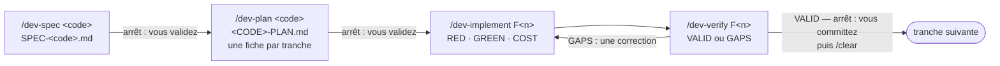

# Développer une fonctionnalité : spécifier, planifier, implémenter, vérifier

*[English](../../workflows/develop.md) · Français*

Cette page s'adresse au développeur du cœur d'un dépôt : vous avez une fonctionnalité à construire, et
vous la voulez spécifiée, planifiée, écrite tests d'abord et auditée avant de la committer. Elle se
déroule **dans une copie de travail git uniquement** : montez la copie de travail là où irait un atelier
et nommez le profil au premier démarrage (`-e HARNESS_PROFILE=dev`), ou changez-le plus tard avec
`/workshop-profile dev`. Le profil `dev` est refusé dans un atelier. À la fin, `todo/<code>/` contient
la spécification, le plan, une fiche par tranche et un verdict par tranche auditée, et le dépôt contient
les commits que vous avez faits, un par tranche.



## Avant de commencer

- **L'espace** : la copie de travail git du dépôt, montée sur `/workspace` (ou `ORKEON_WORKSHOP`), comme
  le décrit [Dans une copie de travail](../reference/harness.md#dans-une-copie-de-travail). Le harnais
  s'installe dans le `.claude/` de la copie de travail, listé dans `.git/info/exclude` ; `todo/` est exclu
  de git de la même façon.
- **Le profil** : `dev` — les packs `core`, `source`, `dev`, `quality` et `usage`
  ([Profils et packs](../reference/harness.md#profils-et-packs)). Le pack règle l'interrupteur
  `HARNESS_DEV_BATCH_GUARD` à `1`, ce qui active le hook `dev-batch-guard` : une tranche `/dev-implement`
  par session.
- **Les valeurs du dépôt** : dans une copie de travail d'Orkeon (`origin` sur `Orkeon/orkeon`), le pack de
  dépôt `repo-orkeon` rejoint le profil. Il apporte les règles de couche `orkeon-domain.md`,
  `orkeon-application.md` et `orkeon-tests.md`, chargées quand un fichier de cette couche est lu, et
  `repo.yaml` : l'organisation (où vivent les projets du domaine, de l'application, de l'infrastructure
  et des tests) et les commandes de construction et de test que les skills lancent. Dans tout autre
  dépôt, les skills demandent une valeur manquante une seule fois, en nommant la clé.
- **Docker**, quand une tranche touche un adaptateur : un test d'intégration s'exécute contre la vraie
  dépendance, dans un conteneur. Sans Docker, le test est écrit et signalé comme non exécuté.

## Étape 1 — `/dev-spec` : la spécification métier

```text
/dev-spec <code> [la fonctionnalité, ou le chemin d'un brief]
```

`<code>` est un court slug en kebab-case ; le dossier est `todo/<code>/`. Claude lit le brief, fait
inventorier par un sous-agent `Explore` ce que le code répond déjà, puis vous demande ce qu'il ne peut
pas répondre : **une décision par question**, la réponse recommandée en premier ; le périmètre n'est
remis en cause que lorsqu'une réponse le réduirait, en trois questions au plus. Il écrit ensuite
`todo/<code>/SPEC-<code>.md` : cas d'usage `UC-nn`, règles métier `BR-nn` avec leur origine et leur
sévérité, données, états, ce qui est hors périmètre, hypothèses et questions ouvertes. Rien de
technique : ni type, ni fichier, ni table, ni framework. Une spécification existante est révisée, jamais
écrasée ; elle est écrite en anglais sauf si vous demandez autrement.

Le sous-agent `adversarial-reviewer` tente ensuite de réfuter la spécification, en lecture seule : il
rend des questions fermées classées `Blocking` ou `Major`, ou `CLEAR`. Chaque question `Blocking` vous
est posée, une à la fois, et sa réponse écrite dans la spécification ; les `Major` restent en questions
ouvertes ou en hypothèses.

**Arrêt : vous validez.** Claude montre les cas d'usage et les règles, les questions ouvertes et leur
sévérité, puis s'arrête. `/dev-plan` refuse de démarrer tant qu'une question ouverte `Blocking`
subsiste.

## Étape 2 — `/dev-plan` : le plan et ses tranches

```text
/dev-plan <code>
```

Claude liste d'abord les questions ouvertes `Blocking` de la spécification ; s'il en reste une, il
s'arrête et vous renvoie à `/dev-spec <code>`. Puis il lit la spécification, les règles de conception
(les identifiants `DDD-`, `APP-` et `PERF-` que chaque plan classe en appliqués ou non applicables avec
une raison) et l'organisation et les commandes du dépôt dans `repo.yaml`, en demandant une fois ce qui
manque et en écrivant la réponse sur les lignes `Commands` et `Layout` du plan. Un sous-agent `Explore`
inventorie les types réutilisables, les cas d'usage qui portent un acte voisin et les points d'ancrage
des tests.

Il écrit deux niveaux sous `todo/<code>/` : le plan global `<CODE>-PLAN.md` (les tranches, leur ordre,
la traçabilité de chaque `BR-nn` et `UC-nn` vers le code qui en répond) et une fiche `<CODE>-PLAN-F<n>.md`
par tranche (ses décisions de conception, la séquence TDD avec un test nommé par comportement, les
chemins exacts que `/dev-implement` copiera). Les tranches sont fonctionnelles et séquentielles par
défaut. L'`adversarial-reviewer` réfute le plan : une ligne `Blocking` est corrigée ou vous est posée,
une ligne `Major` corrigée ou conservée avec sa raison sous le `## Decisions` de la fiche.

**Arrêt : vous validez.** Claude résume les tranches, les identifiants tracés et la façon dont chaque
ligne de la revue a été réglée, puis termine par la commande suivante :

```text
→ Manual plan validation required. Once validated: /dev-implement F1 todo/<code>/<CODE>-PLAN.md
```

## Étape 3 — `/dev-implement` : une tranche, tests d'abord

```text
/dev-implement F<n> todo/<code>/<CODE>-PLAN.md
```

Claude orchestre et juge ; deux sous-agents écrivent. Par comportement de la fiche, strictement dans
cet ordre :

1. **RED** — `dev-test-author` écrit les tests nommés par la fiche, avec les chemins copiés de ses
   points d'ancrage, et les lance : ils doivent échouer sur leur assertion.
2. **GREEN + REFACTOR** — `dev-implementer` écrit le minimum de code de production qui les fait
   passer, puis refactorise ; les fichiers de test sont pour lui en lecture seule.
3. **COST** — le nombre d'appels d'entrée-sortie du comportement doit être borné et indépendant de la
   taille de l'entrée, comme la fiche l'a prévu. Un coût signalé retourne à `/dev-plan`, jamais
   rafistolé.

Chaque étape observée est cochée sur la fiche (`TDD: RED [x] GREEN [x] COST [x]`). Une question qui
change le périmètre, un identifiant ou une décision de conception arrête la tranche ; une question qui
n'en change aucun est écrite sous le `## Assumptions` de la fiche en `Hn`. Puis la construction et les
suites de tests complètes s'exécutent une fois, la fiche et le plan global sont marqués faits, avec la
date, et l'audit de l'étape 4 se déroule en mode rapide.

**Une tranche par session.** Le hook `dev-batch-guard` refuse un deuxième `/dev-implement` dans la même
session et dit de faire `/clear` d'abord ; la correction d'une tranche close passe.

Sur `VALID`, Claude affiche un résumé de la tranche et vous remet le commit sous la forme d'un script
écrit à partir des fichiers que la tranche a touchés (D47). Son message suit la forme que donne
`repo.yaml`, pour Orkeon `type(scope): summary`. Vous le tapez dans Claude Code avec `!` devant, ou dans
un terminal du conteneur :

```bash
bash .claude/local/scripts/commit-F<n>.sh
```

Quand cela a fonctionné, git affiche le hash court du nouveau commit et son message. Si vous êtes sur
la branche par défaut et que le dépôt nomme un motif de branche, Claude le dit avant le script : vous
créez la branche d'abord. La session se termine sur la ligne de clôture, affichée une seule fois :

```text
→ Batch F<n> complete — manual validation required. Run /clear before the next batch.
```

## Étape 4 — `/dev-verify` : l'audit, seul

```text
/dev-verify F<n> [todo/<code>/<CODE>-PLAN.md] [full | resume]
```

`/dev-implement` le lance à sa clôture ; vous le lancez aussi seul, par exemple après une correction. Un
script, `audit-capture.sh`, fait **barrière** : il échoue sur une ligne `TDD:` encore ouverte, un
identifiant de conception ni appliqué ni non applicable, un fichier modifié hors des racines de
production et de test et absent de la fiche, ou des erreurs d'espaces. Rouge, rien n'est audité tant
que vous n'avez pas corrigé ce qu'il liste. Vert, il écrit une capture (état, fichiers modifiés, le diff
de la tranche, le code de sortie de la construction) que le sous-agent `dev-auditor` ouvre une fois, en
lecture seule et dans son propre contexte. L'auditeur parcourt le diff bloc par bloc selon neuf axes,
de l'exactitude au périmètre, lance les commandes de test les plus étroites qui prouvent la tranche, et
répond `VALID` ou `GAPS`. `full` ajoute toute la suite rapide ; `resume` ré-audite après une
correction, à partir de la table d'écarts précédente et du diff depuis.

Claude écrit `todo/<code>/<CODE>-VERIFY-F<n>.md` : le verdict, une table des écarts (sévérité, axe,
écart, preuve, correction attendue) et les validations lancées. `GAPS` dès qu'une ligne `Blocking` ou
`Major` tient ; `VALID` liste ses mineurs, à vous de décider. Lancé seul :

- `VALID` : le commit vous est remis comme à l'étape 3, et la ligne de clôture affichée ;
- `GAPS` : la correction est à vous de la lancer, à partir du premier écart :

```text
/dev-implement F<n> — correction: <l'écart>
```

Une correction rouvre la tranche close sous une ligne `Correction Cn` de son étape et déroule pour elle
la boucle RED, GREEN et COST ; un écart qui change le périmètre, un identifiant ou une décision de
conception est renvoyé à `/dev-spec` ou `/dev-plan`. Deux tours d'audit encore en `GAPS` à la clôture
d'une tranche : Claude s'arrête et vous remet les écarts bloquants.

## À côté de la chaîne : `/dev-unit-tests`, `/dev-integration-tests`

Les deux skills de test sont les guides que `dev-test-author` lit pour le niveau qu'un RED demande ;
vous les lancez aussi seuls, pour un test hors tranche.

| Skill | Ce qu'il écrit |
|---|---|
| `/dev-unit-tests <type ou cas d'usage> [scénario] [id]` | un test unitaire dans le projet de test qui reflète le projet de production, en étendant la classe de test existante, sur des doublures écrites à la main ; rouge d'abord sur son assertion, puis vert sur un code de sortie `0` |
| `/dev-integration-tests <adaptateur> [scénario] [id]` | un test d'intégration d'un adaptateur contre la vraie dépendance (pour Orkeon Testcontainers, `[Trait("Category", "Integration")]`), tenu hors de la suite rapide ; sans Docker il est écrit et signalé comme non exécuté |

Les deux terminent par le test, la commande et son code de sortie. Le code de production passe ensuite
par `/dev-implement` quand un plan existe.

## Entre deux tranches : `/dev-learn`

```text
/dev-learn [axe]
```

À lancer après `/clear`, jamais pendant une tranche, un axe à la fois. Claude lit les écarts `Blocking`
et `Major` non traités de chaque fichier de verdict (`todo/*/*-VERIFY-F*.md`) et les groupe en motifs,
gardés seulement s'ils reviennent sur trois tranches ou plus et qu'une ligne ou une vérification les
aurait attrapés avant l'audit. Chaque motif reçoit la destination la plus étroite : les consignes ou les
vérifications propres au dépôt, écrites dans la copie de travail ; ou un fichier du harnais, jamais
modifié sur place puisque la prochaine synchronisation le réécrit — Claude affiche un correctif exact
pour le dépôt orkeon-workshop, que vous appliquez là-bas. Rien n'est écrit avant que vous acceptiez
chaque proposition ; un motif refusé n'est jamais reproposé. `/dev-implement` vous rappelle l'arriéré à
la clôture d'une tranche quand deux tranches ou plus attendent.

## Ce qu'il y a sur le disque ensuite

```text
<copie de travail>/
├── todo/<code>/                     exclu de git
│   ├── SPEC-<code>.md               la spécification métier
│   ├── <CODE>-PLAN.md               le plan global : tranches, ordre, traçabilité
│   ├── <CODE>-PLAN-F1.md            une fiche par tranche, cochée et datée quand elle est faite
│   ├── <CODE>-PLAN-F2.md
│   └── <CODE>-VERIFY-F1.md          un verdict par tranche auditée (une section datée par resume)
└── .claude/local/
    ├── scripts/commit-F1.sh         le commit remis, un par tranche
    └── dev-learn-state.json         ce que /dev-learn a traité et ce que vous avez refusé
```

## Où cette pièce se connecte

- **Avant** : un ticket ouvert par un contributeur ([Contribuer](./contribute.md)) est souvent le brief que
  vous donnez à `/dev-spec`.
- **Après** : les tranches que vous avez committées et poussées partent en revue sous forme de pull
  request ; le `/contrib-pr` d'un contributeur en parcourt la liste de contrôle du dépôt
  ([Contribuer](./contribute.md)). Une fonctionnalité fusionnée entre ensuite dans une version
  ([Publier une version](./release.md)).
- **Mesurée** : `/quality-report` lance la construction, les tests, la couverture et Sonar du dépôt sur le
  résultat ([Publier une version](./release.md)).
- **Documentée** : `/docs-audit` confronte au code les pages que la fonctionnalité a changées
  ([Garder la documentation vraie](./keep-docs-true.md)).
- **La vue d'ensemble** : [Les workflows](./overview.md).

Suite : [Publier une version](./release.md).
