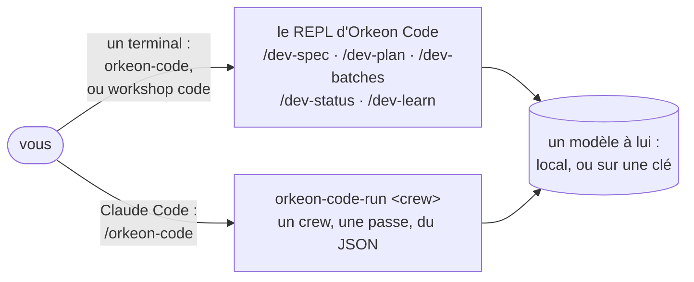

# Développer une fonctionnalité : la chaîne d'Orkeon Code

*[English](../../workflows/develop.md) · Français*

Cette page s'adresse au développeur du cœur d'un dépôt : vous avez une fonctionnalité à construire, un
bogue à corriger ou un refactor à mener dans une copie de travail git, depuis le conteneur de l'atelier.

Jusqu'en novembre 2026, le harnais portait pour cela sa propre chaîne — `/dev-spec`, `/dev-change`,
`/dev-plan`, `/dev-implement`, `/dev-batches`, `/dev-verify`, `/dev-status`, `/dev-learn`, avec leurs
sous-agents et leurs garde-fous. **Cette chaîne est retirée** (D114). La chaîne spécification, plan,
tranches et audit est désormais **celle d'Orkeon Code**, l'agent de code construit sur Orkeon que l'image
embarque. Le harnais garde ce pour quoi Orkeon Code n'a pas d'équivalent : les worktrees, et les packs
autour du code (contribuer, qualité, publication, documentation). Les deux skills de test qu'il avait
d'abord gardés, `/dev-unit-tests` et `/dev-integration-tests`, et leur pack `dev` ont été retirés le même
jour : un test s'écrit lui aussi avec Orkeon Code.



## Ce qu'il faut

- **Un modèle pour Orkeon Code.** Orkeon Code tourne sur un modèle à lui : le modèle local (Ollama), ou
  un modèle hébergé dont vous posez la clé avec `workshop setup keys`
  ([Les clés des modèles](../guides/keys.md)). Il ne peut pas tourner sur un abonnement Claude. **Sans clé
  ni modèle local, la chaîne n'est pas disponible** : Claude Code modifie toujours le code et écrit ses
  tests, sans procédure de spécification, de plan et d'audit.
- **Une copie de travail git**, montée sur `/workspace` (ou `ORKEON_WORKSHOP`), comme le décrit
  [Dans une copie de travail](../reference/harness.md#dans-une-copie-de-travail).
- **Un dossier auquel Orkeon Code fait confiance** : `orkeon-code trust add <dossier>`, que vous tapez
  dans un terminal du conteneur. Claude n'accorde jamais cette confiance à votre place.
- **Un profil source**, pour le harnais dans la copie de travail : `-e HARNESS_PROFILE=dev` au premier
  démarrage, ou `/workshop-profile dev` ensuite. Le profil `dev` réunit les packs `core`, `source`,
  `quality` et `usage` — le rapport qualité et le coût d'une session ; il n'a plus de pack à lui.
  `/orkeon-code` est dans le pack core : tous les profils l'ont, dans un atelier comme dans une copie de
  travail.

## La chaîne, dans Orkeon Code

Ouvrez son REPL dans un terminal du conteneur, à la racine de la copie de travail :

```bash
orkeon-code            # sur le modèle local
workshop code          # en mode keys : le même REPL, avec les clés de workshop setup
```

| Étape | Commande dans le REPL | Ce qu'elle fait |
|---|---|---|
| spécification | `/dev-spec <code> <demande>` | écrit la spécification métier — ou, avec un genre (`bug`, `refactor`, `perf`), une fiche de changement — et règle ses questions ouvertes une à une |
| plan | `/dev-plan <code>` | découpe la spécification en tranches, une fiche chacune, questionnées par un relecteur en lecture seule |
| tranches | `/dev-batches <code>` | exécute les tranches dans l'ordre des dépendances : des tests qui échouent, le moins de code possible, un audit en lecture seule, un commit chacune ; `<code> F<n>` exécute une seule tranche |
| état | `/dev-status` | où en est un travail |
| apprentissage | `/dev-learn` | propose des règles à partir des écarts que les audits retrouvent |

Les commandes, leurs options, les modes de permission et les fichiers qu'elles écrivent (sous
`.orkeon/dev/<code>/` et dans le dossier de travail d'Orkeon Code) sont ceux d'Orkeon Code : sa
documentation est sur <https://orkeon.github.io/orkeon-code/>. Orkeon Code est une version candidate
(`1.0.0-rc.3` dans cette image).

`/dev-spec` et `/dev-batches` posent des questions : il leur faut quelqu'un au clavier, dans le REPL.

## Depuis Claude Code : `/orkeon-code`

Pour une étape qui n'attend aucune réponse en chemin, Claude Code lance un crew d'Orkeon Code en une
passe :

```text
/orkeon-code <crew> [demande]
```

Le skill vérifie qu'un modèle est réglé (`orkeon-bench setup status`), vous dit s'il est payant et
demande avant le premier lancement, choisit un mode de permission et dit lequel, puis lance :

```bash
orkeon-code-run <crew> --inputs '<json>'
```

| Demande | Crew |
|---|---|
| une demande de code | `main-loop` |
| la revue du diff, de fichiers ou d'un commit | `code-review` |
| une carte de la base de code | `analyze` |
| le plan d'une spécification déjà écrite | `dev-plan` |
| l'audit d'une tranche déjà implémentée | `dev-verify` |
| les propositions tirées des audits passés | `dev-learn` |

Le résultat est un objet JSON sur la sortie standard. Claude le lit, puis regarde ce qui a changé
(`git status`, `git diff`) et rend compte. Le détail — les modes, les codes de sortie, les réglages lus —
est dans [Orkeon Code et les applications de terminal de Studio](../guides/orkeon-code.md).

## Ce que le harnais garde

**Aucun skill de test.** Un test unitaire ou un test d'intégration d'un dépôt se demande à Orkeon Code :
dans son REPL (`workshop code`, où `/dev-batches` écrit les tests en échec d'une tranche avant son code),
ou comme une demande de code depuis Claude Code (`/orkeon-code main-loop <demande>`).

**Les valeurs du dépôt.** Dans une copie de travail d'Orkeon (`origin` sur `Orkeon/orkeon`), le pack de
dépôt `repo-orkeon` rejoint le profil : ses règles de couche, et `repo.yaml` — la disposition et les
commandes de construction et de test que les skills lancent, et que lisent aussi les crews de
développement d'Orkeon Code. Dans tout autre dépôt, les skills demandent une fois une valeur manquante,
en nommant la clé.

**Les worktrees.** Un worktree que Claude Code demande (`claude --worktree`, un sous-agent dans son propre
worktree) est toujours créé par le harnais, avec les dossiers non suivis partagés du dépôt reliés
([Dans une copie de travail](../reference/harness.md#dans-une-copie-de-travail)) ; sur un dossier
Windows, mettez-les sur un volume
([Les worktrees sur un volume](../guides/docker-modes.md#avancé--les-worktrees-sur-un-volume)).

**Le CLI du produit.** Dans une copie de travail d'Orkeon, l'`orkeon` du PATH est l'Orkeon que l'image
embarque (la version publiée 1.3.0 aujourd'hui), pas ce code. Une commande qui l'exécute est refusée, et le refus cite la commande de la
copie de travail, lue dans `repo.yaml`.

**Les packs autour du code** : `/contrib-*` ([Contribuer](./contribute.md)), `/quality-report` et
`/release-*` ([Publier une version](./release.md)), `/docs-audit`
([Garder la documentation vraie](./keep-docs-true.md)), `/token-usage` ([Mesurer](./measure.md)).

## Ce qui a disparu

| Retiré | Désormais |
|---|---|
| `/dev-spec`, `/dev-change`, `/dev-plan`, `/dev-implement`, `/dev-batches`, `/dev-verify`, `/dev-status`, `/dev-learn` comme skills du harnais | les commandes du même nom dans le REPL d'Orkeon Code ; `/orkeon-code` pour les crews en une passe |
| `/dev-unit-tests`, `/dev-integration-tests` et le pack `dev` | Orkeon Code : une demande de code, ou les tranches de sa chaîne, qui écrivent leurs tests d'abord ; le profil `dev` reste, en `core`, `source`, `quality`, `usage` |
| les sous-agents `dev-test-author`, `dev-implementer`, `dev-auditor`, `dev-batch`, `adversarial-reviewer` | les crews d'Orkeon Code |
| les hooks `dev-batch-guard`, `dev-write-roots`, `dev-compact`, les garde-fous des lectures du pilote et des restores | les modes de permission d'Orkeon Code et les jeux de règles de ses étapes dev |
| les interrupteurs `HARNESS_DEV_BATCH_GUARD`, `HARNESS_PILOT_GUARD`, `HARNESS_DEV_WRITE_ROOTS`, `HARNESS_DEV_COMPACT`, `HARNESS_DEV_BATCHES_MAX`, `HARNESS_DEV_BATCH_MODEL`, `HARNESS_AUTO_RESUME`, `HARNESS_GUARD_RESTORE` | rien : une valeur restée dans `.claude/settings.local.json` est ignorée |
| `todo/<code>/SPEC-…`, `…-PLAN…`, `…-VERIFY…` écrits par le harnais | les fichiers d'Orkeon Code, dans ses formats ; les fichiers d'une exécution antérieure restent où ils sont, et rien ne les lit |

Une copie de travail qui a déjà le harnais perd les fichiers retirés à sa prochaine synchronisation.

## Où cette pièce se connecte

- **Avant** : un ticket ouvert par un contributeur ([Contribuer](./contribute.md)) est souvent le brief que
  vous donnez à `/dev-spec`.
- **Après** : les commits partent en revue sous forme de pull request ; le `/contrib-pr` d'un contributeur
  en parcourt la liste de contrôle du dépôt ([Contribuer](./contribute.md)). Une fonctionnalité fusionnée
  entre ensuite dans une version ([Publier une version](./release.md)).
- **Mesurée** : `/quality-report` lance la construction, les tests, la couverture et Sonar du dépôt sur le
  résultat ([Publier une version](./release.md)).
- **Documentée** : `/docs-audit` confronte au code les pages que la fonctionnalité a changées
  ([Garder la documentation vraie](./keep-docs-true.md)).
- **La vue d'ensemble** : [Les workflows](./overview.md).

Suite : [Publier une version](./release.md).
