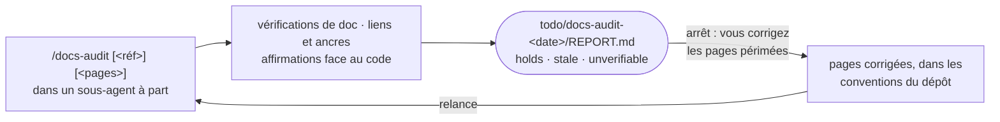

# Garder la documentation fidèle au code

*[English](../../workflows/keep-docs-true.md) · Français*

Cette page s'adresse à qui garde la documentation d'un dépôt — Orkeon, ou un autre — fidèle à son code.
Cela se passe dans la **copie de travail git** du dépôt, jamais dans un atelier : montez la copie de
travail là où irait un atelier et prenez le profil `docs` — `-e HARNESS_PROFILE=docs` au premier
démarrage du conteneur, ou `/workshop-profile docs` plus tard. Le profil contient les packs `core`,
`source` et `docs-audit` ; le profil `release` contient aussi `docs-audit`, de sorte que la personne qui
publie dispose du même skill. Dans la copie de travail d'Orkeon, le pack de dépôt `repo-orkeon` lui donne
les vérifications de documentation propres au dépôt. À la fin, vous avez un rapport sous
`todo/docs-audit-<date>/`, et des pages que vous avez corrigées vous-même.



L'audit lit et exécute des vérifications ; il ne modifie ni page, ni fichier source, ni test. Le rapport
est le livrable, et la correction vous revient.

## Avant de commencer

- **L'espace** : la copie de travail, montée sur `/workspace`, avec le profil `docs` ou `release`
  ([Dans une copie de travail](../reference/harness.md#dans-une-copie-de-travail),
  [Choisir un profil](../reference/harness.md#choisir-un-profil)).
- **Une référence** : un tag dans la copie de travail, ou un tag ou un commit que vous nommez dans les
  arguments ; les pages auditées sont celles modifiées depuis.
- **Les vérifications de documentation du dépôt** : pour Orkeon, `scripts/check-docs-parity.sh`,
  `scripts/check-doc-claims.py` et la construction docfx avec les avertissements en erreurs, qui demande
  un build Release avant elle. Un outil absent rend sa vérification `not run: <tool> missing`, pas un
  échec. Dans un dépôt sans pack, les vérifications sont `not run`, et le rapport le dit : le sous-agent
  à part ne peut pas vous les demander.

## `/docs-audit [<tag ou commit>] [<page ou dossier> ...]`

```text
/docs-audit                        # les fichiers Markdown modifiés depuis le dernier tag
/docs-audit v1.0.0-rc.4            # depuis ce tag ou ce commit
/docs-audit docs/guides            # ces pages ou dossiers, quoi qu'il ait changé
```

Claude exécute le skill dans un **sous-agent à part** (fork) : le bruit des vérifications y reste et votre
conversation reçoit un court résumé. Il ne peut rien vous demander : ce qui manque est signalé, pas
réclamé. La référence est l'argument qui nomme un tag ou un commit, sinon le dernier tag ; les pages sont
les chemins que vous donnez, sinon les fichiers Markdown modifiés depuis la référence, 15 au plus —
au-delà, les 15 plus modifiés, le reste listé comme `not audited`. Puis, dans l'ordre :

1. **Les vérifications de documentation du dépôt**, lancées depuis sa racine, leur sortie sous
   `todo/docs-audit-<date>/logs/` : code de sortie et au plus 10 lignes d'échecs chacune.
2. **Les liens et les ancres** des pages, avec `check-links.py` : chaque lien relatif ou ancre cassé est
   un constat avec son fichier et sa ligne.
3. **Les affirmations face au code** : pour chaque page, au plus 12 affirmations que le code peut
   trancher — une commande ou une option, une valeur par défaut, une clé de réglage, un chemin, un type,
   un nombre, un comportement — chacune retrouvée dans le code et dotée d'un verdict avec sa preuve en
   `chemin:ligne`.

| Verdict | Sens |
|---|---|
| `holds` | le code dit la même chose |
| `stale` | le code dit autre chose : la page et le code sont cités tous deux |
| `unverifiable` | aucun code ne le tranche, ou cela dépend d'une exécution que le sous-agent ne peut pas faire |

Une recherche qui ne trouve rien ne prouve pas `stale` : c'est `unverifiable` tant que le code qui devrait
porter l'affirmation n'est pas trouvé et ne dit pas autre chose. La formulation, les opinions, les projets
et ce que fait un tiers ne sont pas vérifiés. Une page traduite est auditée sur sa page source ; ses
propres affirmations ne sont vérifiées que là où elles diffèrent. Quand le pack `dev` est déployé aussi,
l'audit lit la charte de `adversarial-reviewer` et adopte sa posture : trouver ce qui est faux, une preuve
pour chaque verdict.

Claude écrit `todo/docs-audit-<date>/REPORT.md` — vérifications de documentation, liens et ancres, le
tableau des affirmations, un paragraphe par affirmation périmée avec la correction que son responsable
peut faire, ce qui n'a pas été audité — et revient dans la conversation en 15 lignes au plus : référence
et pages, les vérifications et leurs codes de sortie, les liens cassés, le nombre d'affirmations par
verdict, les périmées en une ligne chacune, le chemin du rapport.

## Arrêt : vous corrigez les pages

L'audit ne corrige rien. Lisez la section `Stale claims` du rapport, corrigez chaque page dans les
conventions du dépôt — pour Orkeon, une modification d'une page anglaise est reportée sur son miroir
français, et `scripts/check-docs-parity.sh` dit quand elle ne l'est pas — puis relancez l'audit sur les
mêmes pages jusqu'à ce que plus rien ne soit `stale`. Commitez et poussez comme d'habitude : le harnais ne
fait aucun commit dans une copie de travail.

## Ce qu'il y a sur le disque ensuite

```text
todo/
└── docs-audit-<date>/
    ├── REPORT.md                # vérifications de doc, liens et ancres, affirmations, périmées, non auditées
    └── logs/                    # la sortie de chaque vérification de documentation
```

`todo/` est inscrit dans `.git/info/exclude` : le rapport n'atteint jamais git. Vos corrections des pages
sont des modifications ordinaires du dépôt.

## Où cette pièce se raccorde

- **Avant** : une fonctionnalité livrée par la chaîne de développement a modifié des pages — auditez-les
  ([Développer une fonctionnalité](./develop.md)).
- **Après** : `/release-prepare` cite le dernier audit avant qu'une version soit étiquetée
  ([Publier une version](./release.md)).
- **Depuis un utilisateur** : une page périmée rencontrée par un utilisateur dans un atelier peut devenir
  un ticket de type `docs` ([Contribuer](./contribute.md)).
- **Pour les pages de ce projet** : le mainteneur d'Orkeon Workshop entretient sa documentation bilingue
  avec `/ws-docs` ([Faire vivre Orkeon Workshop lui-même](./maintain-the-workshop.md)) ; la carte de
  toutes les pièces est la [Vue d'ensemble](./overview.md).

Suite : [Faire vivre Orkeon Workshop lui-même](./maintain-the-workshop.md).
