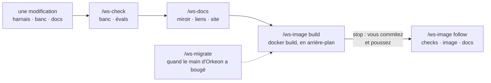

# Faire vivre Orkeon Workshop lui-même : vérifications, docs, image, migration

*[English](../../workflows/maintain-the-workshop.md) · Français*

Cette page s'adresse à qui modifie Orkeon Workshop lui-même — un hook, un skill, une règle, le banc, une
page de cette documentation — et veut la modification vérifiée comme le `CLAUDE.md` du projet le demande :
le banc et les évals du harnais au vert, le miroir français à jour, le site construit, l'image reconstruite
sur le dernier `main` d'Orkeon. Cela se passe dans une **copie de travail git du dépôt `orkeon-workshop`**,
montée là où serait un atelier ([Dans une copie de travail git](../../../README.fr.md#dans-une-copie-de-travail-git-dorkeon)),
avec un profil fait pour une copie de travail : `dev`, `docs`, `release`, `contrib` ou `all` —
`/workshop-profile dev` dans Claude Code, ou `-e HARNESS_PROFILE=dev` au premier démarrage d'un conteneur.
Quand l'`origin` de la copie de travail est `github.com/Orkeon/orkeon-workshop`, le pack de dépôt
`repo-orkeon-workshop` rejoint le profil de lui-même : quatre skills, `/ws-check`, `/ws-docs`, `/ws-image`
et `/ws-migrate`, et trois règles pour le banc, les docs et les hooks. Les quatre skills lisent et
rendent compte ; ils ne modifient rien. À la fin, la copie de travail contient votre modification,
vérifiée, et les traces que vous avez écrites dans le plan ; votre démon Docker contient une image
`orkeon-workshop` fraîche.



Claude lance les vérifications et la construction ; commit, push et tag vous restent, et Claude vous
remet les commandes exactes (D47). Les règles du travail sont le [`CLAUDE.md`](../../../CLAUDE.md) du
dépôt ; les valeurs que lisent les skills — commandes, vérifications manuelles, l'épingle Orkeon, le
miroir des docs — sont dans le `repo.yaml` du pack, déployé en
`.claude/harness/packs/repo-orkeon-workshop/references/repo.yaml`.

## Avant de commencer

- **La copie de travail et le profil.** Le dépôt `orkeon-workshop` monté en `/workspace`, avec `dev`,
  `docs`, `release`, `contrib` ou `all` ; après `/workshop-profile`, redémarrez Claude Code comme il le
  demande (`/exit`, puis `claude`). `/workshop-profile --show` liste les packs actifs :
  `repo-orkeon-workshop` doit en faire partie ([Choisir un profil](../reference/harness.md#choisir-un-profil)).
- **Pour `/ws-check bench`** : `npm ci` fait dans `.devcontainer/bench`.
- **Pour `/ws-check evals`** : `orkeon`, `orkeon-bench` (`bench/bin`, sur un `dist/` à jour),
  `orkeon-studio-check`, `rtk` et PyYAML sur le PATH. En mode strict, un outil manquant fait échouer ses
  cas. Un `orkeon` qui n'est pas à la version de référence laisse de côté une comparaison, celle du
  catalogue d'outils avec `orkeon run --list-tools`.
- **Pour `/ws-check ci` et `/ws-image build`** : Docker, accessible depuis le conteneur
  ([Socket de l'hôte](../guides/docker-modes.md#socket-de-lhôte)). Sans lui, `/ws-image` dit que l'image ne
  peut pas être construite ici et s'arrête.
- **Pour `/ws-check templates`** : un flux de paquets Orkeon construit depuis le commit de référence avec
  `.devcontainer/csharp/scripts/build-orkeon-packages.sh`.
- **Pour `/ws-docs`** : `dotnet`, pour que docfx puisse être installé ; `mmdc` sur le PATH pour les
  diagrammes Mermaid, sinon ils sont déclarés non vérifiés.
- **Pour `/ws-image follow`** : `gh`, qui liste et suit les exécutions des workflows.
- **Pour `/ws-migrate`** : github.com joignable, pour résoudre le `main` d'Orkeon et le cloner.

## 1. `/ws-check [bench | evals | ci | templates | all]` — les vérifications du dépôt

Vous le tapez dans la copie de travail, avec les vérifications voulues ; sans rien, `bench` puis `evals`.
Claude :

- confie chaque vérification à son propre sous-agent, l'une après l'autre, jamais ensemble : les évals ne
  doivent pas tourner pendant que le banc reconstruit `dist/`. Chaque sous-agent rapporte la commande, son
  code de sortie, la ligne de résumé et chaque échec par son nom avec ses premières lignes ;
- `bench` lance le lint (types et règles de dépendance), puis les tests, qui reconstruisent `dist/`
  d'abord ;
- `evals` lance les évals du harnais en mode strict : un cas qui ne peut pas tourner échoue au lieu d'être
  sauté ;
- `ci` rejoue les étapes de `.github/workflows/checks.yml` dans un conteneur `node:24-bookworm` démarré
  sur `tail -f /dev/null` — un conteneur sans `orkeon` ni `rtk`, dont le premier processus ne récolte
  rien : un test qui passe dans l'image peut y échouer ;
- `templates` lance la vérification des gabarits .NET contre votre flux, hors ligne, avec le test de
  fumée.

Il n'écrit aucun fichier et ne corrige rien. Le compte rendu est un tableau — vérification, commande,
résultat : `green`, `N failed`, ou `not run` avec la raison quand un prérequis manque — puis les échecs
par leur nom. Une vérification dont le prérequis manque n'est jamais dite au vert. Un échec n'est dit
préexistant que si le même cas a été vu au rouge sur le commit de base dans cette session.

## 2. `/ws-docs [<base commit>]` — le miroir français, les liens, le site

Vous le tapez après une modification de `README.md`, de `docs/` ou des pages françaises ; la base est le
commit de comparaison, par défaut la base de fusion avec `main`. Claude :

- vérifie que chaque page sous `docs/` a sa page sous `docs/fr/` et `README.md` son `README.fr.md`, hors
  les deux fichiers en anglais seul, le plan et `docs/profiles-design.md` ; liste chaque page anglaise
  modifiée depuis la base dont la page française n'a pas changé ; vérifie qu'une page ajoutée, déplacée ou
  supprimée l'est dans les deux `toc.yml` et les deux index ;
- dans un sous-agent, vérifie chaque lien relatif et chaque ancre de chaque fichier Markdown suivi, dossiers
  cachés compris, contre les slugs de titres de GitHub, et rend les diagrammes Mermaid des pages modifiées
  quand `mmdc` est sur le PATH ;
- dans un sous-agent, construit le site : docfx est installé une fois à la version que nomme le workflow
  `docs.yml`, dans un dossier de cache hors de la copie de travail, puis `scripts/build-docs-site.sh`
  tourne. La construction échoue sur un lien cassé, une ancre cassée ou une entrée de `toc.yml` sans sa
  page. Sans `dotnet`, elle n'est pas lancée.

Il ne traduit rien et ne corrige rien, sauf si vous le demandez. Le compte rendu est un tableau —
vérification, résultat, constats — puis chaque constat en `fichier:ligne`.

## 3. `/ws-image build` — l'image sur le commit épinglé

Vous le tapez une fois les vérifications au vert ; `build` est la valeur par défaut. Claude :

- résout le dernier commit du `main` d'Orkeon et le compare à `ORKEON_COMMIT` dans
  `.github/workflows/image.yml`. Quand l'épingle est en retard, il le dit — une construction sur l'épingle
  ne valide pas la modification — et propose `/ws-migrate` ; il ne construit sur l'épingle que si vous le
  demandez ;
- sans Docker, dit que l'image ne peut pas être construite ici, propose `/ws-check` à la place, et
  s'arrête ;
- lance le `docker build` du `CLAUDE.md` dans un sous-agent, en arrière-plan : la construction est longue
  et son journal plus long encore. Le sous-agent rapporte le code de sortie, la durée, l'identifiant de
  l'image et, en cas d'échec, l'étape fautive avec ses premières lignes d'erreur.

Le vert veut dire plus qu'une image compilée : la construction elle-même lance l'autovérification des
gabarits, les tests du banc et les évals du harnais en mode strict, et un seul cas au rouge la fait
échouer. Le compte rendu dit ce qui a été construit, sur quel commit d'Orkeon, et dit clairement quand
l'image n'a pas été construite ou l'a été sur un autre commit que le dernier `main`.

## 4. Commit et push — remis à l'utilisateur

Claude n'écrit rien dans git. Une fois les vérifications et la construction au vert, il vous remet le
`git commit` et le `git push` de votre branche, et le `git tag` quand il y en a un ; vous les tapez dans
un terminal du conteneur, ou dans Claude Code avec `!` devant. Un push lance jusqu'à trois workflows,
selon leurs filtres de chemins : `checks` quand le push touche `harness/` ou `bench/`, `image` quand il
touche `.devcontainer/` (son `README.md` excepté) ou le workflow lui-même, `docs` pour le site. Un push de
`docs/` ou des README racine seuls ne construit aucune image : c'est à cela que servait l'étape 3.

## 5. `/ws-image follow` — les workflows après votre push

Vous le tapez une fois poussé. Claude lance `gh run list` pour votre commit, puis pour chacun de `checks`,
`image` et `docs` que le push a démarrés, `gh run watch <id>` jusqu'au bout, et
`gh run view <id> --log-failed` quand l'un est au rouge. Une image verte ne dit pas que `checks` est vert :
`checks` tourne dans un conteneur nu qui n'a ni `orkeon` ni `rtk`. Le compte rendu donne, par workflow,
l'identifiant de l'exécution et sa conclusion.

## 6. `/ws-migrate [<commit>]` — quand le `main` d'Orkeon a bougé

Vous le tapez quand `/ws-image` a trouvé l'épingle en retard, ou au début de toute modification, comme le
`CLAUDE.md` le demande ; avec un commit, c'est ce commit qui est essayé à la place de `main`. Claude :

- résout le `main` d'Orkeon et lit `ORKEON_COMMIT`. Même commit : il dit que l'épingle est le dernier
  `main` et s'arrête ;
- dans un sous-agent travaillant dans un clone d'Orkeon — une copie de travail existante, ou un clone sans
  blobs dans son brouillon — lit le journal amont, le résumé du diff et les nouvelles entrées du
  `CHANGELOG.md`, dit lesquelles touchent ce sur quoi l'atelier s'appuie (options de la CLI, catalogue
  d'outils, paquets, clés de configuration, DSL YAML et TypeScript), et calcule la nouvelle version,
  `<version Orkeon>.src.<date du commit>.g<commit, 7 caractères>`, comme le fait `orkeon-update.sh --source` ;
- liste les fichiers à mettre au pas dans un tableau — fichier, ce qui change, de, vers — à partir de la
  liste de fichiers de l'épingle dans `repo.yaml` et d'un `git grep` de l'ancien hash court ; laisse de
  côté ce qui enregistre l'histoire (une exécution faite sur une construction antérieure, « depuis
  `<commit>` », le commit qui a livré un changement amont) ; marque chaque affirmation sur Orkeon à vérifier
  sur le nouveau commit avant qu'elle ne bouge ; termine par l'entrée de `VERIFICATIONS.md` et la ligne du
  § 11.1 du plan dont la migration aura besoin.

Puis il s'arrête et vous remet le tableau. Les modifications, la reconstruction avec `/ws-image` et les
vérifications avec `/ws-check` démarrent quand vous le dites.

## Ce qu'il y a sur le disque ensuite

Les quatre skills n'écrivent aucun fichier : ils rendent compte dans la conversation. Ce que le workflow
touche :

```text
<copie de travail>/
├── .claude/                               le harnais du profil, listé dans .git/info/exclude
│   ├── harness/packs/repo-orkeon-workshop/references/repo.yaml   les valeurs que lisent les skills ws-*
│   └── local/profile                      le profil actif, une ligne
├── .github/workflows/image.yml            ORKEON_COMMIT, l'épingle que /ws-migrate compare
├── .devcontainer/harness/VERIFICATIONS.md une entrée V-nn par migration, écrite par vous
├── docs/orkeon-workshop-plan.md           § 11.1 l'avancement, § 13 les décisions : la trace
└── todo/                                  les artefacts des autres packs du profil
```

Hors de la copie de travail : l'image `orkeon-workshop` dans votre démon Docker, et docfx dans un dossier
de cache de votre répertoire personnel, installé une fois.

## Où cette pièce se raccorde

- **Avant** : la modification vient d'une chaîne de développement menée dans cette copie de travail, ou
  d'une règle que `/dev-learn` a proposée après que les audits ont retrouvé le même écart
  ([Développer](./develop.md)) ; ou d'un correctif de skill après un échec signalé depuis un atelier
  ([Contribuer](./contribute.md)).
- **À côté** : `/ws-docs` vérifie la forme de la documentation — miroir, liens, site ; ce que les pages
  affirment face au code, c'est `/docs-audit` ([Garder les docs vraies](./keep-docs-true.md)).
- **Après** : `/contrib-pr` prépare la pull request vers ce projet ([Contribuer](./contribute.md)) ; un tag
  `vX.Y.Z` publie une image versionnée : le pack de ce projet donne à `/release-verify` ses trois
  canaux — l'image sur ghcr, les jobs de sa construction, le site ([Publier](./release.md)).
- **La trace** : une décision va au § 13 du [plan](../../orkeon-workshop-plan.md), l'avancement à son
  § 11.1 ; les faits sur Orkeon vérifiés sur le nouveau commit vont dans `VERIFICATIONS.md`.
- **Toutes les pièces** : [les workflows](./overview.md).

Suite : [Mesurer ce que coûte une session](./measure.md).
