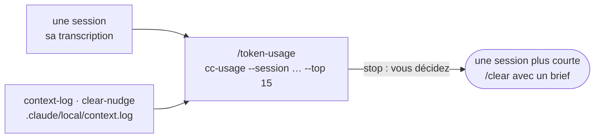

# Mesurer ce que coûte une session

*[English](../../workflows/measure.md) · Français*

Cette page s'adresse à qui veut savoir ce qu'une session Claude Code a coûté et ce qui a rempli son
contexte : une longue session de construction d'équipe qui a semblé chère, un lot de développement à
comparer au précédent, une semaine de travail dans un projet. Elle vaut dans un **atelier** comme dans
une **copie de travail git**. C'est le pack `usage` qui la donne, et les profils `contrib`, `dev` et `all`
portent ce pack ; tout autre profil le prend par un profil personnalisé — `/workshop-profile
custom:workshop,usage` dans un atelier garde le harnais de l'atelier et ajoute la mesure. Le pack apporte un
skill, `/token-usage`, au-dessus de la commande `cc-usage` de l'image, et allume deux hooks, `context-log`
et `clear-nudge`. À la fin, rien de neuf n'est écrit hormis deux petits fichiers sous `.claude/local/` :
les chiffres se lisent dans la conversation.



## Avant de commencer

- **Le profil** : `contrib`, `dev`, `all`, ou une liste `custom:` qui contient `usage`
  ([Profils et packs](../reference/harness.md#profils-et-packs)). Les deux hooks sont éteints tant que le
  pack n'est pas actif : c'est lui qui met `HARNESS_CONTEXT_LOG` et `HARNESS_CLEAR_NUDGE` à `1`
  ([Interrupteurs](../reference/harness.md#interrupteurs)).
- **`cc-usage`**, sur le PATH dans l'image ; ailleurs, les mêmes arguments vont à
  `python3 /usr/local/share/cc-usage/cc-usage.py`. Sans l'un ni l'autre, le skill le dit en une ligne et
  s'arrête.
- **Les transcriptions** : `cc-usage` les lit sous `$CLAUDE_CONFIG_DIR/projects`, sinon sous
  `~/.claude/projects` — le dossier que le `docker run` de l'installation monte en volume, pour qu'elles
  survivent au conteneur.
- **Les prix** : une liste de prix quotidienne récupérée chez LiteLLM, en cache 24 h dans
  `~/.cache/cc-usage/`. Rien d'autre ne quitte la machine. Hors ligne, `--no-fetch` utilise le dernier
  cache ; sans cache, le coût est 0 et l'exécution le dit.

## 1. `/token-usage [<id ou chemin de session> | <jours>]` — une session, ou une période

Vous le tapez dans Claude Code, avec un identifiant de session ou un chemin de transcription pour une
session, ou un nombre de jours pour une période ; Claude peut aussi s'en servir de lui-même quand vous
demandez ce qu'une session a coûté. Claude lance la commande `cc-usage` que la question appelle et lit sa
sortie :

| Question | Commande |
|---|---|
| cette session, ou une session : ce qui a rempli son contexte | `cc-usage --session <début d'id ou chemin> --top 15` |
| la même, pour un script (les jetons `(startup)`) | `cc-usage --session <id> --json` |
| ce qu'ont coûté un projet, une semaine, un mois | `cc-usage --days 30 --top 12` (`--since AAAA-MM-JJ`, `--project <texte>`, `--models`, `--daily`) |
| une habitude : `Read` coûte-t-il cher, que coûtent les sous-agents | `cc-usage --days 30 --tools` (lit toutes les transcriptions : la lente) |
| quelles sessions ouvrir d'abord | `cc-usage --days 7 --triage` |
| une note de A à F par session | `cc-usage --days 30 --audit` |
| ce que les sessions ont laissé dans git | `cc-usage --days 30 --yield` |

La session courante est la transcription la plus récente du projet. Le compte rendu tient en quelques
lignes ou un court tableau : le coût et la part qui est exacte — « N sessions sur M mesurées par le
compteur de Claude Code », le reste reconstruit depuis la transcription et donc un plancher —, les deux ou
trois lignes qui pèsent le plus, et une action au plus par constat, aucune quand rien n'était évitable.
Les lignes sans nom d'outil sont celles à lire d'abord : `(startup)`, c'est l'invite système, la chaîne
des `CLAUDE.md`, les règles et les définitions d'outils et de skills, portées par chaque tour ;
`(replayed output)`, ce sont les réponses de Claude lui-même renvoyées en entrée à chaque tour suivant,
souvent la plus grosse ligne d'une longue session ; `(compaction)`, ce qu'un `/compact` a reconstruit ;
`(subagents)`, les contextes propres des sous-agents, qui sur une session à éventail peuvent peser plus
que la chaîne principale.

Vous pouvez aussi taper les mêmes commandes vous-même, dans un terminal du conteneur ou dans Claude Code
avec `!` devant :

```bash
cc-usage --days 7 --triage
```

`--dashboard` et `--serve` ne sont pas utilisables dans l'image : `claude-usage-dashboard`, lancé avec le
conteneur, sert la vue agrégée par jour, modèle et projet
([Où trouver quoi dans le conteneur](../reference/configuration.md#où-trouver-quoi-dans-le-conteneur)).

## 2. Les deux hooks — le journal des fichiers d'instructions, et le rappel

- **`context-log`** ajoute une ligne à `.claude/local/context.log` chaque fois qu'un fichier d'instructions
  entre dans le contexte : au début d'une session et à chaque chargement différé — le `CLAUDE.md` d'un
  sous-dossier, une règle dont le `paths:` a correspondu, le rechargement après une compaction. Une ligne
  tient l'heure, la raison, le type, les octets et les jetons estimés d'après eux, le chemin, la session et
  l'agent. Pour une question sur le coût de démarrage, `/token-usage` additionne les lignes de la session et
  les met en regard des jetons `(startup)` : le reste, c'est l'invite système et les définitions d'outils
  et de skills. Le journal garde au plus 256 Kio.
- **`clear-nudge`** lit, avant chacune de vos invites, la taille de la requête que le tour suivant
  rejouera. Chaque fois que cette taille franchit un palier de 150 000 jetons, une fois par palier et par
  session, il ajoute une ligne au contexte de Claude, qui lui demande de dire en fin de réponse, si la tâche
  est terminée, qu'un `/clear` avec un court brief de l'état des choses coûte moins que de continuer. Si le
  travail continue, il continue : ce n'est qu'un nombre. Les paliers déjà dits sont gardés dans
  `.claude/local/clear-nudge.tsv`.

## 3. Lire les chiffres

Les coûts sont au tarif public de l'API : une comparaison entre sessions, pas une facture. Au-delà de 200k
jetons d'invite, l'API peut facturer un tarif majoré, appliqué là où LiteLLM en publie un, sinon compté et
signalé. Une entrée de cache vit cinq minutes : après une pause plus longue, le tour suivant réécrit tout
le préfixe, et l'exécution signale ces tours et leur coût évitable. `--audit` note ce qu'une session
aurait pu éviter en part de ce qu'elle a coûté, jamais selon sa taille ; une longue session qui n'a rien
gaspillé a un A, et une session de lecture ou de planification sans commit n'est pas du gaspillage. Les
jours suivent le fuseau horaire de la machine.

## Ce qu'il y a sur le disque ensuite

```text
<atelier ou copie de travail>/
└── .claude/local/
    ├── context.log          une ligne par fichier d'instructions chargé, 256 Kio au plus
    └── clear-nudge.tsv      les paliers déjà dits, par session (les 32 plus récentes)
~/.cache/cc-usage/           la liste de prix, en cache 24 h
```

## Où cette pièce se raccorde

- **La chaîne de développement** mène un lot par session et demande un `/clear` entre les lots
  ([Développer](./develop.md)) : la ligne `(replayed output)` en est la raison — elle grossit avec la
  longueur de la session, et seul `/clear` la fait tomber.
- **Tout workflow de ce groupe** est une session : la même lecture vaut pour une contribution, une
  publication ou un audit des docs ([les workflows](./overview.md)).
- **La vue agrégée**, par jour, modèle et projet, c'est `claude-usage-dashboard`, déjà lancé dans le
  conteneur ([Où trouver quoi dans le conteneur](../reference/configuration.md#où-trouver-quoi-dans-le-conteneur)).

Suite : [Le harnais](../reference/harness.md).
