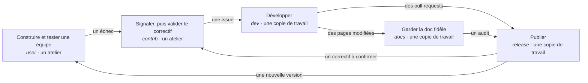

# Les workflows : qui fait quoi, et comment les pièces s'assemblent

*[English](../../workflows/overview.md) · Français*

Le harnais est un ensemble de workflows. Chacun est une pièce d'un puzzle : il a une personne, un
lieu — un atelier, ou la copie de travail git d'un dépôt — un **profil** qui déploie ses skills,
quelques commandes à taper, les fichiers qu'il laisse sur le disque, et les points où vous décidez.
Chaque pièce tient debout seule : vous pouvez en utiliser une sans jamais rencontrer les autres.
Assemblées, elles sont la façon dont le projet Orkeon vit, et dont des équipes d'agents se
construisent :

> Une équipe construite dans un atelier rencontre un échec. L'échec devient une reproduction et une
> issue. Un développeur transforme l'issue en spécification, en plan et en lots testés. Une version
> publiée emporte le correctif, avec ses preuves. La personne qui l'a signalé le confirme sur la version
> publiée. La documentation est auditée face au code qu'elle décrit. Et le harnais qui a conduit tout
> cela est lui-même vérifié, construit et tenu au pas d'Orkeon.

Cette page montre les pièces et leurs points de jonction. Chaque pièce a sa propre page.

## Les pièces

| Pièce | Qui | Où | Profil | Vous tapez | Ce qu'elle laisse sur le disque | Page |
|---|---|---|---|---|---|---|
| **Construire et tester une équipe** | un utilisateur d'Orkeon | un atelier | `user` | `/team-init`, `/team-need`, `/team-test-plan`, `/team-design`, `/team-tests`, `/team-approve …` | `teams/<slug>/`, `workbooks/<slug>/`, `tests/<slug>/` | [Comment se construit une équipe](../concepts/process.md) |
| **Signaler un échec, valider un correctif** | un contributeur extérieur | un atelier | `contrib` | `/contrib-issue`, `/contrib-validate` | `contrib/<slug>/` | [Contribuer](./contribute.md) |
| **Ouvrir une pull request** | un contributeur | une copie de travail | `contrib` | `/contrib-pr` | `todo/pr-<slug>/` | [Contribuer](./contribute.md) |
| **Développer une fonctionnalité** | un développeur du cœur | une copie de travail | `dev` | `/dev-spec`, `/dev-plan`, `/dev-implement`, `/dev-verify` | `todo/<code>/`, `.claude/agent-memory/` | [Développer](./develop.md) |
| **Publier une version** | la personne qui publie | une copie de travail | `release` | `/quality-report`, `/release-prepare`, `/release-evidence`, `/release-verify` | `todo/quality-<date>/`, `todo/release-<version>/` | [Publier](./release.md) |
| **Garder la documentation fidèle** | qui tient la documentation | une copie de travail | `docs` (aussi dans `release`) | `/docs-audit` | `todo/docs-audit-<date>/` | [Garder la documentation fidèle](./keep-docs-true.md) |
| **Faire vivre Orkeon Workshop lui-même** | un mainteneur de ce projet | une copie de travail de ce dépôt | `dev`, `docs` ou `all` | `/ws-check`, `/ws-docs`, `/ws-image`, `/ws-migrate` | des rapports dans la conversation ; le plan tient le registre | [Faire vivre l'atelier](./maintain-the-workshop.md) |
| **Mesurer ce que coûte une session** | n'importe qui | les deux | `contrib`, `dev`, `all`, ou `custom:…,usage` | `/token-usage` | `.claude/local/context.log` | [Mesurer](./measure.md) |

Un profil se choisit une fois par dossier : `-e HARNESS_PROFILE=<profil>` au premier `docker run`, ou
`/workshop-profile <profil>` dans Claude Code à tout moment
([Choisir un profil](../reference/harness.md#choisir-un-profil)). Un profil fait pour une copie de
travail est refusé dans un atelier, et inversement ; `/workshop-profile --list` dit lesquels conviennent
au dossier. Dans une copie de travail, le harnais s'installe dans `.claude/`, listé dans
`.git/info/exclude`, et n'écrit rien que git suit
([Dans une copie de travail](../reference/harness.md#dans-une-copie-de-travail)).

## Un échec, de bout en bout

Les pièces s'enchaînent d'un rôle à l'autre. Voici le chemin que prend un échec quand toutes les pièces
servent — la plupart du temps seules certaines servent, et le reste se fait ailleurs, autrement.

1. **Dans un atelier**, vous construisez une équipe avec la méthode
   ([Comment se construit une équipe](../concepts/process.md)) et une exécution ne fait pas ce que la
   documentation d'Orkeon promet.
2. **Toujours dans l'atelier**, avec le profil `contrib`, `/contrib-issue <slug>` rejoue la plus petite
   équipe qui échoue, enregistre ce qui a été vu et rédige l'issue sur le gabarit d'Orkeon. Vous la
   déposez ([Contribuer](./contribute.md)).
3. **Dans une copie de travail d'Orkeon**, un développeur avec le profil `dev` prend l'issue comme brief
   de `/dev-spec`, vous validez la spécification, puis le plan, et chaque lot est implémenté tests
   d'abord puis audité ([Développer](./develop.md)). Claude committe et pousse chaque lot (D71) ;
   `/contrib-pr` vérifie la modification face à la liste de contrôle du dépôt lui-même et ouvre la pull
   request, après vous avoir demandé.
4. **Dans la même copie de travail**, `/docs-audit` confronte au code les pages que la fonctionnalité a
   modifiées ([Garder la documentation fidèle](./keep-docs-true.md)).
5. **Dans une copie de travail**, avec le profil `release`, `/quality-report` relève les chiffres,
   `/release-prepare` vérifie que la version est prête et rédige les notes, `/release-evidence`
   rassemble les preuves qu'elle s'installe, vous posez le tag, et `/release-verify` vérifie chaque
   canal où le dépôt publie ([Publier](./release.md)).
6. **De retour dans l'atelier**, `/contrib-validate main` construit le `main` d'Orkeon, qui porte désormais le
   correctif, et rejoue la reproduction enregistrée : corrigé, ou non. Et `orkeon-update` apporte la nouvelle version à chaque
   atelier ([Mettre à jour](../guides/updating.md#orkeon-et-ollama-dans-un-conteneur)).

La même chaîne, appliquée à ce projet plutôt qu'à Orkeon, est la façon dont le harnais lui-même est
maintenu : [Faire vivre l'atelier](./maintain-the-workshop.md).

## Ce que toutes les pièces partagent

- **Une trace sur le disque, datée.** Un cahier dans un atelier, `contrib/<slug>/` pour un signalement,
  `todo/<code>/` dans une copie de travail — tenus hors de git par le harnais — ou le dossier de travail
  que le dépôt nomme à sa place (`backstage/tasks/` pour Orkeon, D69), que git voit. Rien d'important ne
  voyage par la seule conversation ; une pièce se reprend dans une nouvelle session, par quelqu'un
  d'autre.
- **Des arrêts là où une personne décide.** Vous validez un besoin, une spécification, un plan ; une
  pull request s'ouvre après vous avoir demandé, sauf si vous posez `HARNESS_PR_AUTO=1` (D71) ; et
  chaque commande qui pose un tag, dépose une issue, commente, publie ou paie vous est remise, avec
  l'endroit où la taper — Claude ne l'exécute pas (D47). Le commit et le push de ce qu'une étape a
  produit sont le geste de Claude, avec l'identité git que vous avez posée (D71) : quand le conteneur
  n'en a pas, il s'arrête et vous remet `workshop --git-identity` ou les deux lignes `git config`.
- **Les valeurs du dépôt lui-même.** Les commandes, listes de contrôle, gabarits et canaux qu'une pièce
  utilise viennent d'un pack de dépôt — celui d'Orkeon, ou celui de ce projet — lus plutôt que
  supposés. Dans un autre dépôt, le skill vous demande ce qui lui manque, une fois, et le nomme.
- **Les mêmes garde-fous partout.** Lectures bornées, secrets tenus hors des fichiers, travail bruyant
  délégué à des sous-agents, chaque garde-fou un hook avec ses évals ([Le harnais](../reference/harness.md)).
  Les skills qui lisent et rapportent (`/ws-*`, `/contrib-validate`, `/quality-report`, `/docs-audit`)
  tournent en entier dans un sous-agent en fork — pour les trois premiers, une charte de leur pack —, et la
  conversation ne reçoit que leur rapport.

## Par où commencer ?

- **Vous utilisez Orkeon et voulez une équipe** : [Installer](../getting-started/install.md), puis
  [Votre première équipe](../getting-started/first-team.md), puis la méthode,
  [Comment se construit une équipe](../concepts/process.md).
- **Quelque chose a échoué et vous voulez que ce soit corrigé** : [Contribuer](./contribute.md).
- **Vous développez Orkeon** : [Développer une fonctionnalité](./develop.md).
- **Vous le publiez** : [Publier une version](./release.md).
- **Vous tenez sa documentation** : [Garder la documentation fidèle au code](./keep-docs-true.md).
- **Vous maintenez ce projet** : [Faire vivre Orkeon Workshop lui-même](./maintain-the-workshop.md).
- **Vous voulez savoir ce qu'une session a coûté** : [Mesurer ce que coûte une session](./measure.md).

Suite : [Contribuer](./contribute.md).
