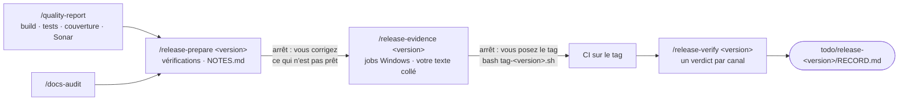

# Publier une version : qualité, préparation, preuves, tag, vérification

*[English](../../workflows/release.md) · Français*

Cette page s'adresse à la personne qui publie les versions d'un dépôt — Orkeon, ou un autre. Cela se
passe dans la **copie de travail git** du dépôt, jamais dans un atelier : montez la copie de travail là
où irait un atelier et prenez le profil `release` — `-e HARNESS_PROFILE=release` au premier démarrage du
conteneur, ou `/workshop-profile release` plus tard. Le profil contient les packs `core`, `source`,
`quality`, `release` et `docs-audit` ; dans la copie de travail d'Orkeon, le pack de dépôt `repo-orkeon`
le rejoint et donne aux skills les valeurs qu'ils lisent (fichier de version, forme du tag, changelog,
workflows, canaux). À la fin, vous avez un rapport de qualité et un audit de la documentation sous
`todo/`, l'enregistrement de la version et ses notes sous `todo/release-<version>/`, un tag que vous avez
poussé vous-même, et un verdict par canal de publication.



Claude vérifie, lit et consigne ; il ne modifie aucun fichier du dépôt et ne publie rien. Le tag est la
seule commande qui vous est remise (D47). Chaque artefact va sous `todo/`, que le harnais inscrit dans
`.git/info/exclude` : rien de ce workflow n'atteint git.

## Avant de commencer

- **L'espace** : la copie de travail, montée sur `/workspace`, avec le profil `release`
  ([Dans une copie de travail](../reference/harness.md#dans-une-copie-de-travail),
  [Choisir un profil](../reference/harness.md#choisir-un-profil)).
- **`gh`**, connecté à GitHub : les skills lisent les exécutions de la CI, les jobs et la release avec
  `gh run list`, `gh run view` et `gh release view`.
- **Sonar, facultatif** : `/quality-report` ne le lance que si `SONAR_HOST_URL` et `SONAR_TOKEN` sont
  définis dans l'environnement, si le dépôt déclare une commande Sonar, et si le serveur répond `UP`.
  Sinon Sonar est `not_run` avec la raison, jamais un échec. Le jeton ne vit que dans l'environnement :
  jamais affiché, jamais sur une ligne de commande, jamais dans un fichier
  ([SonarQube](../guides/docker-modes.md#sonarqube)).
- **Docker, seulement pour `--integration`** : les tests d'intégration d'Orkeon en ont besoin
  ([Socket de l'hôte](../guides/docker-modes.md#socket-de-lhôte)).
- **Les valeurs** : dans la copie de travail d'Orkeon, le pack `repo-orkeon` les fournit. Dans un autre
  dépôt, les skills de release vous demandent une fois chaque valeur manquante, en nommant sa clé ;
  `/quality-report`, qui tourne dans un sous-agent forké et ne peut pas demander, les prend en arguments
  à la place (étape 1).

| Valeur pour Orkeon | Où |
|---|---|
| fichier de version | `src/Directory.Build.props` (`VersionPrefix`, puis `-` et `VersionSuffix`) |
| tag | `v<version>` |
| changelog | `CHANGELOG.md`, sections `## [<version>] - AAAA-MM-JJ` |
| workflows | `release.yml`, `release-verify.yml`, `publish.yml` |
| jobs Windows | `smoke-windows`, `smoke-windows-service`, `msi` |
| commande de préparation | `python3 scripts/check-release-readiness.py` |
| canaux | `github-release`, `release-verify`, `apt`, `msi`, `archives`, `nuget`, `ghcr` |

## 1. `/quality-report` — les portes de qualité dans un rapport vérifié

```text
/quality-report [--integration] [--no-sonar] [--<step> "<command>" ...]
```

Le skill tourne dans un sous-agent forké, `quality-runner`, qui n'écrit que sous `todo/quality-<date>/`.
Claude lit les commandes du dépôt — build, tests, couverture, Sonar, et les tests d'intégration seulement
avec `--integration` — et les y exécute une à la fois, dans cet ordre, la sortie de chacune dans
`logs/<step>.log` ; les étapes suivantes réutilisent le build, et un build en échec les laisse `not_run`.
Une commande que le dépôt ne déclare pas rend son étape `not_run` avec la raison `no commands.<step>`, et
le rapport nomme la clé d'un pack de dépôt et l'argument qui la donne : `--<step> "<command>"`
(`--build`, `--test`, `--coverage`, `--sonar`, `--test_integration`) donne ou remplace une commande. Il
écrit d'abord
`REPORT.json`, puis `REPORT.md` à partir de lui, et vérifie l'arithmétique des deux avec
`quality-report-check.py` : une ligne `FAIL` est corrigée et la vérification relancée, une ligne `WARN`
devient un constat du rapport. Le rapport est un instantané des valeurs du jour : pas de tendance, pas
de comparaison avec une exécution antérieure. Une seconde exécution le même jour écrase le dossier, et
le dit. Sur le disque : `todo/quality-<date>/REPORT.json`, `REPORT.md` et `logs/`.

Claude s'arrête sur le tableau de synthèse — statut et durée de chaque étape, totaux des tests, couverture
des lignes et des branches, la porte Sonar ou la raison pour laquelle Sonar n'a pas tourné — et les deux
ou trois constats qui comptent le plus.

## 2. `/docs-audit` — le dernier audit des pages

`/release-prepare` cite le dernier `todo/docs-audit-*/REPORT.md`, et nomme `/docs-audit` quand il n'y en
a pas. Lancez-le avant la vérification de préparation, sur les pages modifiées depuis le tag précédent ;
corrigez ce qu'il trouve `stale` et relancez-le. La pièce entière a sa propre page :
[Garder la documentation fidèle au code](./keep-docs-true.md).

## 3. `/release-prepare <version>` — ce commit est-il prêt à devenir `<version>`

```text
/release-prepare <version>
```

Claude exécute les vérifications du tableau ci-dessous sur le commit courant et consigne un verdict pour
chacune — `ready`, `not ready`, `not checked`, ou `not applicable (no <key>)` quand le dépôt ne déclare
ni ce fichier ni cette commande. Il rédige ensuite `todo/release-<version>/NOTES.md` à partir de la
section de la version dans le changelog : un titre, les en-têtes `### ` de la section comme liste des
changements, ses changements incompatibles en entier, un lien vers la section sur la branche par défaut —
rien que la section ne dise pas. Sans changelog, les notes listent les sujets de `git log --oneline`
depuis le tag précédent, mot pour mot.

| Vérification | Prêt quand |
|---|---|
| fichier de version | la version qu'il déclare est égale à `<version>` |
| tag libre | ni `git tag -l` ni `git ls-remote --tags origin` ne connaissent `v<version>` |
| changelog | une section `## [<version>]` avec une date, et un `[Unreleased]` vide |
| préparation | la commande de préparation sort avec le code 0 |
| poussé | `git status --porcelain` est vide et la branche par défaut contient le commit |
| CI verte | chaque exécution de `gh run list --commit <commit>` est terminée, `success` ou `skipped` |
| qualité, docs | les derniers `todo/quality-*/REPORT.md` et `todo/docs-audit-*/REPORT.md`, leur date et leur verdict cités |

Claude ajoute une entrée `prepare` datée — commit, verdicts, chemin des notes — à
`todo/release-<version>/RECORD.md` et s'arrête. **Vous décidez.** Pas prêt : il liste ce qui manque, une
ligne par point, avec l'étape qui le corrige ; vous corrigez le dépôt, commitez et poussez vous-même, et
relancez le skill. Prêt : l'étape suivante est celle des preuves. Le skill ne modifie aucun fichier du
dépôt.

## 4. `/release-evidence <version> [<run id>]` — la preuve que ça s'installe, avant le tag

```text
/release-evidence <version> [<run id>]
```

Claude a besoin d'une entrée `prepare` dans l'enregistrement ; sans elle, il s'arrête et nomme
`/release-prepare`. Il prend l'exécution que vous donnez, sinon la dernière exécution du workflow de
release sur le commit de cette entrée. Pour Orkeon, `release.yml` a un déclencheur manuel qui ne publie
rien : Claude vous remet d'abord `gh workflow run release.yml --ref <branche>`, puis
`/release-evidence <version> <run id>` une fois l'exécution terminée. Un workflow de release sans un tel
déclencheur donne ses preuves après le tag.

De l'exécution, `gh run view <run id> --json jobs` donne à chaque job Windows sa conclusion, ses étapes et
son URL, et `gh run view <run id> --log --job <job id>` ses 40 dernières lignes de journal : chacun va
dans `evidence/ci-<job>.txt`, un job absent de l'exécution est `missing`. Claude vous demande ensuite
**une fois** ce que vous avez vu sur une machine Windows à vous — `orkeon --version` après l'installation
de la version candidate, la fin de l'installeur, `orkeon doctor` — ou rien ; chaque texte collé est
enregistré tel quel dans `evidence/pasted-<n>.txt`, clés masquées. Il ajoute une entrée `evidence` datée :
URL et événement de l'exécution, une ligne par job Windows, les fichiers collés.

Un job qui n'est pas `success`, ou une entrée `prepare` pas prête : Claude nomme ce qui manque, et aucune
ligne de tag n'est écrite. Sinon il écrit `.claude/local/scripts/tag-<version>.sh`, le vérifie avec
`bash -n`, vous le remet et ajoute une entrée `tag handed over`. Le script tient deux commandes, le tag
et son push, et peut être lancé deux fois sans dommage :

```bash
#!/bin/bash
set -euo pipefail
git rev-parse -q --verify "refs/tags/v<version>" >/dev/null || git tag v<version> <commit>
git push origin v<version>
```

**Arrêt : vous posez le tag.** À taper dans Claude Code avec `!` devant, ou dans un terminal du
conteneur, à la racine de la copie de travail :

```bash
bash .claude/local/scripts/tag-<version>.sh
```

Quand cela a marché, git affiche `* [new tag] v<version> -> v<version>` ; le tag lance les workflows de
release.

## 5. `/release-verify <version>` — ce qui a atteint les utilisateurs

```text
/release-verify <version>
```

Une fois les workflows de release exécutés sur le tag, Claude liste leurs exécutions avec
`gh run list --workflow <fichier> --branch v<version>` — pour Orkeon `release.yml`, `release-verify.yml`
et `publish.yml` — et s'arrête si l'une n'est pas terminée, en disant laquelle. Pour chaque exécution, il
lit la conclusion de chaque job ; un job en échec reçoit son nom, son URL et ses 30 dernières lignes de
journal dans `evidence/ci-<job>.txt`, et un job sauté sur un tag qui devrait le lancer est un constat,
pas une réussite.

Puis un verdict par canal que le dépôt liste — `published`, `missing`, `wrong` (présent, mais pas comme
annoncé) ou `not checked` avec la raison — en exécutant la vérification de chaque canal : la release
GitHub et ses fichiers face à `SHA256SUMS` et `SHA256SUMS.msi`, les jobs de vérification, apt (`rc` pour
chaque tag, `stable` aussi quand la version ne contient pas de `-`), les archives, les paquets NuGet.org,
l'image GHCR. Le MSI est le canal que le conteneur ne peut pas vérifier : Claude vous demande une fois de
coller une installation depuis le MSI publié, enregistrée dans `evidence/pasted-<n>.txt` ; sans texte
collé, `not checked`.

Claude ajoute une entrée `verify` datée — chaque exécution, chaque job en échec, une ligne par canal avec
sa preuve — et s'arrête. Quelque chose de `missing` ou de `wrong` : il le nomme avec la ligne qui le
relancerait, la reprise d'un job ou un lancement manuel du workflow de vérification, remise à vous. Il ne
publie, ne relance et ne supprime rien.

## Ce qu'il y a sur le disque ensuite

```text
todo/
├── quality-<date>/
│   ├── REPORT.json              # schéma quality-report/1
│   ├── REPORT.md
│   └── logs/
├── docs-audit-<date>/
│   ├── REPORT.md
│   └── logs/
└── release-<version>/
    ├── RECORD.md                # entrées prepare, evidence, tag handed over, verify — ajoutées, jamais réécrites
    ├── NOTES.md                 # le brouillon des notes de version
    ├── evidence/
    │   ├── ci-<job>.txt         # conclusion, étapes, dernières lignes de journal d'un job
    │   └── pasted-<n>.txt       # ce que vous avez collé, tel quel, clés masquées
    └── assets/                  # names.txt et les fichiers de sommes de contrôle de la release publiée
.claude/local/scripts/tag-<version>.sh
```

Rien de tout cela n'est suivi par git : `todo/` et `.claude/local/` sont inscrits dans
`.git/info/exclude`.

## Où cette pièce se raccorde

- **Avant** : la chaîne de développement a produit ce qui est publié — spécification, plan, lots, audits
  ([Développer une fonctionnalité](./develop.md)) ; l'audit de la documentation alimente la vérification
  de préparation ([Garder la documentation fidèle au code](./keep-docs-true.md)).
- **Après, pour un contributeur** : qui a signalé un échec confirme le correctif en construisant `main`,
  qui le porte, avec `/contrib-validate main` ([Contribuer](./contribute.md)) ; le skill prend un numéro
  de pull request ou `main`, pas une étiquette.
- **Après, pour un utilisateur d'atelier** : `orkeon-update` amène la version dans un atelier
  ([Orkeon et Ollama, dans un conteneur](../guides/updating.md#orkeon-et-ollama-dans-un-conteneur)).
- **La carte de toutes les pièces** : [Vue d'ensemble](./overview.md) ; les packs et leurs skills :
  [Les skills des packs](../reference/harness.md#les-skills-des-packs).

Suite : [Garder la documentation fidèle au code](./keep-docs-true.md).
