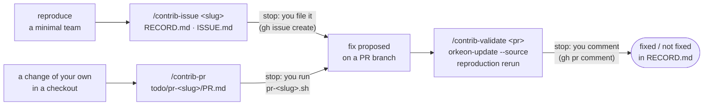

# Contribute: report a failure, validate a fix, open a pull request

*English · [Français](../fr/workflows/contribute.md)*

This page is for the outside contributor: something fails while you use Orkeon, and you want it
reported in a form a developer can act on, the fix checked on the very team that showed it, or a change
of your own made ready for review. The first two steps happen in a **workshop**, where the failing team
lives; the third in a **git checkout** of the repository. The profile `contrib` gives all three in either
space: `/workshop-profile contrib` in Claude Code, or `-e HARNESS_PROFILE=contrib` at the first start of
a container. In a workshop it keeps the `workshop` pack, so the reproduction is built with the workshop's
own skills; in a checkout there is no workshop pack and only `/contrib-pr` applies. Nothing is posted by
Claude: it writes the record, the issue, the comment and the body of the pull request under
`contrib/<slug>/` or `todo/pr-<slug>/` (`todo/` is the default work folder of a checkout; a repository
may name its own, D69), then hands you the command (D47), saying where it is typed.



## Before you start

- **The profile.** `/workshop-profile contrib`, then restart Claude Code as it asks (`/exit`, then
  `workshop`; `claude` in a checkout). `/workshop-profile --show` lists the packs deployed
  ([Choosing a profile](../reference/harness.md#choosing-a-profile)).
- **For `/contrib-issue` and `/contrib-validate`: a workshop** — a `teams/` folder and `orkeon` on the
  PATH. `/contrib-validate` also needs `orkeon-update` on the PATH: building a branch is what that command
  does ([Orkeon and Ollama, in a container](../guides/updating.md#orkeon-and-ollama-in-a-container)).
- **For `/contrib-pr`: the checkout** of the repository, mounted where a workshop would be
  ([In a git checkout of Orkeon](../../README.md#get-started)), the change already
  written, `origin` pointing to your fork when you contribute from one.
- **`gh`.** The skills read the issue template and the pull request with it, and every command they hand
  over is a `gh` command. Without it, `/contrib-issue` uses the offline shape of Orkeon's templates and says so.
- **The repository's values** (branch and commit shapes, checklist, pull request template, build and test
  commands) come from the `repo-orkeon` pack in a checkout of Orkeon; elsewhere `/contrib-pr` asks you
  once for each missing value and names the key that would have given it.

## 1. `/contrib-issue <slug> [bug|docs|feature]` — record the failure, draft the issue

You type it in the workshop, with a slug of a few lowercase words joined by hyphens, and the kind of
issue (`bug` by default). Claude:

- stops outside a workshop: the reproduction is a team of a workshop;
- expects a reproduction, a minimal team under `teams/` and one command. If none exists yet, it stops and
  proposes the smallest crew that fails, built with the workshop's skills; you come back once it fails.
  It builds nothing itself in this step;
- runs the command now and saves its output under `contrib/<slug>/evidence/`, keys redacted. A command
  that does not fail is not reported: the entry says `not reproduced`, and the skill stops;
- collects the environment by running commands, not by asking: `orkeon --version`, `orkeon-update
  --check` (the install channel), `uname -sr`, `dotnet --version`, the provider and model of `orkeon doctor`;
- appends a dated `reproduced` entry to `contrib/<slug>/RECORD.md`: version, channel, environment, steps,
  expected, actual, evidence paths. The expected behaviour is quoted from you or from the documentation
  page that promises it. A past entry is never rewritten;
- writes `contrib/<slug>/ISSUE.md` on the repository's issue template, read with `gh api`: a `Title:`
  line, then one section per input field, in the template's order. When the template is unreachable, the
  offline shape of Orkeon's `bug`, `docs` or `feature` template is used, and Claude says so. A dropdown
  takes one of its options word for word; a required field Claude cannot fill stays `TBD` and is named to you.

Then it stops, shows the path and the title of `ISSUE.md`, and hands over the command. You type it in
the terminal of the container, after `/exit`:

```bash
gh issue create --repo <owner>/<repo> --title "<title>" --body-file contrib/<slug>/ISSUE.md
```

No `--label`: labels need triage rights on the repository. Once the issue exists, record its URL with
`/contrib-issue <slug> filed <issue url>`: a dated `filed` entry joins the record, and the skill stops.

## 2. `/contrib-validate <pr number> [<slug>] | main [<slug>]` — try the fix on the reproduction

A pull request claims to fix what you recorded. You type the skill in the same workshop, with the number
of the pull request, or `main` once the fix is merged. The skill runs in a forked subagent,
`contrib-validator`, which writes under `contrib/<slug>/` only and cannot ask you anything. Without a
slug, Claude takes the only record without a `validated` entry; when several qualify it stops, lists them
and gives the relaunch, `/contrib-validate <n> <slug>`; with no record at all it stops and names
`/contrib-issue`. Then it:

- reads the pull request with `gh pr view`: title, state, head branch and commit, whether it comes from a
  fork. It **refuses**, records a dated `refused PR #<n>` entry with the reason, and stops when the pull
  request comes from a fork (`orkeon-update --source` fetches branches, tags and commits of
  `Orkeon/orkeon` only, and the branch lives in the fork), when it is closed, or when it is merged and its
  branch is gone — then it proposes `/contrib-validate main <slug>`. With `main` in place of a number,
  no pull request is read: the ref is `main`, its commit read from the repository;
- notes the version in place (`orkeon --version`, `orkeon-update --check`), so that you can go back, then
  builds the branch with `orkeon-update --source <branch>`, output to
  `contrib/<slug>/evidence/<YYYYMMDD-HHMM>-build.log`: a few minutes, refused while an `orkeon` process
  runs. A branch that does not build is recorded `inconclusive`, with the error lines. Then
  `orkeon-update --check` must report the head commit it read: when the branch moved in between, Claude
  says which commit was built;
- reruns the steps of the first `reproduced` entry, word for word, from the workshop root, and saves the
  output under `contrib/<slug>/evidence/`. The verdict is `fixed` (the expected behaviour of the record,
  observed), `not fixed` (the actual behaviour, again) or `inconclusive` (anything else, said in one
  line: another error, a model that did not answer);
- appends a dated `validated on PR #<n>` entry (`validated on main` with `main`): commit built, version,
  verdict, evidence path.

Then it stops. With a pull request, it writes `contrib/<slug>/PR-<n>-COMMENT.md` — what was built, the
steps, the result, the environment, at most the log lines that show the verdict — and hands over the
command, typed in the terminal of the container after `/exit`:

```bash
gh pr comment <n> --repo <owner>/<repo> --body-file contrib/<slug>/PR-<n>-COMMENT.md
```

With `main` there is no pull request to comment on. In both cases Claude says how to return to the
version it noted — `orkeon-update --source` for the build you had, or `orkeon-update --channel release`
— and runs it when you ask.

## 3. `/contrib-pr [<slug>]` — make a change of your own ready for review

The change is written in your checkout, Claude Code is open there on the `contrib` profile, and you type
the skill. Claude:

- stops outside a source space (the root of a git checkout, with no `teams/`): a pull request is prepared
  in the repository's checkout;
- reads the repository's values ([the table below](#the-checklist-for-orkeon) for Orkeon);
- finds the change against `origin/<default branch>`, untracked files included, and stops when there is
  none. On the default branch it stops too and hands you the line that moves the work to a branch,
  `git switch -c fix/<slug>`, run by you. The slug is the argument, or the branch name without its prefix;
- runs the build and the tests once, in a general-purpose subagent so that the output stays out of the
  conversation. The logs go to `todo/pr-<slug>/logs/build.log` and `test.log`; Claude gets back the exit
  code, the duration and at most twenty lines of each;
- walks the checklist, one verdict per line — `met`, `not met`, `not applicable`, or `to confirm` when
  only you can say — each with its evidence: a command and its result, a file and a line. The mechanical
  checks are run, not guessed. A line `not met` is not fixed here: Claude names it, you decide;
- writes `todo/pr-<slug>/PR.md` on the pull request template: what changes and why in two sentences, the
  issue it fixes when there is one, the checklist with `[x]` only on the `met` and `not applicable` lines,
  and the notes for the reviewer — what is `to confirm`, what is left out.

Then it stops, shows the verdicts as a table and the path of `PR.md`, and writes the four commands into
one script, `.claude/local/scripts/pr-<slug>.sh`, checked with `bash -n`: `git add` of the changed files,
`git commit` with a message in the repository's shape, `git push -u origin <branch>`, and `gh pr create`
with `PR.md` as body, skipped when the pull request already exists. `origin` is your fork when you
contribute from one. You run it from the root of the checkout, in Claude Code with `!` in front or in a
terminal of the container:

```bash
bash .claude/local/scripts/pr-<slug>.sh
```

When it worked, its last line is the URL of the pull request.

### The checklist, for Orkeon

The lines `/contrib-pr` walks in a checkout of Orkeon, as the `repo-orkeon` pack states them:

| Line | How it is checked |
|---|---|
| The branch is not `main` and follows `feature\|fix\|chore/<slug>` | the current branch against the shape |
| `dotnet build Orkeon.sln -warnaserror` is green; a new public API is declared in its project's `PublicAPI.Unshipped.txt` | the build run above; an RS0016/RS0017 error names the file to complete |
| A changed public signature also builds `examples/Orkeon.Examples.sln` with `-warnaserror` | the diff of the `PublicAPI.*.txt` files; the examples solution is built only when one changed |
| Tests added or updated for a behaviour change, and the fast suite passes | the tests run above, and the diff under `tests/` |
| Docs updated when behaviour or configuration changes, French mirror included | the repository's docs parity script; `not applicable` when neither docs nor behaviour changed |
| `CHANGELOG.md` has an entry under `[Unreleased]` for anything user-visible | the diff of `CHANGELOG.md`; `not applicable` for a change no user sees |
| New shell or shebang scripts carry the executable bit in the index | the mode of each added file that starts with `#!`; otherwise `git add --chmod=+x <file>` is handed over |
| No credential, token or key in the diff | `gitleaks` over the branch when it is installed; otherwise a read of the diff, and `to confirm` |
| No direct `System.IO` in framework code | covered by the build: the analyzer fails it |
| Comments are English and carry no accented letter | the repository's `check-comment-accents.py` |
| Commit messages follow `type(scope): summary`, in English | the message written into the script |
| First contribution: the CLA check asks for one sentence | `to confirm` |

## What is on disk afterwards

In the workshop after steps 1 and 2, then in the checkout after step 3 (all of it excluded from git):

```text
teams/<slug>/                       the minimal team that fails, built with the workshop's skills
contrib/<slug>/
├── RECORD.md                       dated entries, newest last: reproduced, filed, validated on PR #<n>, refused PR #<n>
├── ISSUE.md                        the issue, on the repository's template
├── PR-<n>-COMMENT.md               the comment for the pull request
└── evidence/
    ├── <YYYYMMDD-HHMM>-run.log     the reproduction, keys redacted
    ├── <YYYYMMDD-HHMM>-build.log   the build of the branch
    └── <YYYYMMDD-HHMM>-pr<n>.log   the rerun on the branch (-main.log with main)

todo/pr-<slug>/
├── PR.md                           the body of the pull request
└── logs/
    ├── build.log
    └── test.log
.claude/local/scripts/pr-<slug>.sh  add, commit, push, gh pr create
```

## Where this piece connects

- **Before: a team that fails.** The failure is met while [building a team](../concepts/process.md); the
  reproduction is the smallest crew that shows it, built with the same skills and
  [tested](../concepts/testing.md) the same way.
- **The fix is written by a developer**, with the dev chain of [Develop a feature](./develop.md), from
  the issue you filed. When the pull request is open on the repository, `/contrib-validate <pr number>`
  tries it on your reproduction.
- **Once merged**, `/contrib-validate main <slug>` builds `main`, confirms the fix there and closes the
  record with `validated on main`; the skill takes a pull request number or `main`, not the tag of the
  version that carries it ([Release a version](./release.md)).
- **A change of your own** goes through `/contrib-pr`; its pull request is then a proposed fix like any
  other: `/contrib-validate` tries it on a reproduction when its branch lives on the repository itself (a
  branch on a fork is refused), or on `main` once it is merged.
- **What a session cost**: the `contrib` profile carries the `usage` pack, so `/token-usage` answers
  ([Measure what a session costs](./measure.md)). All the pieces and how they chain: [Overview](./overview.md).

Next: [Develop a feature](./develop.md).
