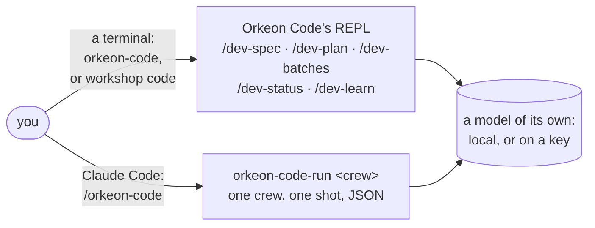

# Develop a feature: Orkeon Code's chain

*English · [Français](../fr/workflows/develop.md)*

This page is for the core developer of a repository: you have a feature to build, a bug to fix or a
refactor to make in a git checkout, from the container of the workshop.

Until November 2026 the harness carried a chain of its own for this — `/dev-spec`, `/dev-change`,
`/dev-plan`, `/dev-implement`, `/dev-batches`, `/dev-verify`, `/dev-status`, `/dev-learn`, with their
subagents and guards. **That chain is removed** (D114). The spec, plan, batch and audit chain is now
**Orkeon Code's**, the coding agent built on Orkeon that the image carries. The harness keeps what Orkeon
Code has no counterpart for: the worktrees, and the packs around the code (contribute, quality, release,
documentation). The two test skills it kept at first, `/dev-unit-tests` and `/dev-integration-tests`, and
their pack `dev` were removed the same day: a test is written through Orkeon Code too.



## What it needs

- **A model for Orkeon Code.** Orkeon Code runs on a model of its own: the local one (Ollama), or a hosted
  one whose key you set with `workshop setup keys` ([Model keys](../guides/keys.md)). It cannot run on a
  Claude plan. **With neither a key nor a local model, the chain is not available**: Claude Code still
  edits the code and writes its tests, without a spec, plan and audit procedure.
- **A git checkout**, mounted at `/workspace` (or `ORKEON_WORKSHOP`), as
  [In a source checkout](../reference/harness.md#in-a-source-checkout) describes.
- **A folder Orkeon Code trusts**: `orkeon-code trust add <folder>`, typed by you in a terminal of the
  container. Claude never trusts a folder for you.
- **A source profile**, for the harness in the checkout: `-e HARNESS_PROFILE=dev` at the first start, or
  `/workshop-profile dev` later. The `dev` profile holds the packs `core`, `source`, `quality` and `usage`
  — the quality report and the cost of a session; it has no pack of its own any more.
  `/orkeon-code` is in the core pack: every profile has it, in a workshop and in a checkout alike.

## The chain, in Orkeon Code

Open its REPL in a terminal of the container, at the top of the checkout:

```bash
orkeon-code            # on the local model
workshop code          # in the keys mode: the same REPL, with the keys of workshop setup
```

| Step | Command in the REPL | What it does |
|---|---|---|
| spec | `/dev-spec <code> <request>` | writes the business spec — or, with a kind (`bug`, `refactor`, `perf`), a change brief — and settles its open questions one at a time |
| plan | `/dev-plan <code>` | cuts the spec into batches, one sheet each, questioned by a read-only reviewer |
| batches | `/dev-batches <code>` | runs the batches in dependency order: failing tests, the least code, a read-only audit, a commit each; `<code> F<n>` runs one batch |
| status | `/dev-status` | where a piece of work stands |
| learn | `/dev-learn` | proposes rules from the gaps the audits keep finding |

The commands, their options, the permission modes and the files they write (under `.orkeon/dev/<code>/`
and Orkeon Code's work folder) are Orkeon Code's: its documentation is at
<https://orkeon.github.io/orkeon-code/>. Orkeon Code is a release candidate (`1.0.0-rc.2` in this image, built from its `main` at 219cc06, D115).

`/dev-spec` and `/dev-batches` ask questions: they need you at the keyboard, in the REPL.

## From Claude Code: `/orkeon-code`

For a step that needs no answer on the way, Claude Code starts one crew of Orkeon Code in one shot:

```text
/orkeon-code <crew> [request]
```

The skill checks that a model is set (`orkeon-bench setup status`), tells you when it is a paid one and
asks before the first launch, chooses a permission mode and says which, then runs:

```bash
orkeon-code-run <crew> --inputs '<json>'
```

| Asked for | Crew |
|---|---|
| a coding request | `main-loop` |
| a review of the diff, of files or of a commit | `code-review` |
| a map of the codebase | `analyze` |
| the plan of a spec already written | `dev-plan` |
| the audit of a batch already implemented | `dev-verify` |
| the proposals learnt from past audits | `dev-learn` |

The result is one JSON object on stdout. Claude reads it, then looks at what changed (`git status`,
`git diff`) and reports. The details — the modes, the exit codes, the settings read — are in
[Orkeon Code and Studio's terminal applications](../guides/orkeon-code.md).

## What the harness keeps

**No test skill.** A unit test or an integration test of a repository is asked of Orkeon Code: in its
REPL (`workshop code`, where `/dev-batches` writes the failing tests of a batch before its code), or as a
coding request from Claude Code (`/orkeon-code main-loop <request>`).

**The repository's values.** In a checkout of Orkeon (`origin` on `Orkeon/orkeon`) the repository pack
`repo-orkeon` joins the profile: its layer rules, and `repo.yaml` — the layout and the build and test
commands the skills run, which Orkeon Code's dev crews read too. In any other repository the skills ask
for a missing value once, naming the key.

**The worktrees.** A worktree Claude Code asks for (`claude --worktree`, a subagent in its own worktree)
is still created by the harness, with the repository's shared untracked folders linked
([In a source checkout](../reference/harness.md#in-a-source-checkout)); on a Windows folder, put them on a
volume ([The worktrees on a volume](../guides/docker-modes.md#advanced-the-worktrees-on-a-volume)).

**The product's CLI.** In a checkout of Orkeon, `orkeon` on the PATH is the released Orkeon the image
carries, not this code. A command that runs it is refused, and the refusal quotes the command of the
checkout, from `repo.yaml`.

**The packs around the code**: `/contrib-*` ([Contribute](./contribute.md)), `/quality-report` and
`/release-*` ([Release a version](./release.md)), `/docs-audit` ([Keep the docs true](./keep-docs-true.md)),
`/token-usage` ([Measure](./measure.md)).

## What is gone

| Removed | Now |
|---|---|
| `/dev-spec`, `/dev-change`, `/dev-plan`, `/dev-implement`, `/dev-batches`, `/dev-verify`, `/dev-status`, `/dev-learn` as skills of the harness | the commands of the same names in Orkeon Code's REPL; `/orkeon-code` for the one-shot crews |
| `/dev-unit-tests`, `/dev-integration-tests` and the pack `dev` | Orkeon Code: a coding request, or the batches of its chain, which write their tests first; the profile `dev` stays, as `core`, `source`, `quality`, `usage` |
| the subagents `dev-test-author`, `dev-implementer`, `dev-auditor`, `dev-batch`, `adversarial-reviewer` | Orkeon Code's own crews |
| the hooks `dev-batch-guard`, `dev-write-roots`, `dev-compact`, the guards of the pilot's reads and of restores | Orkeon Code's permission modes and the rule sets of its dev steps |
| the switches `HARNESS_DEV_BATCH_GUARD`, `HARNESS_PILOT_GUARD`, `HARNESS_DEV_WRITE_ROOTS`, `HARNESS_DEV_COMPACT`, `HARNESS_DEV_BATCHES_MAX`, `HARNESS_DEV_BATCH_MODEL`, `HARNESS_AUTO_RESUME`, `HARNESS_GUARD_RESTORE` | nothing: a value left in `.claude/settings.local.json` is ignored |
| `todo/<code>/SPEC-…`, `…-PLAN…`, `…-VERIFY…` written by the harness | Orkeon Code's files, in its formats; the files of an earlier run stay where they are, and nothing reads them |

A checkout that already has the harness loses the removed files at its next synchronisation.

## Where this piece connects

- **Before**: an issue filed by a contributor ([Contribute](./contribute.md)) is often the brief you give
  `/dev-spec`.
- **After**: the commits go to review as a pull request; a contributor's `/contrib-pr` walks the
  repository's checklist for it ([Contribute](./contribute.md)). A merged feature then goes into a version
  ([Release a version](./release.md)).
- **Measured**: `/quality-report` runs the repository's build, tests, coverage and Sonar on the result
  ([Release a version](./release.md)).
- **Documented**: `/docs-audit` confronts the pages the feature changed with the code
  ([Keep the docs true](./keep-docs-true.md)).
- **The whole picture**: [Workflows](./overview.md).

Next: [Release a version](./release.md).
