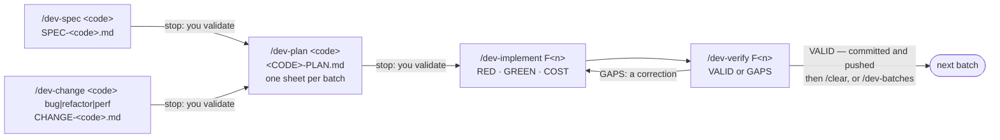

# Develop a feature: spec, plan, implement, verify

*English · [Français](../fr/workflows/develop.md)*

This page is for the core developer of a repository: you have a feature to build, and you want it
specified, planned, written test first, audited and committed. It runs **in a git checkout
only**: mount the checkout where a workshop would be and name the profile at the first start
(`-e HARNESS_PROFILE=dev`), or switch later with `/workshop-profile dev`. The `dev` profile is refused
in a workshop. At the end, `todo/<code>/` holds the spec, the plan, one sheet per batch and one verdict
per audited batch, and the repository holds the commits, one per batch: pushed on their branch when you run
the batches one by one (D71), merged into your branch and pushed once with `/dev-batches` (D79). A bug, a refactor or a
performance change enters the same chain through `/dev-change` instead of `/dev-spec`: a brief made of
evidence replaces the business spec, and everything after it is identical.



Several batches at once: `/dev-batches F2 F3 F4` runs each in a `dev-batch` agent in its own worktree,
in the background, four at a time, the conversation orchestrating ([step 3b](#step-3b--dev-batches-several-batches-one-agent-each)).

## Before you start

- **The space**: the git checkout of the repository, mounted at `/workspace` (or `ORKEON_WORKSHOP`), as
  [In a source checkout](../reference/harness.md#in-a-source-checkout) describes. The harness lands in
  the checkout's `.claude/`, listed in `.git/info/exclude`; `todo/` is excluded from git the same way.
  `todo/` is the default **work folder**: a repository pack may name a folder of the repository instead
  (Orkeon: `backstage/tasks/`, where its tasks and backlog live), the session's first line says which,
  and `todo/` on this page then reads as that folder — git sees it, you commit it (D69).
- **The profile**: `dev` — the packs `core`, `source`, `dev`, `quality` and `usage`
  ([Profiles and packs](../reference/harness.md#profiles-and-packs)). The pack sets the switch
  `HARNESS_DEV_BATCH_GUARD` to `1`, which turns the `dev-batch-guard` hook on: one inline `/dev-implement`
  batch per context, and no batch handed to a generic agent; and `HARNESS_PILOT_GUARD` to `1`: the context
  that orchestrates a batch opens no source or test file (D75).
- **The repository's values**: in a checkout of Orkeon (`origin` on `Orkeon/orkeon`) the repository pack
  `repo-orkeon` joins the profile. It brings the layer rules `orkeon-domain.md`,
  `orkeon-application.md` and `orkeon-tests.md`, loaded when a file of that layer is read, and
  `repo.yaml`: the layout (where the domain, application, infrastructure and test projects live) and the
  build and test commands the skills run. In any other repository the skills ask for a missing value
  once, naming the key.
- **Docker**, when a batch touches an adapter: an integration test runs against the real dependency in a
  container. Without Docker the test is written and reported as not run.
- **The product's CLI**, in a checkout of Orkeon: `orkeon` on the PATH is the build the image carries at
  its own commit, not this code. A command that runs it is refused, and the refusal quotes the command
  of the checkout, from `repo.yaml` (`dotnet run --project src/scripting/Orkeon.Scripting.Cli -- …`,
  typed from the top of the checkout).

## Step 1 — `/dev-spec`: the business spec

```text
/dev-spec <code> [the feature, or the path of a brief]
```

`<code>` is a short kebab-case slug; the folder is `todo/<code>/`. Claude reads the brief, has one
`Explore` subagent list what the code already answers, then asks you what it cannot: **one decision per
question**, the recommended answer first; the scope is challenged only when an answer would cut it, in
three questions at most. It then writes `todo/<code>/SPEC-<code>.md`: use cases `UC-nn`, each saying
where the actor meets it (an existing screen, command, menu or flow, and its place among what is already
there, in business words), business rules `BR-nn` with their origin and severity, data, states, what is
out of scope, assumptions and open questions. Nothing technical: no type, file, table or framework. An existing spec is revised, never
written over; it is written in English unless you ask otherwise.

The `adversarial-reviewer` subagent then tries to refute the spec, read-only: it returns closed
questions ranked `Blocking` or `Major`, or `CLEAR`. Every `Blocking` question is put to you, one at a
time, and its answer written into the spec; `Major` ones stay as open questions or assumptions. The
reviewer keeps a memory of the repository under `.claude/agent-memory/adversarial-reviewer/` — the holes a
spec or a plan of this repository tends to leave, which questions were answered and how, the paths that
exist and the ones that were guessed before — and the `memory-scope` hook lets it write there and nowhere
else.

**Stop: you validate.** Claude shows the use cases and rules, the open questions and their severity,
then stops. `/dev-plan` refuses to start while a `Blocking` open question remains.

## Step 1, for a change — `/dev-change`: the brief of a bug, a refactor or a performance change

```text
/dev-change <code> bug|refactor|perf [the brief, an issue, or contrib/<slug>/RECORD.md]
```

What has no business spec to write takes this entry: a behaviour the product already promises and
breaks (`bug`), the same behaviour in a better shape (`refactor`), the same behaviour at a lower cost
(`perf`). Claude establishes the facts before writing: a bug is **reproduced by running** the origin's
reproduction or the command of the brief (a bug that does not show stops here); a perf change is
**measured** first (the number before, how it was read, the `Cost:` line of the access-cost script); an
`Explore` subagent lists the code path, the tests that already pin the behaviours of the area and the
call sites. Then one decision per question, for what the code cannot answer.

The brief, `todo/<code>/CHANGE-<code>.md`, holds the origin, the evidence, acceptance criteria `CH-nn`
(each with its proof: the reproduction turned green, a number, "nothing observable changes"), a table of
**what must not change** with the test that pins each behaviour — or `unpinned`, which the plan turns into
a characterisation test written first —, the scope and the technical constraints. No design: where the
fix lands is `/dev-plan`'s. A fact that turns out to be a new promise sends you to `/dev-spec`. The
`adversarial-reviewer` refutes the brief as it refutes a spec.

**Stop: you validate.** Then `/dev-plan <code>` reads the brief as it reads a spec; the `CH-nn` ids are
traced, tested and carried as traits like `BR-nn`. For a refactor, the tests that pin the behaviour are
named in the sheet as `pinned`, green before the change and after it; for a bug, the reproduction is
the first red test; for a perf change, the measurement after is the sheet's access-cost target.

## Step 2 — `/dev-plan`: the plan and its batches

```text
/dev-plan <code>
```

Claude first lists the open `Blocking` questions of the spec or the brief; one left, it stops and sends
you back to `/dev-spec <code>` or `/dev-change <code>`. Then it reads the spec, the design rules (`DDD-`, `APP-` and `PERF-` ids every plan
classifies as applied or non-applicable with a reason) and the repository's layout and commands from
`repo.yaml`, asking once for what is missing and writing the answer on the `Commands` and `Layout`
lines of the plan. One `Explore` subagent inventories the reusable types, the use cases that own a
similar act and the test anchors.

It writes two levels under `todo/<code>/`: the global plan `<CODE>-PLAN.md` (the batches, their order,
the traceability of every `BR-nn` and `UC-nn` to a code owner) and one sheet `<CODE>-PLAN-F<n>.md` per
batch (its design decisions, the TDD sequence with a named test per behaviour, the exact paths
`/dev-implement` will copy). Batches are functional; each names the batches it depends on, and
`/dev-batches` runs two at once when neither names the other and their files differ. The
`adversarial-reviewer` refutes the plan: a `Blocking` row is fixed or asked of you, a `Major` row fixed
or kept with its reason under the sheet's `## Decisions`. It reads and extends the same memory of the
repository as in step 1, `.claude/agent-memory/adversarial-reviewer/`, the one place the `memory-scope`
hook lets it write.

**Stop: you validate.** Claude summarises the batches, the ids traced and how each review row was
settled, then ends with the next command:

```text
→ Manual plan validation required. Once validated: /dev-implement F1 todo/<code>/<CODE>-PLAN.md
```

## Step 3 — `/dev-implement`: one batch, test first

```text
/dev-implement F<n> todo/<code>/<CODE>-PLAN.md
```

Claude orchestrates and judges; two subagents write. Per behaviour of the sheet, strictly in this order:

1. **RED** — `dev-test-author` writes the tests named by the sheet, with the paths copied from its
   anchors, and runs them: they must fail on their assertion. Each test carries the repository's rule
   trait for the ids it proves (`[Trait("BR", "BR-nn")]` for Orkeon, from `repo.yaml`): the audit gate
   of step 4 refuses a batch whose sheet names an id no test carries.
2. **GREEN + REFACTOR** — `dev-implementer` writes the least production code that turns them green,
   then refactors; test files are read-only to it.
3. **COST** — the number of IO calls of the behaviour must be bounded and independent of the input
   size, as the sheet planned. It is measured, not stated: `access-cost.py` lists, from the syntax tree
   (`ast-grep`), every call awaited through a port and whether it sits in a loop or a lambda over the
   input or filters in memory what the port could filter; the implementer copies its last line into its
   report, and Claude checks it against the sheet. A flagged cost goes back to `/dev-plan`, never patched.

Each step observed is ticked on the sheet (`TDD: RED [x] GREEN [x] COST [x]`). A question that changes
the scope, an id or a design decision stops the batch; one that changes none is written under the
sheet's `## Assumptions` as `Hn`. Then the whole build and test suites run once, the sheet and the
global plan are marked done with the date, and the audit of step 4 runs in fast mode. The whole suite is
the only one run in full: the fixes and corrections after it run the test projects the batch reaches
(`affected-tests.py`, with the pack's `commands.test_project`), the whole suite again only when a file no
project owns changed (D78).

**One batch per context.** The `dev-batch-guard` hook refuses a second inline `/dev-implement` in the
same context and names the two ways out: `/dev-batches` for several batches, each in its own agent, or
`/clear` for one more here; a correction of a closed batch passes.

**A compaction during a batch** is covered by the `dev-compact` hook, on with the `dev` pack (it sets
`HARNESS_DEV_COMPACT` to `1`). Before the context is compacted, the hook writes
`todo/<code>/<CODE>-STATE-F<n>.md`: the steps of the sheet with their `TDD:` line and the first open one,
the progress lines the batch printed, the delegations made, and `git status --short`. The session that
resumes after the compaction is told to read it first and never to relaunch a delegation it lists. The
file is rewritten at every compaction.

On `VALID`, Claude prints a summary of the batch, then commits and pushes it (D71): the files the batch
touched, never the work folder, with a message in the shape `repo.yaml` gives (for Orkeon
`type(scope): summary`), on a branch named as the repository names them when you were on the default
branch, then `git push -u origin <branch>`. The identity is the one git already has — its
configuration, or the variables `workshop --git-identity "<name>" <email>` sets for the container
([Configuration](../reference/configuration.md#variables-of-the-image)): when git has none, Claude stops
before the commit and gives you that command, or the two `git config --global` lines, to type. It says
the short hash and the branch; a refused push is said with git's line, the commit kept local. Then the
pull request (D71): Claude checks `gh auth status` first — not signed in, it hands you `gh auth login`
and the `gh pr create` line, the branch staying pushed —, finds an existing one and gives its URL, or
writes `todo/pr-<code>-F<n>/PR.md` on the pull request template (the batch, the files per layer, the
validations, the assumptions to validate, the audit verdict and its minors, what was not run) and asks
you once whether to open it, against the repository's default branch; `HARNESS_PR_AUTO=1` opens it
without asking. The session ends on the closing line, printed once:

```text
→ Batch F<n> complete — manual validation required. Run /clear before the next batch.
```

## Step 3b — `/dev-batches`: several batches, one agent each

```text
/dev-batches F<n> [F<m>…] [todo/<code>/<CODE>-PLAN.md]
```

The conversation orchestrates and never carries a batch (D70): each batch named runs `/dev-implement`'s
procedure in a `dev-batch` agent, in the background, in a worktree of its own that the harness creates
under `.claude/worktrees/` from the branch you are on, with the repository's shared untracked folders
(`packages` for Orkeon) linked to your checkout's rather than restored again, and the restore and the
first build of the solution (`commands.restore && commands.build` of the repository pack) started in the
background as soon as the worktree exists, while the agent reads its sheet: the agent waits for that build
before its first red test and never restores again (the warm builds of your checkout run one at a time, under a
lock: two agents restoring into the same shared folder at once would lose each other's files) — one restore per batch, every later `dotnet` carrying
`--no-restore` or `--no-build`, the test author and the implementer building their test project only, the
`guard-restore` module refusing them the rest. Four agents run at a
time (`HARNESS_DEV_BATCHES_MAX`), the others queue in the plan's order; two run at once only when their
sheets' anchors are disjoint and neither names the other under `Depends on`. A batch that depends on
one not yet merged waits for it: Claude merges each `VALID` batch as it returns, so a dependency done but
not merged is one whose merge failed, and Claude says which.

**Before the first launch**, one block: `preflight.sh` checks the git identity, the branch, your
settings and the disk. It stops the run (`FAIL`) when git has no identity (no batch could commit: Claude
hands you `workshop --git-identity`), when you are on the default branch (Claude creates the work branch
first, D71), and when your own `~/.claude/settings.json` holds an `rtk hook claude` (the `docker run`
container installs one at its first start; it rewrites `git` into `rtk git`, which Claude Code's
worktree isolation refuses: remove it from that file, the harness's dispatcher runs rtk itself). It only
warns when `gh` is not signed in (the close needs it: fix it while the batches run) and when less than
two built worktrees fit on the disk.

**While the agents run**, ask a question with `/btw`; never press Esc, Ctrl+C or Ctrl+X Ctrl+K, and send
no message until the conversation is idle: they are reported to stop the agents. A stopped batch is
resumed from `/tasks` by typing into its transcript while its row is listed; otherwise Claude resumes it
from its checkpoints (a local commit and a state line after each green step) — a new agent only on your
explicit yes.

Each agent delegates RED, GREEN and the audit to the same four subagents, commits its batch on its own
local branch and never pushes (D79), and returns what the sheet must record; the conversation writes the
sheet, the global plan and the verdict file from that report — an agent in a worktree cannot write in
your checkout. No call of an agent lasts more than 270 seconds, so that its prompt cache stays warm: a
build or the whole suite runs detached and is awaited in slices (D77). For each `VALID` batch the
conversation merges the branch into yours (`git merge --ff-only`, a rebase of the never-pushed batch
branch when another batch merged first), removes its worktree in the background
(`worktree-create.sh --remove <worktree> --background`; a built worktree holds 25 to 30 GB) and relays
one block per batch. A `GAPS` or blocked batch is never merged, and its worktree stays (`worktree-create.sh --space` lists the
free space and each worktree, merged or not: none merged is left at the end). At the end: a
table of the batches with their verdict, commit, merge and worktree; your branch pushed once and its
**one** pull request — the same procedure as above, `gh auth status` first, one question
(`HARNESS_PR_AUTO=1` opens it without asking) —; and, for batch branches an older harness pushed, a
script that deletes them, handed to you to run. The merge of the pull request stays yours.

## Step 4 — `/dev-verify`: the audit, on its own

```text
/dev-verify F<n> [todo/<code>/<CODE>-PLAN.md] [full | resume]
```

`/dev-implement` runs this at its close; you also run it on its own, for instance after a correction.
A script, `audit-capture.sh`, is the **gate**: it searches the sources with `git grep --untracked`, never
reading `bin/` or `obj/` (`layout.build_outputs`), and fails on a `TDD:` line still open, a design id neither
applied nor non-applicable, a file changed outside the production and test roots and absent from the
sheet, an id of the sheet's TDD sequence that no test carries as its rule trait, or whitespace errors.
Red, nothing is audited until you fix what it lists. Green, it writes a capture (status, changed files,
the batch diff, the build's exit code — the build `/dev-implement` already made when its log is green
and older than no changed file, so the solution is built once per batch —, the access cost of the changed
production files with every port call in a loop flagged, the rule traits found, the last test run and the
test classes each changed file concerns). Two read-only subagents open it, in their own contexts and in
this order (D72: an audit is mechanical first, judged second): `dev-auditor-conformance` (Sonnet) checks
what a grep or a count decides — build exit, ids carried by traits, named tests present, files outside
the sheet, access cost, grep-able layer rules — and returns a table; `dev-auditor` (Opus) receives that
table, walks the diff hunk by hunk along the judged axes, from correctness to placement, runs the test
commands it doubts, and answers `VALID` or `GAPS`. `full` adds the whole fast suite; `resume` re-audits after a correction, from the previous
gap table and the diff since. The auditor keeps a memory of the repository under
`.claude/agent-memory/dev-auditor/` — the layout and the test commands that answer, the gap categories
that keep coming back and the rule `/dev-learn` made of them, a false positive and why it was one — and
the `memory-scope` hook lets it write there and nowhere else.

Claude writes `todo/<code>/<CODE>-VERIFY-F<n>.md`: the verdict, a table of gaps (severity, axis, gap,
evidence, expected fix) and the validations run. `GAPS` as soon as one `Blocking` or `Major` row stands;
`VALID` lists its minors for you to decide. Run on its own:

- `VALID`: the batch is committed and pushed as in step 3, and the closing line printed;
- `GAPS`: the correction is yours to launch, from the first gap:

```text
/dev-implement F<n> — correction: <the finding>
```

A correction reopens the closed batch under a `Correction Cn` line of its step and runs the RED, GREEN
and COST loop for it; a finding that changes the scope, an id or a design decision is routed to
`/dev-spec` or `/dev-plan` instead. Two audit rounds still in `GAPS` at a batch's close: Claude stops
and hands you the blocking gaps.

## Alongside the chain: `/dev-unit-tests`, `/dev-integration-tests`

The two test skills are the guides `dev-test-author` reads for the level a RED asks; you also run
them alone, for a test outside a batch.

| Skill | What it writes |
|---|---|
| `/dev-unit-tests <type or use case> [scenario] [id]` | a unit test in the test project mirroring the production one, extending the existing test class, on hand-written doubles; red first on its assertion, then green on exit `0` |
| `/dev-integration-tests <adapter> [scenario] [id]` | an integration test of an adapter against the real dependency (for Orkeon Testcontainers, `[Trait("Category", "Integration")]`), kept out of the fast suite; without Docker it is written and reported as not run |

Both end with the test, the command and its exit code. The production code then goes through
`/dev-implement` when a plan exists.

## Between batches: `/dev-learn`

```text
/dev-learn [axis]
```

Run after `/clear`, never during a batch, one axis at a time. Claude reads the untreated `Blocking` and
`Major` gaps of every verdict file (`todo/*/*-VERIFY-F*.md`) and groups them into motifs, kept only when
they recur over three batches or more and a line or a check would have caught them before the audit.
Each motif gets the narrowest destination: the repository's own guidance or check, written in the
checkout; or a harness file, never edited in place since the next synchronisation rewrites it — Claude
prints an exact patch for the orkeon-workshop repository, for you to apply there. Nothing is written
before you accept each proposal; a refused motif is never proposed again. `/dev-implement` reminds you
of the backlog at a batch's close when two batches or more are waiting.

## What is on disk afterwards

```text
<checkout>/
├── todo/<code>/                     excluded from git (or the repository's own work folder, D69)
│   ├── SPEC-<code>.md               the business spec — or CHANGE-<code>.md, the brief of a change
│   ├── <CODE>-PLAN.md               the global plan: batches, order, traceability
│   ├── <CODE>-PLAN-F1.md            one sheet per batch, ticked and dated when done
│   ├── <CODE>-PLAN-F2.md
│   ├── <CODE>-VERIFY-F1.md          one verdict per audited batch (a dated section per resume)
│   └── <CODE>-STATE-F1.md           the state of an open batch, written only when a compaction happened during it
├── .claude/agent-memory/            the agents' memory, listed in .git/info/exclude like todo/
│   ├── dev-auditor/
│   └── adversarial-reviewer/
├── .claude/worktrees/               the worktrees of /dev-batches, one per batch, removed once merged
└── .claude/local/
    └── dev-learn-state.json         what /dev-learn treated and what you refused
```

## Where this piece connects

- **Before**: an issue filed by a contributor ([Contribute](./contribute.md)) is often the brief you give
  `/dev-spec`.
- **After**: the batches committed and pushed (or, after `/dev-batches`, merged into one branch pushed once) go to review as a pull request; a contributor's
  `/contrib-pr` walks the repository's checklist for it ([Contribute](./contribute.md)). A merged feature
  then goes into a version ([Release a version](./release.md)).
- **Measured**: `/quality-report` runs the repository's build, tests, coverage and Sonar on the result
  ([Release a version](./release.md)).
- **Documented**: `/docs-audit` confronts the pages the feature changed with the code
  ([Keep the docs true](./keep-docs-true.md)).
- **The whole picture**: [Workflows](./overview.md).

Next: [Release a version](./release.md).
