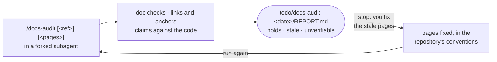

# Keep the documentation true to the code

*English · [Français](../fr/workflows/keep-docs-true.md)*

This page is for whoever keeps the documentation of a repository — Orkeon, or another one — true to its
code. It happens in the **git checkout** of the repository, never in a workshop: mount the checkout where
a workshop would be and take the `docs` profile — `-e HARNESS_PROFILE=docs` at the first start of the
container, or `/workshop-profile docs` later. The profile holds the packs `core`, `source` and
`docs-audit`; the `release` profile holds `docs-audit` too, so the person who releases has the same
skill. In Orkeon's checkout the repository pack `repo-orkeon` gives it the repository's own doc checks.
At the end you have a report under `todo/docs-audit-<date>/`, and pages you fixed yourself.



The audit reads and runs checks; it edits no page, no source file and no test. The report is the
deliverable, and the fix is yours.

## Before you start

- **The space**: the checkout, mounted at `/workspace`, with the `docs` or `release` profile
  ([In a source checkout](../reference/harness.md#in-a-source-checkout),
  [Choosing a profile](../reference/harness.md#choosing-a-profile)).
- **A reference**: a tag in the checkout, or a tag or commit you name in the arguments; the pages audited
  are those changed since it.
- **The repository's doc checks**: for Orkeon, `scripts/check-docs-parity.sh`, `scripts/check-doc-claims.py`
  and the docfx build with warnings as errors, which needs a Release build before it. A tool that is
  missing makes its check `not run: <tool> missing`, not a failure. In a repository without a pack the doc
  checks are `not run`, and the report says so: the forked subagent cannot ask you for them.

## `/docs-audit [<tag or commit>] [<page or folder> ...]`

```text
/docs-audit                        # the Markdown files changed since the latest tag
/docs-audit v1.0.0-rc.4            # since that tag or commit
/docs-audit docs/guides            # these pages or folders, whatever changed
```

Claude runs the skill in a **forked subagent**: the noise of the checks stays there and your conversation
gets a short summary. It cannot ask you anything, so what is missing is reported, not requested. The
reference is the argument that names a tag or a commit, else the latest tag; the pages are the paths
you give, else the Markdown files changed since the reference, at most 15 — beyond that, the 15 most
changed, the rest listed as `not audited`. Then, in order:

1. **The repository's doc checks**, run from its root, their output under `todo/docs-audit-<date>/logs/`:
   exit code and at most 10 lines of failures each.
2. **Links and anchors** of the pages, with `check-links.py`: every broken relative link or anchor is a
   finding with its file and line.
3. **Claims against the code**: for each page, at most 12 claims the code can decide — a command or a
   flag, a default value, a setting key, a path, a type, a count, a behaviour — each found in the code
   and given a verdict with its evidence as `path:line`.

| Verdict | Meaning |
|---|---|
| `holds` | the code says the same |
| `stale` | the code says otherwise: the page and the code are both quoted |
| `unverifiable` | no code decides it, or it depends on a run the subagent cannot make |

A search that finds nothing is not proof of `stale`: it is `unverifiable` until the code that should
hold the claim is found and says otherwise. Wording, opinions, plans and what a third party does are
not checked. A translated page is audited on its source page; its own claims are checked only where they
differ. When the `dev` pack is deployed too, the audit reads the `adversarial-reviewer` charter and takes
its stance: find what is wrong, evidence for every verdict.

Claude writes `todo/docs-audit-<date>/REPORT.md` — doc checks, links and anchors, the table of claims,
one paragraph per stale claim with the fix its owner may make, what was not audited — and returns to the
conversation in at most 15 lines: reference and pages, the doc checks and their exits, broken links, the
count of claims per verdict, the stale ones in one line each, the report's path.

## Stop: you fix the pages

The audit fixes nothing. Read the `Stale claims` section of the report, correct each page in the
repository's conventions — for Orkeon, a change to an English page is ported to its French mirror, and
`scripts/check-docs-parity.sh` says when it is not — then run the audit again on the same pages until
nothing is `stale`. Commit and push as you always do: the harness makes no commit in a checkout.

## What is on disk afterwards

```text
todo/
└── docs-audit-<date>/
    ├── REPORT.md                # doc checks, links and anchors, claims, stale claims, not audited
    └── logs/                    # the output of each doc check
```

`todo/` is listed in `.git/info/exclude`: the report never reaches git — unless the repository names its
own work folder (Orkeon: `backstage/tasks/`, D69), which git sees. Your fixes to the pages are
ordinary changes of the repository.

## Where this piece connects

- **Before**: a feature delivered by the dev chain changed pages — audit them
  ([Develop a feature](./develop.md)).
- **After**: `/release-prepare` quotes the latest audit before a version is tagged
  ([Release a version](./release.md)).
- **From a user**: a stale page a user met in a workshop can become an issue of kind `docs`
  ([Contribute](./contribute.md)).
- **For this project's own pages**: the maintainer of Orkeon Workshop keeps its bilingual documentation
  with `/ws-docs` ([Maintain Orkeon Workshop itself](./maintain-the-workshop.md)); the map of every
  piece is the [Overview](./overview.md).

Next: [Maintain Orkeon Workshop itself](./maintain-the-workshop.md).
