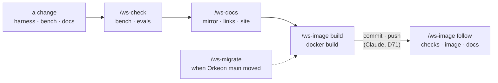

# Maintain Orkeon Workshop itself: checks, docs, image, migration

*English · [Français](../fr/workflows/maintain-the-workshop.md)*

This page is for whoever changes Orkeon Workshop itself — a hook, a skill, a rule, the bench, a page of
this documentation — and wants the change checked the way the project's `CLAUDE.md` asks: the bench and
the harness evals green, the French mirror in step, the site built, the image rebuilt on the latest
Orkeon `main`. It happens in a **git checkout of the `orkeon-workshop` repository**, mounted where a
workshop would be ([In a git checkout](../../README.md#get-started)), with a profile made
for a checkout: `dev`, `docs`, `release`, `contrib` or `all` — `/workshop-profile dev` in Claude Code, or
`-e HARNESS_PROFILE=dev` at the first start of a container. When the checkout's `origin` is
`github.com/Orkeon/orkeon-workshop`, the repository pack `repo-orkeon-workshop` joins the profile on its
own: four skills, `/ws-check`, `/ws-docs`, `/ws-image` and `/ws-migrate`, and three rules for the bench,
the docs and the hooks. The four skills read and report; they edit nothing, and they run in their own
subagent, `ws-runner`, so that the output of the checks never reaches your conversation. At the end, the
checkout holds your change, checked, and the records you wrote in the plan; your Docker daemon holds a
fresh `orkeon-workshop` image.



Claude runs the checks and the build, then commits and pushes the change (D71); a tag stays with you, and
Claude gives you its exact command (D47). The rules of the work are the repository's [`CLAUDE.md`](../../CLAUDE.md); the values the
skills read — commands, manual checks, the Orkeon pin, the docs mirror — are in the pack's `repo.yaml`,
deployed at `.claude/harness/packs/repo-orkeon-workshop/references/repo.yaml`.

## Before you start

- **The checkout and the profile.** The `orkeon-workshop` repository mounted at `/workspace`, with
  `dev`, `docs`, `release`, `contrib` or `all`; after `/workshop-profile`, restart Claude Code as it asks
  (`/exit`, then `claude`). `/workshop-profile --show` lists the active packs: `repo-orkeon-workshop` must
  be among them ([Choosing a profile](../reference/harness.md#choosing-a-profile)).
- **For `/ws-check bench`**: `npm ci` done in `.devcontainer/bench`.
- **For `/ws-check evals`**: `orkeon`, `orkeon-bench` (`bench/bin`, on an up-to-date `dist/`),
  `orkeon-studio-check`, `rtk` and PyYAML on the PATH. In strict mode a missing tool fails its cases. An
  `orkeon` that is not at the reference version leaves out one comparison, the tool catalogue against
  `orkeon run --list-tools`.
- **For `/ws-check ci` and `/ws-image build`**: Docker, reachable from the container
  ([Host socket](../guides/docker-modes.md#host-socket)). Without it, `/ws-image` says the image cannot be
  built here and stops.
- **For `/ws-check templates`**: a feed of Orkeon packages built from the reference commit with
  `.devcontainer/csharp/scripts/build-orkeon-packages.sh`.
- **For `/ws-docs`**: `dotnet`, so that docfx can be installed; `mmdc` on the PATH for the Mermaid
  diagrams, otherwise they are reported not checked.
- **For `/ws-image follow`**: `gh`, which lists and watches the workflow runs.
- **For `/ws-migrate`**: github.com reachable, to resolve Orkeon's `main` and clone it.

## 1. `/ws-check [bench | evals | ci | templates | all]` — the checks of the repository

You type it in the checkout, with the checks you want; with nothing, `bench` then `evals`. Claude:

- runs in a forked subagent, `ws-runner`, read-only: the checks run there one after the other, never
  together — the evals must not run while the bench rebuilds `dist/` — each command's output to its own
  log, `${TMPDIR:-/tmp}/ws-check-<check>.log`, and your conversation gets the report alone: the
  command, its exit code, the summary line and each failure by name with its first lines;
- `bench` runs the lint (types and dependency rules), then the tests, which rebuild `dist/` first;
- `evals` runs the harness evals in strict mode: a case that cannot run fails instead of being skipped;
- `ci` replays the steps of `.github/workflows/checks.yml` in a `node:24-bookworm` container started on
  `tail -f /dev/null` — a container without `orkeon` or `rtk`, whose first process reaps nothing: a test
  that passes in the image can fail there;
- `templates` runs the .NET templates' check against your feed, offline, with the smoke test.

It writes no file and fixes nothing. The report is one table — check, command, result: `green`,
`N failed`, or `not run` with the reason when a need is missing — then the failures by name. A check
whose need is missing is never called green. A failure is called pre-existing only when the same case
was run red on the base commit in this run.

## 2. `/ws-docs [<base commit>]` — the French mirror, the links, the site

You type it after a change to `README.md`, `docs/` or the French pages; the base is the commit to compare
with, by default the merge base with `main`. The skill runs in the forked subagent `ws-runner`, as
`/ws-check` does; Claude:

- checks that every page under `docs/` has its page under `docs/fr/` and `README.md` its `README.fr.md`,
  except the two English-only files, the plan and `docs/profiles-design.md`; lists every English page
  changed since the base whose French page did not change; checks that a page added, moved or removed
  is added, moved or removed in both `toc.yml` and both indexes;
- checks every relative link and anchor of every tracked Markdown file, hidden folders included, against
  the GitHub heading slugs — with the `check-links.py` script of the `docs-audit` skill when it is
  deployed, else its own pass — and renders the Mermaid diagrams of the changed pages when `mmdc` is on
  the PATH;
- builds the site, output to `${TMPDIR:-/tmp}/ws-docs-site.log`: docfx is installed once at the version
  the `docs.yml` workflow names, in a cache folder outside the checkout, then `scripts/build-docs-site.sh`
  runs. The build fails on a broken link, a broken anchor or a `toc.yml` entry without its page. Without
  `dotnet`, it is not run.

It translates nothing and fixes nothing unless you ask. The report is one table — check, result,
findings — then each finding as `file:line`.

## 3. `/ws-image build` — the image on the pinned commit

You type it once the checks are green; the arguments are `build`, `build pinned` or `follow` (step 5),
and `build` is the default. The skill runs in the forked subagent `ws-runner`, as `/ws-check` does;
Claude:

- resolves the latest commit of Orkeon's `main` and compares it with `ORKEON_COMMIT` in
  `.github/workflows/image.yml`. When the pin is behind, it says so — a build on the pin does not
  validate the change — names `/ws-migrate` and stops. `build pinned` is how you ask for the build on
  the pin anyway; the report then says the image was built on another commit than the latest `main`;
- without Docker, says the image cannot be built here, names `/ws-check` instead, and stops;
- runs the `docker build` of `CLAUDE.md` detached, its log in `${TMPDIR:-/tmp}/ws-image-build.log` with
  the exit code written at its end: the build is long and its log longer. It waits in slices of at most
  nine minutes and reads the last lines of the log between two; then it reports the exit code, the
  duration, the image id, and on failure the failing step with its first error lines.

Green means more than a compiled image: the build itself runs the templates' self-check, the tests of
the bench and the harness evals in strict mode, and a single red case fails it. The report says what was
built, on which Orkeon commit, and plainly when the image was not built or was built on another commit
than the latest `main`.

## 4. Commit and push — Claude's, once green (D71)

Once the checks and the build are green, Claude commits the files the change touched, with a message in
the shape the pack gives, and pushes your branch — with the git identity the container has; when it has
none, it stops before the commit and hands you the two `git config --global` lines. A `git tag`, when
there is one, is handed to you (D47): you type it in a terminal of the container, or in Claude Code with
`!` in front. This repository's own `CLAUDE.md` asks for no commit the user did not ask for: running
this workflow is that ask. A push starts up to three workflows, by their path
filters: `checks` when the push touches `harness/` or `bench/`, `image` when it touches `.devcontainer/`
(its `README.md` excepted) or the workflow itself, `docs` for the site. A push of `docs/` or of the root
READMEs alone builds no image: that is what step 3 was for.

## 5. `/ws-image follow` — the workflows after the push

You type it once pushed. Claude runs `gh run list` for your commit, then for each of `checks`, `image`
and `docs` the push started, `gh run watch <id>` to its end, and `gh run view <id> --log-failed` when one
is red. A green image does not say `checks` is green: `checks` runs in a bare container that has neither
`orkeon` nor `rtk`. The report gives, per workflow, its run id and its conclusion.

## 6. `/ws-migrate [<commit>]` — when Orkeon `main` moved

You type it when `/ws-image` found the pin behind, or at the start of any change, as `CLAUDE.md` asks;
with a commit, that commit is tried instead of `main`. The skill runs in the forked subagent `ws-runner`,
as the others do: the upstream log and diff stay there, your conversation gets the table alone. Claude:

- resolves Orkeon's `main` and reads `ORKEON_COMMIT`. Same commit: it says the pin is the latest `main`
  and stops;
- in a clone of Orkeon — an existing checkout, or a blobless clone under
  `${TMPDIR:-/tmp}/ws-migrate-orkeon` — reads the upstream log, the diff summary and the new
  `CHANGELOG.md` entries, says which of
  them touch what the workshop relies on (CLI options, the tool catalogue, packages, settings keys, the
  YAML and TypeScript DSL), and computes the new version, `<Orkeon version>.src.<commit date>.g<commit,
  7 characters>`, as `orkeon-update.sh --source` does;
- lists the files to bring in step in one table — file, what changes, from, to — from the pin's file list
  of `repo.yaml` and from `git grep` of the previous short hash; leaves out what records history (a run
  made on an earlier build, "since `<commit>`", the commit that delivered an upstream change); marks each
  statement about Orkeon that must be checked on the new commit before it moves; ends with the
  `VERIFICATIONS.md` entry and the plan's § 11.1 line the migration will need.

Then it stops and hands you the table. The edits, the rebuild with `/ws-image` and the checks with
`/ws-check` start when you say so.

## What is on disk afterwards

The four skills write no file in the checkout: their logs go under `${TMPDIR:-/tmp}/`, and they report
in the conversation. What the workflow touches:

```text
<checkout>/
├── .claude/                               the harness of the profile, listed in .git/info/exclude
│   ├── harness/packs/repo-orkeon-workshop/references/repo.yaml   the values the ws-* skills read
│   └── local/profile                      the active profile, one line
├── .github/workflows/image.yml            ORKEON_COMMIT, the pin /ws-migrate compares
├── .devcontainer/harness/VERIFICATIONS.md a V-nn entry per migration, written by you
├── docs/orkeon-workshop-plan.md           § 11.1 progress, § 13 decisions: the record
└── todo/                                  the artefacts of the other packs of the profile
```

Outside the checkout: the image `orkeon-workshop` in your Docker daemon, docfx in a cache folder of your
home, installed once, and the logs of the four skills, `${TMPDIR:-/tmp}/ws-<skill>-<check>.log`, with
the Orkeon clone of `/ws-migrate` beside them.

## Where this piece connects

- **Before**: the change comes from a dev chain run in this checkout, or from a rule `/dev-learn`
  proposed after audits kept finding the same gap ([Develop](./develop.md)); or from a fix of a skill after
  a failure reported from a workshop ([Contribute](./contribute.md)).
- **Beside**: `/ws-docs` checks the shape of the documentation — mirror, links, site; what the pages
  claim against the code is `/docs-audit` ([Keep the docs true](./keep-docs-true.md)).
- **After**: `/contrib-pr` prepares the pull request to this project ([Contribute](./contribute.md)); a
  `vX.Y.Z` tag publishes a versioned image: this project's pack gives `/release-verify` its three
  channels — the image on ghcr, the jobs of its build, the site ([Release](./release.md)).
- **The record**: a decision goes to § 13 of the [plan](../orkeon-workshop-plan.md), progress to its
  § 11.1; the Orkeon facts checked on the new commit go to `VERIFICATIONS.md`.
- **All the pieces**: [the workflows](./overview.md).

Next: [Measure what a session costs](./measure.md).
