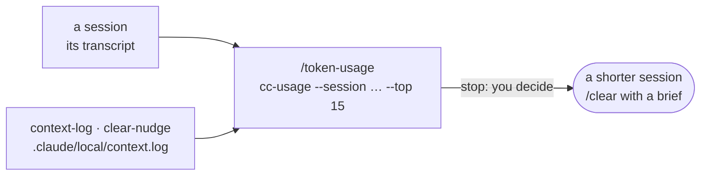

# Measure what a session costs

*English · [Français](../fr/workflows/measure.md)*

This page is for whoever wants to know what a Claude Code session cost and what filled its context: a
long team-building session that felt expensive, a dev batch to compare with the previous one, a week of
work in a project. It works in a **workshop** and in a **git checkout** alike. The pack `usage` gives it,
and the profiles `contrib`, `dev` and `all` carry that pack; any other profile takes it through a custom
one — `/workshop-profile custom:workshop,usage` in a workshop keeps the workshop's harness and adds the
measure. The pack brings one skill, `/token-usage`, over the `cc-usage` command of the image, and switches
on two hooks, `context-log` and `clear-nudge`. At the end, nothing new is written but two small files
under `.claude/local/`: the figures are read in the conversation.



## Before you start

- **The profile**: `contrib`, `dev`, `all`, or a `custom:` list that holds `usage`
  ([Profiles and packs](../reference/harness.md#profiles-and-packs)). Both hooks are off unless the pack is
  active: it sets `HARNESS_CONTEXT_LOG` and `HARNESS_CLEAR_NUDGE` to `1` ([Switches](../reference/harness.md#switches)).
- **`cc-usage`**, on the PATH in the image; elsewhere, the same arguments go to
  `python3 /usr/local/share/cc-usage/cc-usage.py`. Without either, the skill says so in one line and stops.
- **The transcripts**: `cc-usage` reads them under `$CLAUDE_CONFIG_DIR/projects`, else `~/.claude/projects`
  — the folder the `docker run` of the install mounts as a volume, so that they survive the container.
- **The prices**: a daily price list fetched from LiteLLM, cached 24 h in `~/.cache/cc-usage/`. Nothing
  else leaves the machine. Offline, `--no-fetch` uses the last cache; with none, the cost is 0 and the run
  says so.

## 1. `/token-usage [<session id or path> | <days> | --agent <id or path>]` — one session, a period, one agent

You type it in Claude Code, with a session id or a transcript path for one session, or a number of days
for a period; Claude may also use it on its own when you ask what a session cost. Claude runs the
`cc-usage` command the question needs and reads its output:

| Question | Command |
|---|---|
| this session, or one session: what filled its context | `cc-usage --session <id prefix or path> --top 15` |
| the same, for a script (the `(startup)` tokens) | `cc-usage --session <id> --json` |
| what a project, a week, a month cost | `cc-usage --days 30 --top 12` (`--since YYYY-MM-DD`, `--project <text>`, `--models`, `--daily`) |
| a habit: is `Read` expensive, what do subagents cost | `cc-usage --days 30 --tools` (parses every transcript: the slow one) |
| which sessions to open first | `cc-usage --days 7 --triage` |
| a grade A to F per session | `cc-usage --days 30 --audit` |
| what the sessions left in git | `cc-usage --days 30 --yield` |
| one subagent on its own — a batch of `/dev-batches`: cost, final context, share of reads, costliest calls | `cc-usage --agent <agent id prefix or path> --top 10` |

The current session is the newest transcript of the project. A subagent is named by the id the `Agent`
tool returned when it was launched, or by the path of its transcript, `<project>/<session>/subagents/agent-<id>.jsonl`;
`--agent` measures that transcript as a chain of its own, so a `dev-batch` agent reads like a session: its
cost, its final context, what it read, its costliest calls — the tokens beside the `Measure` line
(duration, turns, subagents) the batch's verdict file carries. Subagent costs measured before 2026-10-14 were underestimated:
`cc-usage` counted the partial output tokens of the first record of a message; this is fixed. The report is a few lines or one short
table: the cost and how much of it is exact — "N of M sessions measured by Claude Code's counter", the
rest rebuilt from the transcript and so a floor —, the two or three lines that weigh most, and one action
at most per finding, none when nothing is avoidable. The lines without a tool name are the ones to read
first: `(startup)` is the system prompt, the `CLAUDE.md` chain, the rules and the tool and skill
definitions, carried by every turn; `(replayed output)` is Claude's own replies resent as input on every
later turn, often the largest line of a long session; `(compaction)` is what a `/compact` rebuilt;
`(subagents)` is the subagents' own contexts, which on a fan-out session can outweigh the main chain.

You can also type the same commands yourself, in a terminal of the container or in Claude Code with `!`
in front:

```bash
cc-usage --days 7 --triage
```

`--dashboard` and `--serve` are not usable in the image: `claude-usage-dashboard`, started with the
container, serves the aggregated view per day, model and project
([Where things are in the container](../reference/configuration.md#where-things-are-in-the-container)).

## 2. The two hooks — the log of the instruction files, and the nudge

- **`context-log`** appends one line to `.claude/local/context.log` each time an instruction file enters
  the context: at the start of a session and on every lazy load — the `CLAUDE.md` of a sub-folder, a rule
  whose `paths:` matched, the reload after a compaction. A line holds the time, the reason, the type, the
  bytes and the tokens estimated from them, the path, the session and the agent. For a question about
  startup cost, `/token-usage` sums the lines of the session and sets them beside the `(startup)` tokens:
  the rest is the system prompt and the tool and skill definitions. The log keeps at most 256 KiB.
- **`clear-nudge`** reads, before each of your prompts, the size of the request the next turn replays.
  Each time that size crosses a step of 150 000 tokens, once per step and session, it adds one line to
  Claude's context, which asks it to say at the end of its answer, if the task is finished, that `/clear`
  with a short brief of where things stand costs less than carrying on. If the work goes on, it goes on:
  this is only a number. The steps already said are kept in `.claude/local/clear-nudge.tsv`. Inside a
  `dev-batch` agent of `/dev-batches`, which receives no prompt of yours, the same hook runs before each of
  the agent's delegations, reads the agent's own transcript, and asks it to carry the figure into its
  report; the step is kept under `<session>:<agent>`.

## 3. Reading the figures

Costs are at the public API list price: a comparison between sessions, not a bill. Past 200k tokens of
prompt the API may bill a premium rate, applied where LiteLLM publishes one, else counted and said. A
cache entry lives five minutes: after a longer pause, the next turn rewrites the whole prefix, and the run
reports those turns and their avoidable cost. `--audit` grades what a session could have avoided as a
share of what it cost, never its size; a long session that wasted nothing grades A, and a reading or
planning session that left no commit is not waste. Days follow the machine's time zone.

## What is on disk afterwards

```text
<workshop or checkout>/
└── .claude/local/
    ├── context.log          one line per instruction file loaded, 256 KiB at most
    └── clear-nudge.tsv      the steps already said, per session (the 32 newest)
~/.cache/cc-usage/           the price list, cached 24 h
```

## Where this piece connects

- **The dev chain** runs one batch per context and asks for `/clear` between inline batches, or runs them
  in agents of their own with `/dev-batches`
  ([Develop](./develop.md)): the `(replayed output)` line is why — it grows with the length of the session,
  and only `/clear` drops it.
- **Any workflow of this group** is a session: the same reading applies to a contribution, a release or a
  docs audit ([the workflows](./overview.md)).
- **The aggregated view**, per day, model and project, is `claude-usage-dashboard`, already running in the
  container ([Where things are in the container](../reference/configuration.md#where-things-are-in-the-container)).

Next: [The harness](../reference/harness.md).
