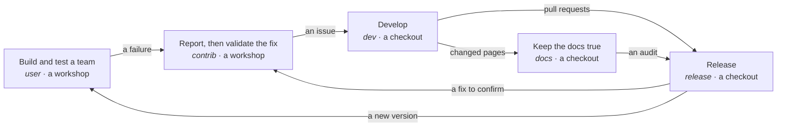

# Workflows: who does what, and how the pieces fit

*English · [Français](../fr/workflows/overview.md)*

The harness is a set of workflows. Each one is a piece of a puzzle: it has a person, a place — a
workshop, or the git checkout of a repository — a **profile** that deploys its skills, a few commands
to type, the files it leaves on disk, and the points where you decide. Each piece stands on its own:
you can use one and never meet the others. Put together, they are how the Orkeon project lives, and how
agent teams get built:

> A team built in a workshop meets a failure. The failure becomes a reproduction and an issue. A
> developer turns the issue into a spec, a plan and tested batches. A release carries the fix, with its
> evidence. The person who reported it confirms it on the released build. The documentation is audited
> against the code it describes. And the harness that drove all of this is itself checked, built and
> kept in step with Orkeon.

This page shows the pieces and where they connect. Each piece has its own page.

## The pieces

| Piece | Who | Where | Profile | You type | It leaves on disk | Page |
|---|---|---|---|---|---|---|
| **Build and test a team** | an Orkeon user | a workshop | `user` | `/team-init`, `/team-need`, `/team-test-plan`, `/team-design`, `/team-tests`, `/team-approve …` | `teams/<slug>/`, `workbooks/<slug>/`, `tests/<slug>/` | [How a team gets built](../concepts/process.md) |
| **Report a failure, validate a fix** | an outside contributor | a workshop | `contrib` | `/contrib-issue`, `/contrib-validate` | `contrib/<slug>/` | [Contribute](./contribute.md) |
| **Open a pull request** | a contributor | a checkout | `contrib` | `/contrib-pr` | `todo/pr-<slug>/` | [Contribute](./contribute.md) |
| **Develop a feature** | a core developer | a checkout | `dev` | `/dev-spec`, `/dev-plan`, `/dev-implement`, `/dev-verify` | `todo/<code>/`, `.claude/agent-memory/` | [Develop](./develop.md) |
| **Release a version** | the person who releases | a checkout | `release` | `/quality-report`, `/release-prepare`, `/release-evidence`, `/release-verify` | `todo/quality-<date>/`, `todo/release-<version>/` | [Release](./release.md) |
| **Keep the documentation true** | whoever keeps the docs | a checkout | `docs` (also in `release`) | `/docs-audit` | `todo/docs-audit-<date>/` | [Keep the documentation true](./keep-docs-true.md) |
| **Maintain Orkeon Workshop itself** | a maintainer of this project | a checkout of this repository | `dev`, `docs` or `all` | `/ws-check`, `/ws-docs`, `/ws-image`, `/ws-migrate` | reports in the conversation; the plan keeps the record | [Maintain the workshop](./maintain-the-workshop.md) |
| **Measure what a session costs** | anyone | both | `contrib`, `dev`, `all`, or `custom:…,usage` | `/token-usage` | `.claude/local/context.log` | [Measure](./measure.md) |

A profile is chosen once per folder: `-e HARNESS_PROFILE=<profile>` at the first `docker run`, or
`/workshop-profile <profile>` in Claude Code at any time
([Choosing a profile](../reference/harness.md#choosing-a-profile)). A profile made for a checkout is
refused in a workshop, and the other way round; `/workshop-profile --list` says which fit the folder.
In a checkout, the harness lands in `.claude/`, listed in `.git/info/exclude`, and writes nothing git
tracks ([In a source checkout](../reference/harness.md#in-a-source-checkout)).

## One failure, end to end

The pieces chain across roles. Here is the path a failure takes when every piece is used — most of the
time only some are, and the others happen elsewhere, by other means.

1. **In a workshop**, you build a team with the method ([How a team gets built](../concepts/process.md))
   and a run does not do what Orkeon's documentation promises.
2. **Still in the workshop**, with the `contrib` profile, `/contrib-issue <slug>` reruns the smallest
   team that fails, records what was seen, and drafts the issue on Orkeon's template. You file it
   ([Contribute](./contribute.md)).
3. **In a checkout of Orkeon**, a developer with the `dev` profile takes the issue as the brief of
   `/dev-spec`, you validate the spec, then the plan, and each batch is implemented test first and
   audited ([Develop](./develop.md)). The developer commits and pushes; `/contrib-pr` prepares the
   pull request against the repository's own checklist.
4. **In the same checkout**, `/docs-audit` confronts the pages the feature changed with the code
   ([Keep the documentation true](./keep-docs-true.md)).
5. **In a checkout**, with the `release` profile, `/quality-report` takes the figures, `/release-prepare`
   checks the version is ready and drafts the notes, `/release-evidence` gathers the proof it installs,
   you tag, and `/release-verify` checks every channel the repository publishes to
   ([Release](./release.md)).
6. **Back in the workshop**, `/contrib-validate main` builds Orkeon's `main`, which now carries the fix, and
   reruns the recorded reproduction: fixed, or not. And `orkeon-update` brings the new version to every workshop
   ([Updating](../guides/updating.md#orkeon-and-ollama-in-a-container)).

The same chain, applied to this project instead of Orkeon, is how the harness itself is maintained:
[Maintain the workshop](./maintain-the-workshop.md).

## What every piece shares

- **A record on disk, dated.** A workbook in a workshop, `contrib/<slug>/` for a report, `todo/<code>/`
  in a checkout — kept out of git by the harness. Nothing important travels through the conversation
  only; a piece can be resumed in a new session, by someone else.
- **Stops where a person decides.** You validate a need, a spec, a plan; and every command that
  commits, pushes, tags, files an issue, comments, publishes or pays is handed to you, with where to
  type it — Claude does not run it (D47).
- **The repository's own values.** The commands, checklists, templates and channels a piece uses come
  from a repository pack — Orkeon's, or this project's — read instead of assumed. In another
  repository the skill asks you for what it misses, once, and names it.
- **The same guards everywhere.** Bounded reads, secrets kept out of files, noisy work delegated to
  subagents, each guard a hook with its evals ([The harness](../reference/harness.md)). The skills that
  read and report (`/ws-*`, `/contrib-validate`, `/quality-report`, `/docs-audit`) run whole in a forked
  subagent — for the first three, a charter of their pack —, so the conversation gets their report alone.

## Where do you start?

- **You use Orkeon and want a team**: [Install](../getting-started/install.md), then
  [Your first team](../getting-started/first-team.md), then the method,
  [How a team gets built](../concepts/process.md).
- **Something failed and you want it fixed**: [Contribute](./contribute.md).
- **You develop Orkeon**: [Develop a feature](./develop.md).
- **You release it**: [Release a version](./release.md).
- **You keep its documentation**: [Keep the documentation true to the code](./keep-docs-true.md).
- **You maintain this project**: [Maintain Orkeon Workshop itself](./maintain-the-workshop.md).
- **You want to know what a session cost**: [Measure what a session costs](./measure.md).

Next: [Contribute](./contribute.md).
