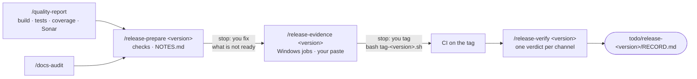

# Release a version: quality, readiness, evidence, tag, verification

*English · [Français](../fr/workflows/release.md)*

This page is for the person who releases a repository — Orkeon, or another one. It happens in the
**git checkout** of the repository, never in a workshop: mount the checkout where a workshop would be
and take the `release` profile — `-e HARNESS_PROFILE=release` at the first start of the container, or
`/workshop-profile release` later. The profile holds the packs `core`, `source`, `quality`, `release`
and `docs-audit`; in Orkeon's checkout the repository pack `repo-orkeon` joins it and gives the skills
the values they read (version file, tag shape, changelog, workflows, channels). At the end you have a
quality report and a docs audit under `todo/`, a release record and its notes under
`todo/release-<version>/`, a tag you pushed yourself, and one verdict per publication channel.



Claude checks, reads and records; it changes no file of the repository and publishes nothing. The tag is
the one command it hands to you (D47). Every artefact goes under `todo/`, which the harness lists in
`.git/info/exclude`: nothing of this workflow reaches git.

## Before you start

- **The space**: the checkout, mounted at `/workspace`, with the `release` profile ([In a source
  checkout](../reference/harness.md#in-a-source-checkout), [Choosing a profile](../reference/harness.md#choosing-a-profile)).
- **`gh`**, signed in to GitHub: the skills read the CI runs, the jobs and the release with
  `gh run list`, `gh run view` and `gh release view`.
- **Sonar, optional**: `/quality-report` runs it only when `SONAR_HOST_URL` and `SONAR_TOKEN` are set in
  the environment, the repository declares a Sonar command, and the server answers `UP`. Otherwise Sonar is
  `not_run` with the reason, never a failure. The token lives in the environment only: never printed,
  never on a command line, never in a file ([SonarQube](../guides/docker-modes.md#sonarqube)).
- **Docker, only for `--integration`**: Orkeon's integration tests need it
  ([Host socket](../guides/docker-modes.md#host-socket)).
- **The values**: in Orkeon's checkout the `repo-orkeon` pack gives them. In another repository the
  release skills ask you once for each missing value, naming its key; `/quality-report`, which runs in a
  forked subagent and cannot ask, takes them as arguments instead (step 1).

| Value for Orkeon | Where |
|---|---|
| version file | `src/Directory.Build.props` (`VersionPrefix`, then `-` and `VersionSuffix`) |
| tag | `v<version>` |
| changelog | `CHANGELOG.md`, sections `## [<version>] - YYYY-MM-DD` |
| workflows | `release.yml`, `release-verify.yml`, `publish.yml` |
| Windows jobs | `smoke-windows`, `smoke-windows-service`, `msi` |
| readiness command | `python3 scripts/check-release-readiness.py` |
| channels | `github-release`, `release-verify`, `apt`, `msi`, `archives`, `nuget`, `ghcr` |

## 1. `/quality-report` — the quality gates in one checked report

```text
/quality-report [--integration] [--no-sonar] [--<step> "<command>" ...]
```

The skill runs in a forked subagent, `quality-runner`, which writes under `todo/quality-<date>/` only.
Claude reads the repository's commands — build, test, coverage, Sonar, and the integration tests only
with `--integration` — and runs them there one at a time, in that order, the output of each in
`logs/<step>.log`; the later steps reuse the build, and a failed build leaves them `not_run`. A command
the repository does not declare makes its step `not_run` with the reason `no commands.<step>`, and the
report names the key of a repository pack and the argument that gives it: `--<step> "<command>"`
(`--build`, `--test`, `--coverage`, `--sonar`, `--test_integration`) gives or replaces a command. It
writes `REPORT.json` first,
then `REPORT.md` from it, and checks the arithmetic of both with `quality-report-check.py`: a `FAIL`
line is corrected and the check run again, a `WARN` line becomes a finding of the report. The report is a
snapshot of today's values: no trend, no comparison with an earlier run. A second run the same day
overwrites the folder, and says so. On disk: `todo/quality-<date>/REPORT.json`, `REPORT.md` and `logs/`.

Claude stops with the summary table — each step's status and duration, the test totals, line and branch
coverage, the Sonar gate or why Sonar was not run — and the two or three findings that matter most.

## 2. `/docs-audit` — the latest audit of the pages

`/release-prepare` quotes the latest `todo/docs-audit-*/REPORT.md`, and names `/docs-audit` when there is
none. Run it before the readiness check, on the pages changed since the previous tag; fix what it finds
`stale` and run it again. The whole piece is on its own page:
[Keep the documentation true to the code](./keep-docs-true.md).

## 3. `/release-prepare <version>` — is this commit ready to become `<version>`

```text
/release-prepare <version>
```

Claude runs the checks of the table below on the current commit and records one verdict each — `ready`,
`not ready`, `not checked`, or `not applicable (no <key>)` when the repository declares no such file or
command. It then drafts `todo/release-<version>/NOTES.md` from the version's section of the changelog: a
title, the section's `### ` headings as the list of changes, its breaking changes in full, a link to the
section on the default branch — nothing the section does not say. Without a changelog, the notes list the
subjects of `git log --oneline` since the previous tag, word for word.

| Check | Ready when |
|---|---|
| version file | the version it declares equals `<version>` |
| tag is free | neither `git tag -l` nor `git ls-remote --tags origin` knows `v<version>` |
| changelog | a `## [<version>]` section with a date, and an empty `[Unreleased]` |
| readiness | the readiness command exits 0 |
| pushed | `git status --porcelain` is empty and the default branch contains the commit |
| CI green | every run of `gh run list --commit <commit>` is completed, `success` or `skipped` |
| quality, docs | the latest `todo/quality-*/REPORT.md` and `todo/docs-audit-*/REPORT.md`, their date and verdict quoted |

Claude appends a dated `prepare` entry — commit, verdicts, the path of the notes — to
`todo/release-<version>/RECORD.md` and stops. **You decide.** Not ready: it lists what is missing, one
line each, with the step that fixes it; you fix the repository, commit and push on your own, and run the
skill again. Ready: the next step is the evidence. The skill changes no file of the repository.

## 4. `/release-evidence <version> [<run id>]` — proof that it installs, before the tag

```text
/release-evidence <version> [<run id>]
```

Claude needs a `prepare` entry in the record; without one it stops and names `/release-prepare`. It
takes the run you give, else the latest run of the release workflow on the commit of that entry. For
Orkeon, `release.yml` has a manual trigger that publishes nothing: Claude hands over
`gh workflow run release.yml --ref <branch>` first, then `/release-evidence <version> <run id>` once the
run has finished. A release workflow without such a trigger gives its evidence after the tag.

From the run, `gh run view <run id> --json jobs` gives each Windows job its conclusion, its steps and its
URL, and `gh run view <run id> --log --job <job id>` its last 40 log lines: each goes to
`evidence/ci-<job>.txt`, a job absent from the run is `missing`. Claude then asks you **once** for what
you saw on a Windows machine of your own — `orkeon --version` after installing the candidate, the
installer's end, `orkeon doctor` — or for nothing; each paste is saved verbatim to
`evidence/pasted-<n>.txt`, keys redacted. It appends a dated `evidence` entry: run URL and event, one row
per Windows job, the pasted files.

A job not `success`, or a `prepare` entry not ready: Claude names what is missing, and no tag line is
written. Otherwise it writes `.claude/local/scripts/tag-<version>.sh`, checks it with `bash -n`, hands it
over and appends a `tag handed over` entry. The script holds two commands, the tag and its push, and
can be run twice without harm:

```bash
#!/bin/bash
set -euo pipefail
git rev-parse -q --verify "refs/tags/v<version>" >/dev/null || git tag v<version> <commit>
git push origin v<version>
```

**Stop: you tag.** Typed in Claude Code with `!` in front, or in a terminal of the container, at the root
of the checkout:

```bash
bash .claude/local/scripts/tag-<version>.sh
```

When it worked, git prints `* [new tag] v<version> -> v<version>`; the tag starts the release workflows.

## 5. `/release-verify <version>` — what reached the users

```text
/release-verify <version>
```

Once the release workflows have run on the tag, Claude lists their runs with
`gh run list --workflow <file> --branch v<version>` — for Orkeon `release.yml`, `release-verify.yml` and
`publish.yml` — and stops if one is not completed, saying which. For each run it reads every job's
conclusion; a failed job gets its name, its URL and its last 30 log lines in `evidence/ci-<job>.txt`,
and a job skipped on a tag that should run it is a finding, not a pass.

Then one verdict per channel the repository lists — `published`, `missing`, `wrong` (there, but not as
stated) or `not checked` with the reason — by running each channel's check: the GitHub release and its
assets against `SHA256SUMS` and `SHA256SUMS.msi`, the verify jobs, apt (`rc` for every tag, `stable` too
when the version holds no `-`), the archives, the NuGet.org packages, the GHCR image. The MSI is the
channel the container cannot check: Claude asks you once for a paste of an install from the published
MSI, saved to `evidence/pasted-<n>.txt`; no paste, `not checked`.

Claude appends a dated `verify` entry — each run, each failed job, one row per channel with its evidence
— and stops. Something `missing` or `wrong`: it names it with the line that would retry it, a rerun of a
job or a manual run of the verify workflow, handed over to you. It publishes, reruns and deletes nothing.

## What is on disk afterwards

```text
todo/
├── quality-<date>/
│   ├── REPORT.json              # schema quality-report/1
│   ├── REPORT.md
│   └── logs/
├── docs-audit-<date>/
│   ├── REPORT.md
│   └── logs/
└── release-<version>/
    ├── RECORD.md                # entries prepare, evidence, tag handed over, verify — appended, never rewritten
    ├── NOTES.md                 # the draft release notes
    ├── evidence/
    │   ├── ci-<job>.txt         # conclusion, steps, last log lines of a job
    │   └── pasted-<n>.txt       # what you pasted, verbatim, keys redacted
    └── assets/                  # names.txt and the checksum files of the published release
.claude/local/scripts/tag-<version>.sh
```

None of it is tracked by git: `todo/` and `.claude/local/` are listed in `.git/info/exclude`.

## Where this piece connects

- **Before**: the dev chain produced what is released — spec, plan, batches, audits
  ([Develop a feature](./develop.md)); the docs audit feeds the readiness check
  ([Keep the documentation true to the code](./keep-docs-true.md)).
- **After, for a contributor**: whoever reported a failure confirms the fix by building `main`, which
  carries it, with `/contrib-validate main` ([Contribute](./contribute.md)); the skill takes a pull
  request number or `main`, not a tag.
- **After, for a workshop user**: `orkeon-update` brings the version into a workshop
  ([Orkeon and Ollama, in a container](../guides/updating.md#orkeon-and-ollama-in-a-container)).
- **The map of every piece**: [Overview](./overview.md); the packs and their skills:
  [The skills of the packs](../reference/harness.md#the-skills-of-the-packs).

Next: [Keep the documentation true to the code](./keep-docs-true.md).
